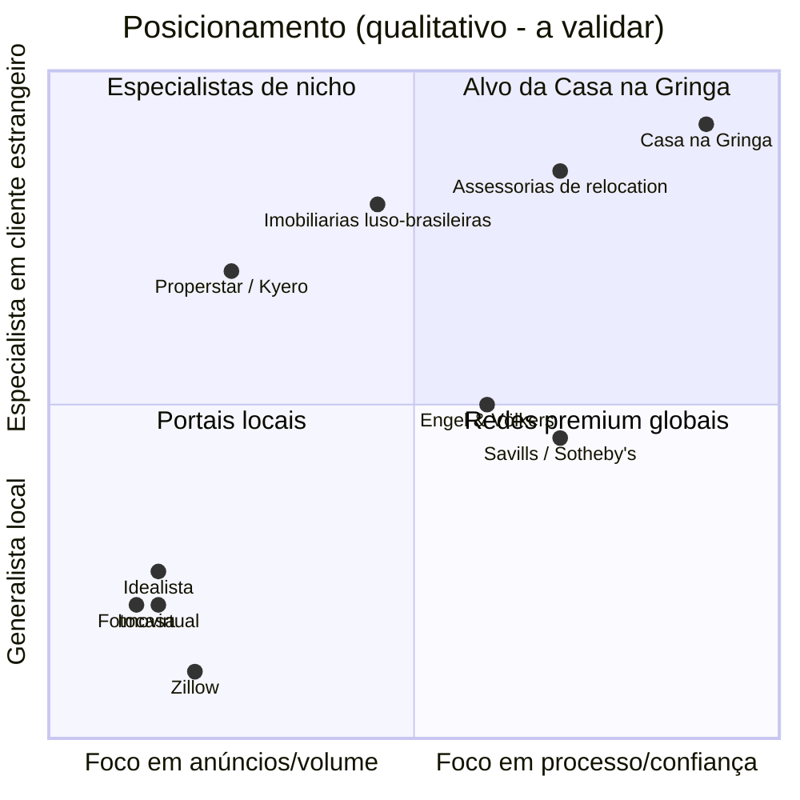
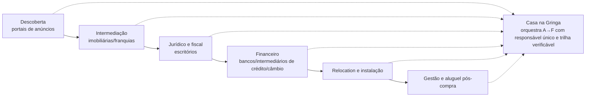
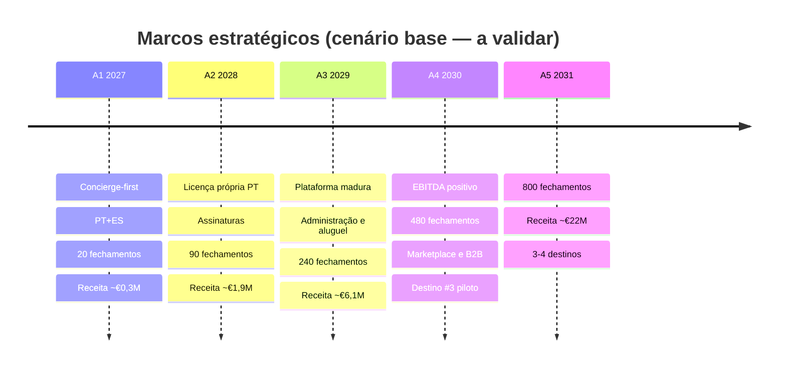

# 01 — Visão Estratégica · CASA NA GRINGA

| Campo | Valor |
|---|---|
| **Objetivo** | Definir visão de 5 anos, missão, posicionamento, proposta de valor, público, mercado (TAM/SAM/SOM), concorrência, moat, princípios, crítica das premissas do fundador e marcos por ano |
| **Público** | Fundador(es), investidores pré-seed/seed, futuros líderes (produto, jurídico, operações), parceiros estratégicos |
| **Status** | Rascunho v0.1 |
| **Data** | 16/11/2026 (referência nov/2026; M1 = jan/2027) |
| **Contrato comum** | [00-premissas-e-decisoes.md](00-premissas-e-decisoes.md) (prevalece em caso de divergência) |
| **Documentos relacionados** | [02-modelo-negocio.md](02-modelo-negocio.md) · [03-business-model-canvas.md](03-business-model-canvas.md) · [14-plano-monetizacao.md](14-plano-monetizacao.md) · 15 (financeiro) · 19 (compliance) · 20 (expansão) · 21 (riscos) |

> [!IMPORTANT]
> **Legenda de confiança.** Dados marcados **[F]** vêm de fonte pública consultada em nov/2026 (INE, AIMA, Colégio de Registradores, imprensa setorial) mas **devem ser reconfirmados na fonte primária** antes de uso em material de investidor. Dados marcados **[E]** são **estimativas do autor — a validar**. Todo dado legal, regulatório ou tributário exige **verificação com advogado/contador local antes de uso**.

---

## 1. Sumário executivo

**Casa na Gringa** (casanagringa.com) é uma **plataforma de confiança para a compra de imóveis no exterior**, começando por brasileiros e portugueses que compram em **Portugal e Espanha**. O imóvel é o veículo; o produto é **segurança jurídica, financeira, documental e operacional do início ao fim**, entregue por uma combinação de **consultoria humana + parceiros regulados + tecnologia (IA com revisão humana, cofre documental, trilha de auditoria imutável)**.

Teses centrais:

1. **A dor dominante não é "achar anúncio"** (Idealista, Imovirtual, Fotocasa já resolvem), e sim **"não ser enganado e não errar" num país, idioma, sistema fiscal e jurídico que o cliente não domina** — somada à fragmentação entre corretor, advogado, contador, banco, câmbio, notário e relocation.
2. **O mercado-corredor é grande e concreto.** Em Portugal, os brasileiros foram o maior grupo estrangeiro comprador (≈ 9,8 mil transações/ano, ≈ 24% das compras de naturais de outros países) **[F]**; a comunidade brasileira residente supera 490 mil pessoas **[F]**; em Espanha, estrangeiros compraram ≈ 97 mil imóveis em 2025 (≈ 13,8% do mercado) **[F]**.
3. **Receita multi-linha, mas com disciplina:** a comissão de intermediação é a âncora; assinaturas, due diligence, financiamento, câmbio, administração e marketplace entram **por fases**. Meta base (a validar): **20 → 800 fechamentos/ano em 5 anos; receita de ≈ € 0,3 M (A1) a ≈ € 22 M (A5); GMV acumulado transacionado ≈ € 320 M/ano no A5** (ver §5 e [14-plano-monetizacao.md](14-plano-monetizacao.md)).
4. **Defensabilidade vem de ativos de confiança** (rede de parceiros auditada, *Country Packs* curados, dados de processo, dossiê verificável do cliente, licenças) — **não** de volume de anúncios nem de "IA genérica".
5. **Estágio real: ideia, sem equipe nem capital.** O plano é *concierge-first* (serviço manual com tecnologia mínima), provar confiança e unit economics com 20 fechamentos, e só então escalar plataforma.

---

## 2. Visão, missão e posicionamento

### 2.1 Visão (horizonte 2031)
> **Ser a plataforma de referência em confiança para quem compra, possui e administra imóveis fora do seu país de origem** — começando pelo corredor Brasil/Portugal ⇄ Portugal/Espanha e expandindo para 3–4 destinos até 2031.

### 2.2 Missão
> **Tirar o medo e a burocracia da compra de um imóvel no exterior**, entregando segurança jurídica, financeira e documental verificável do primeiro contato à gestão pós-compra.

### 2.3 Proposta de valor (do contrato comum)
> **"Seu imóvel no exterior com menos burocracia e com segurança do início ao fim."**

Operacionalização — a promessa só é crível se cada palavra tiver mecanismo mensurável:

| Palavra da promessa | Mecanismo operacional | Métrica pública |
|---|---|---|
| **Menos burocracia** | Roteiro único por país (*Country Pack*), checklist dinâmico, NIF/NIE e conta bancária coordenados, assinatura eletrônica, cofre de documentos | Tempo médio do 1º contato à escritura; nº de documentos pedidos 2× ao cliente (meta: 0) |
| **Segurança** | Due diligence documental padronizada + revisão por advogado parceiro; KYC/AML via parceiro regulado; sem custódia de fundos pela plataforma (fase 1); trilha de auditoria *hash-chain* + WORM | Incidentes de fraude (meta 0); % imóveis reprovados na DD (transparência); cobertura de seguro RC |
| **Do início ao fim** | Orquestração das etapas: busca → visita → proposta → DD → financiamento → câmbio → CPCV/arras → escritura → registro → utilities → gestão/aluguel | NPS por etapa; % processos concluídos com a mesma equipe |

> [!WARNING]
> **Evitar a palavra "garantia" em comunicação comercial** até haver produto de seguro/escrow regulado que a sustente. Preferir "processo verificado", "checagem documental", "transparência de remuneração". Ver §8 (crítica das premissas).

### 2.4 Posicionamento

**Declaração:** *Para brasileiros e portugueses com capital que querem comprar imóvel em Portugal ou Espanha, a Casa na Gringa é a plataforma de confiança que coordena todo o processo com segurança verificável, diferente de portais de anúncios (que só mostram imóveis) e de imobiliárias tradicionais (que só intermediam a venda e têm interesse no fechamento).*

Mapa de posicionamento (eixos: profundidade do serviço × orientação ao cliente estrangeiro):

**Arquétipo de marca:** "o guia confiável" (sábio + cuidador); tom: claro, direto, sem jargão, sem promessas de retorno financeiro. **Nunca** vender "investimento garantido", "visto dourado", "rentabilidade" (risco regulatório CVM no Brasil / publicidade de investimento — verificar com advogado).

---

## 3. Público-alvo e personas

### 3.1 Segmentação do público (B2C) — decisão de foco

| Segmento | Descrição | Ticket típico | Motivação principal | Prioridade (A1–A2) |
|---|---|---|---|---|
| **S1. Brasileiro residente no Brasil — diversificação/relocation** | Empresário, executivo, profissional liberal; patrimônio líquido ≥ US$ 1 mi | € 450 mil–€ 2 mi | Segurança, educação dos filhos, proteção cambial, plano B | **Alta (wedge de ticket alto)** |
| **S2. Brasileiro residente em Portugal — 1ª compra/upgrade** | 2–8 anos em PT; renda estável; financiamento | € 250–450 mil | Sair do aluguel, fixar raiz, nacionalidade | **Alta (wedge de volume)** |
| **S3. Brasileiro investidor em Espanha** | Madrid/Barcelona/Valência; renda de aluguel/valorização | € 300–800 mil | Diversificação, rendimento | Média |
| **S4. Residente em Portugal comprando em Espanha (ou vice-versa)** | Português/lusófono com capital | € 300–700 mil | Segunda casa, ativo regional | Média-baixa |
| **S5. Diáspora portuguesa (França, Suíça, Luxemburgo, Brasil) comprando em Portugal** | Emigrante com capital que compra na terra natal | € 200–500 mil | Retorno futuro, família | Média |
| **S6. PALOP (Angola, Moçambique, Cabo Verde) — HNWI** | Capital de fora da UE; sensibilidade AML alta | € 500 mil–€ 3 mi | Segurança patrimonial | **Fase 3** (AML pesado) |

**Recomendação de wedge (dados dão suporte, a validar em entrevistas):** começar com **S2 (volume, ciclo curto, mais conversão por já estarem em PT) + S1 (ticket maior, maior receita/fechamento)**, usando S2 para gerar casos, avaliações e dados; S1 para margem. Os demais entram conforme capacidade de parceiros.

### 3.2 Personas

| | **P1 — Marcelo (S1)** | **P2 — Ana & Rafael (S2)** | **P3 — Dra. Helena (S3)** |
|---|---|---|---|
| **Perfil** | 46 anos, empresário em São Paulo, casado, 2 filhos (11 e 14) | 38 e 35 anos, profissionais de TI e saúde em Porto há 3 anos (visto de trabalho) | 58 anos, médica/investidora em Rio de Janeiro, viúva, 2 filhos adultos |
| **Orçamento** | € 900 mil (30% financiado ou 100% cash) | € 320 mil; entrada € 80 mil; financiamento 75% | € 600 mil cash (2 imóveis alugáveis) |
| **Objetivo** | Casa em Cascais/Lisboa; opção de mudança em 24 meses | Primeira casa própria; nacionalidade em 5–6 anos | Diversificar patrimônio em euro; renda mensal |
| **Dores** | Medo de golpe, de errar fiscalmente (IRPF/CBE, bitributação), não sabe confiar em advogado | Burocracia de crédito para estrangeiro, tempo, taxas escondidas | Não quer gerir à distância; teme leis de inquilinato e de aluguel turístico |
| **Jornada hoje** | Indicações de amigos, grupos WhatsApp, 3–4 intermediários desconexos | Idealista + imobiliária + intermediário de crédito + advogado indicado | Palestras de "investimento no exterior", vendedores agressivos |
| **O que compra de nós** | Plano Private, DD completa, visita guiada, câmbio, concierge, tributário (parceiro) | Plano Plus, financiamento (parceiro), DD, concierge de instalação | Plano Plus/Private, administração, gestão de aluguel |
| **Canais** | Indicação, LinkedIn, eventos de family office, YouTube, podcasts | Instagram/TikTok/YouTube de brasileiros em Portugal, grupos de Facebook/WhatsApp, Google | Indicação (contador, gerente de banco), eventos, Instagram |
| **Gatilho de compra** | Insegurança política/violência; escolha escolar | Fim de contrato de aluguel; aumento de renda | Venda de outro ativo; herança |
| **Objeções** | "Vocês ganham comissão do vendedor?" "E se der problema?" | "Vale pagar assinatura?" | "Quem cuida se o inquilino não pagar?" |
| **Critério de sucesso** | Escritura sem surpresa; visão fiscal clara | Chave na mão no prazo prometido | Renda líquida previsível e relatório mensal |

| | **P4 — João (S4)** | **P5 — Carlos (S5)** |
|---|---|---|
| **Perfil** | 51 anos, empresário em Lisboa | 49 anos, emigrante português na Suíça (Genebra) |
| **Orçamento** | € 450 mil em Espanha (Galiza/Valência) | € 350 mil em Braga/Minho, cash + parte financiada |
| **Dor** | Desconhece ITP regional, NIE, notário espanhol | Desconfia de intermediários; precisa fazer tudo remotamente; documentos dispersos |
| **O que compra** | Plano Plus, DD, parceiros ES | Plano Essencial/Plus, DD, procuração e escritura remota coordenada |

**Anti-personas (não atender / escalar para compliance):** (i) clientes com origem de fundos não documentada; (ii) PEP/sancionados sem aprovação do *compliance_officer*; (iii) pedidos de subfaturação de escritura; (iv) *flippers* de curto prazo sem residência/NIF; (v) compradores de imóvel < € 150 mil (sem unit economics).

### 3.3 Jobs-to-be-done (síntese)
1. "Quando quero comprar num país que não conheço, quero **um responsável único** e um roteiro claro para não ser enganado."
2. "Quando envio dinheiro ao exterior, quero **conformidade fiscal (BCB/Receita) e custo de câmbio transparentes**."
3. "Quando fecho a compra, quero **instalar a vida** (NIF, banco, utilities, escola, saúde) sem perder meses."
4. "Quando sou proprietário ausente, quero **gerir e/ou alugar** com relatórios e sem surpresa."

---

## 4. Análise de mercado (TAM / SAM / SOM)

### 4.1 Dados-base do mercado (2025) e fontes

| Indicador | Valor | Fonte / status |
|---|---|---|
| Portugal — habitação transacionada 2025 | 169.812 imóveis; € 41,2 bi (+21,7% em valor); IPHab +17,6% a/a | INE (via imprensa) **[F — confirmar na fonte primária]** |
| Portugal — compradores de naturalidade estrangeira (todas as nacionalidades) | ≈ 24–28% das transações (≈ 41–47 mil) | INE (via imprensa/Idealista) **[F — metodologia varia; confirmar]** |
| Portugal — brasileiros | ≈ 9.808 transações/ano; ≈ 23,9% das compras de estrangeiros; ticket médio ≈ € 257 mil (compradores brasileiros) | INE/Banco de Portugal via imprensa **[F — período exato a confirmar]** |
| Portugal — ticket médio UK / EUA | ≈ € 513 mil / ≈ € 479 mil | INE **[F]** |
| Portugal — brasileiros residentes | 493.622 (31/12/2025); 31,1% dos estrangeiros; 115.709 novas autorizações em 2025 | AIMA RMA via imprensa **[F]** |
| Espanha — compras por estrangeiros 2025 | ≈ 97.300 imóveis; ≈ 13,8% do mercado | Colégio de Registradores via imprensa **[F]** |
| Espanha — origem América do Sul | ≈ 6–7% das compras de estrangeiros (≈ 6–7 mil/ano); Brasil não é desagregado nas estatísticas trimestrais | Registradores **[F]/[E]** |
| Brasileiros e patrimônio no exterior | Estoque de investimentos imobiliários de brasileiros em Portugal teria superado o dos EUA (dados BCB via imprensa) | **[F — a validar no BCB/CBE]** |
| Comissão típica de mediação | PT: ≈ 5% + IVA 23% (≈ 6,15%); ES: 3–5% + IVA 21% (≈ 3,6–6,05%) | Imprensa setorial **[F]** |
| Idealista (referência de portal) | Receita 2024 > € 300 mi (+16%); EBITDA ≈ € 84 mi; avaliação ≈ € 2,9 bi na venda à Cinven (2024) | Imprensa financeira **[F]** |

> [!NOTE]
> As consultas retornaram dados agregados via imprensa e agregadores; **nenhum desses números deve ser citado a investidores sem cruzamento com INE, AIMA, Registradores e BCB**. A seção usa-os como âncora de ordem de grandeza.

### 4.2 TAM — Total Addressable Market (corredor ibérico, compradores estrangeiros)

**Definição:** volume anual de compras residenciais por estrangeiros em Portugal + Espanha, e o *pool* de receita de serviços associados.

| Item | Cálculo | Resultado |
|---|---|---|
| Portugal — transações de compradores de naturalidade estrangeira | ≈ 41.000 tx **[F/E]** × ticket médio ≈ € 300 mil **[E]** | ≈ € 12,3 bi |
| Espanha — transações de estrangeiros | 97.300 × ticket médio ≈ € 240 mil **[E]** | ≈ € 23,4 bi |
| **GMV TAM** | PT + ES | **≈ € 35,7 bi/ano** |
| *Pool* de comissão de mediação | GMV × ≈ 5,0% (ex-IVA, lado vendedor; mix 3–5%) **[E]** | ≈ € 1,8 bi |
| *Pool* de serviços adjacentes (jurídico, fiscal, financiamento, câmbio, relocation, seguros, gestão) | GMV × ≈ 2,0% **[E]** | ≈ € 0,7 bi |
| **TAM de receita (pool de serviços + intermediação)** | | **≈ € 2,5 bi/ano** |

### 4.3 SAM — Serviceable Addressable Market (corredor-alvo e ticket ≥ € 250 mil)

**Definição:** compras por clientes **originários/relacionados a Brasil, Portugal e diáspora lusófona** no ticket-alvo (≥ € 250 mil; foco € 300 mil–€ 2 mi), nos dois destinos iniciais.

| Componente | Transações/ano (2026 base) | Premissa | Ticket médio (faixa-alvo) | GMV |
|---|---|---|---|---|
| A. Brasileiros compradores em Portugal | ≈ 3.900 | 9.800 tx × 40% na faixa ≥ € 250 mil **[E]** | € 400 mil **[E]** | € 1,56 bi |
| B. Brasileiros compradores em Espanha | ≈ 900 | ≈ 1.500 tx total **[E: derivado de ≈ 7% de 97 mil e peso do Brasil na AL]** × 60% na faixa | € 450 mil **[E]** | € 0,41 bi |
| C. Lusófonos (PT residentes → ES; diáspora e PALOP → PT) | ≈ 3.000 | Estimativa grosseira **[E — validar com dados de notários/registro]** | € 350 mil **[E]** | € 1,05 bi |
| **SAM (2026)** | **≈ 7.800 tx** | | | **≈ € 3,0 bi** |

*Pool* de receita do SAM com o modelo de monetização da empresa (ver [14-plano-monetizacao.md](14-plano-monetizacao.md)): receita relacionada ao fechamento ≈ 4,2% do GMV (≈ € 127 mi) + recorrência/B2B ≈ 30% adicional ⇒ **SAM de receita ≈ € 165 mi/ano [E]**.

Crescimento do SAM: **+6% a.a.** [E] (volume de brasileiros em PT cresce de forma mais lenta que em 2022–2024; IPHab alto tende a empurrar ticket, não volume; risco de choques regulatórios em ES — §8).

### 4.4 SOM — Serviceable Obtainable Market (cenário base)

| | A1 (2027) | A2 (2028) | A3 (2029) | A4 (2030) | A5 (2031) |
|---|---|---|---|---|---|
| SAM (tx/ano, +6% a.a.; sem novos destinos) | 8.300 | 8.800 | 9.300 | 9.900 | 10.500 |
| **Fechamentos (SOM) — base** | **20** | **90** | **240** | **480** | **800** |
| **Participação sobre o SAM** | 0,24% | 1,0% | 2,6% | 4,8% | 7,6% |
| GMV (ticket médio € 400 mil) | € 8 mi | € 36 mi | € 96 mi | € 192 mi | € 320 mi |
| Conservador (≈ 44–50% do base) | 10 | 40 | 110 | 220 | 350 (3,3%) |
| Otimista (≈ 150% do base) | 30 | 135 | 360 | 720 | 1.200 (11%) |

> [!NOTE]
> A participação de 7,6% do SAM em A5 é **ambiciosa**: exige marca forte na comunidade brasileira, rede de indicações (contadores, advogados, bancos) e ao menos 1 licença própria. Se o canal de indicação falhar, o cenário **conservador (3,3%)** é o plano de segurança. O SAM não inclui novos destinos (EUA, Emirados, Itália, Grécia) — que são **opção de upside** (doc 20).

### 4.5 Tendências e vetores de mercado

| Vetor | Efeito | Direção | Observação (verificar) |
|---|---|---|---|
| Fim do visto dourado imobiliário (PT 2023; ES abr/2025) | Remove um canal de entrada de capital não-UE; redireciona demanda para D7/D2/nacionalidade | ↓ para investidor puro; ↑ para residentes | Confirmar regras vigentes |
| Pressão política sobre compradores não-UE em Espanha (proposta de tributação elevada; status incerto) | Risco para S3 | ↓ | Monitorar; a confirmar |
| Mudanças na lei da nacionalidade portuguesa (prazos de residência) | Afeta decisão de compra de brasileiros residentes | ± | Em evolução; a confirmar |
| Câmbio EUR/BRL | Define poder de compra dos brasileiros | ± | Premissa de referência € 1 = R$ 6,30 **[E]** |
| Juros (Euribor) e crédito para não residentes | Afeta financiamento (S2) | ± | LTV de não residentes ≈ 60–70% **[E]** |
| Regulação de alojamento local (PT) e aluguel turístico (ES) | Reduz potencial de gestão de aluguel de curto prazo | ↓ para STR | Preferir aluguel de média/longa duração |
| Digitalização notarial/registral, assinatura eletrônica qualificada | Reduz burocracia | ↑ | "Casa Pronta"/balcão digital em PT; verificar disponibilidade |
| Crescimento de golpes e fraudes imobiliárias a estrangeiros | Aumenta valor percebido da confiança | ↑ | Principal insight de marca |

---

## 5. Concorrência e benchmark

### 5.1 Mapa competitivo (por camada da cadeia)

### 5.2 Benchmark detalhado

| Concorrente | Tipo | Modelo de receita | Força | Fraqueza frente à CNG | Ameaça |
|---|---|---|---|---|---|
| **Idealista** (ES/PT/IT) | Portal líder | Assinaturas de agências/promotores, destaques, publicidade; receita 2024 > € 300 mi, EBITDA ≈ € 84 mi **[F]** | Audiência, dados de preço, marca | Não orquestra a compra, não assume responsabilidade, pouco foco no estrangeiro lusófono; conflito com agências (clientes) | Média (pode lançar serviços de transação/financiamento) |
| **Fotocasa / Habitaclia** (ES, hoje no ecossistema Scout24 — **a confirmar**) | Portal | Assinaturas, leads | Audiência ES | Idem | Baixa-média |
| **Imovirtual / OLX Group (Prosus)** (PT) | Portal | Assinaturas/listagens | Alcance PT | Idem | Média |
| **Zillow** (EUA) | Portal + serviços (hipoteca, ofertas) | Publicidade a corretores (*Premier Agent*), hipotecas; receita da ordem de US$ 2 bi/ano **[E]** | Produto e dados; *one-stop-shop* tentativas | Não atua no corredor; mostra limite do *iBuying* (encerrado em 2021) | Baixa (referência de modelo) |
| **QuintoAndar** (Brasil) | Marketplace + intermediação + serviços de locação | Comissão de locação/venda, serviços; unicórnio (≈ US$ 5 bi em 2021 **[E]**) | Marca BR, tecnologia, confiança local | Foco doméstico; expansão internacional não confirmada **[a validar]** | Baixa-média (potencial entrada em Portugal) |
| **ZAP+/VivaReal (OLX Brasil)** | Portais BR | Assinaturas/leads | Audiência BR | Sem execução no exterior | Baixa |
| **Properstar, Kyero, A Place in the Sun, Rightmove Overseas** | Portais multilíngues de imóveis internacionais | Taxas de anúncio por agente, leads | Públicos internacionais (UK/DE/NL), conteúdo | Pouco PT-BR; sem *workflow* de compra; qualidade de anúncio variável | Média |
| **Juwai IQI** (China → global) | Portal + corretagem para compradores chineses | Leads, comissões, serviços | **Análogo mais próximo**: corredor-nacionalidade com serviços | Corredor diferente; mostra o caminho (e os riscos) | Referência |
| **Savills** (RU, prime global) | Consultoria/corretagem integrada | Honorários e comissões; > £ 2 bi de receita **[E]** | Marca prime, pesquisa | Foco em ticket muito alto; atendimento menos digital | Baixa (ticket > € 2 mi) |
| **Engel & Völkers** (DE, franquia) | Franquia prime | *Royalty* ≈ 5,5–6% da receita de comissão dos *shops* **[F — a validar]** | Presença em PT/ES, marca | Modelo de franquia; qualidade variável por *shop*; interesse do vendedor | Média |
| **Sotheby's International Realty** (Anywhere) | Franquia prime | *Royalty* ≈ 6% + ≈ 2% de fundo de marketing **[F — a validar]** | Marca de luxo | Idem | Baixa-média |
| **Redes (RE/MAX, Century 21, ERA, Keller Williams, Zome)** em PT/ES | Franquias/redes | Taxas de franquia, comissão | Capilaridade, inventário | Sem processo ponta a ponta para estrangeiro | Média (potenciais **parceiros** e concorrentes) |
| **Imobiliárias boutique luso-brasileiras (Lisboa, Cascais, Porto, Algarve)** | Corretagem de nicho | Comissão de venda | Relacionamento, idioma | Escala limitada, interesse no fechamento, padrões variáveis | **Alta (concorrência direta e fonte de parceria)** |
| **Escritórios de assessoria a estrangeiros / relocation / imigração** | Serviços profissionais | Honorários (NIF, vistos, abertura de conta, assessoria imobiliária) | Confiança, conhecimento regulatório | Fragmentação; pouca tecnologia; preço opaco | Média-alta (podem integrar imóveis) |
| **Fintechs de câmbio/conta (Wise e similares)** | Pagamentos | Spread/taxas | Custo baixo | Não orquestram a compra | **Parceiros** |
| **Plataformas de *title/escrow* (ex.: Propy, EUA)** | Proptech de transação | Taxa de transação | Tecnologia | Outro ordenamento | Referência |

### 5.3 Insight competitivo

- **Ninguém ocupa "responsável único com trilha verificável" para o brasileiro/português comprando na Península Ibérica.** Existem peças (portais, corretores, advogados, relocation, câmbio) mas **sem integração, sem padrão de transparência de remuneração e sem dados de processo**.
- **Portais são mais "clientes" do que concorrentes** no curto prazo: a CNG pode **consumir** inventário via parceria/co-corretagem; só concorre se virar portal de volume (o que **não** é recomendado — §8).
- **Risco principal:** uma imobiliária boutique ou um escritório de relocation bem-capitalizado copiar o *playbook*. Defesa: velocidade, marca, rede de parceiros auditados e **transparência radical** (difícil de copiar por quem vive de comissão opaca).

---

## 6. Diferenciais defensáveis (moat)

| # | Ativo de moat | Como constrói | Tempo p/ ser forte | Força inicial (A1) | Força prevista (A4) |
|---|---|---|---|---|---|
| 1 | **Marca de confiança na comunidade BR/PT** (reviews verificadas, casos, transparência) | Casos publicados, NPS público, zero fraude | 24–36 m | Fraca | **Alta** |
| 2 | **Rede de parceiros auditados** (advogados, corretores licenciados, bancos/intermediários, notários, câmbio) com SLA, nota e histórico | Onboarding rigoroso, contratos, *scorecards*, auditoria periódica | 18–30 m | Média | **Alta** |
| 3 | ***Country Packs* curados e versionados** (base legal, custos, prazos, checklists) revisados por advogados locais | RAG sobre base curada + revisão periódica | 12–24 m | Média | **Alta** |
| 4 | **Dados de processo proprietários** (prazos reais por etapa, custos efetivos, taxa de reprovação em DD, sinais de fraude) | Telemetria do fluxo de compra | 24 m+ | Baixa | **Alta** |
| 5 | **Dossiê verificável do cliente/imóvel** (cofre documental + *hash-chain* + WORM + assinatura eletrônica) | Arquitetura de segurança (doc 05) | 12 m | Média | Alta |
| 6 | **Licenças e registros** (AMI/IMPIC em PT; intermediário de crédito; seguros) | Processos regulatórios (§ [02](02-modelo-negocio.md)) | 12–24 m | Nenhuma | Média-alta |
| 7 | **Efeito de rede B2B** (promotores, bancos e advogados que preferem canal qualificado) | Programa de parceiros + leads de qualidade | 24–36 m | Nenhuma | Média |
| 8 | **Custo de troca** (documentos, histórico, gestão e aluguel pós-compra no mesmo cofre) | Produto recorrente | 24 m+ | Baixa | Média-alta |
| 9 | **Bilinguismo jurídico PT-BR/PT-PT/ES/EN** (terminologia, contexto cultural, UX) | Conteúdo + produto + equipe | Contínuo | Média | Média |

> [!WARNING]
> **Honestidade sobre o moat:** em A1 o moat é essencialmente **execução e foco**. Tecnologia e IA **não** são moat (commodity); o moat é **confiança operacionalizada** e dados de processo. Isso deve guiar a alocação de capital: **primeiros € 500 mil em operação e parceiros, não em plataforma**.

---

## 7. Princípios (ordem de prioridade do contrato comum)

| # | Princípio | Tradução em decisões de negócio |
|---|---|---|
| 1 | **Segurança** | Sem custódia de fundos (fase 1); MFA obrigatório; DD antes de CPCV |
| 2 | **Privacidade** | LGPD + RGPD; dados da UE na UE; consentimento granular; **proibido vender listas** — apenas "introdução a pedido do cliente" |
| 3 | **Transparência** | *Statement of Compensation* (declaração de remuneração) antes de qualquer proposta; teto de remuneração total publicado |
| 4 | **Rastreabilidade** | Trilha de auditoria encadeada; dossiê exportável ao cliente |
| 5 | **Escalabilidade** | *Country Packs* e playbooks reutilizáveis; automação *human-in-the-loop* |
| 6 | **Automação** | IA assistida; decisões críticas sempre com humano |
| 7 | **Experiência do cliente** | Responsável único; PT/EN/ES; sem pedir o mesmo documento 2× |
| 8 | **Riqueza de detalhes** | Procedimentos, checklists, custos com exemplos |
| 9 | **Prazos** | Prazos realistas e publicados; SLA por etapa |

**Princípios adicionais propostos:** (10) **Lado do cliente por padrão** (representação do comprador, sem *dual agency* oculta); (11) **"Não sabemos" é resposta válida** (IA e humanos escalam em vez de inventar); (12) **Qualidade acima de quantidade** (2 países, 12 meses).

---

## 8. Questionamento crítico das premissas do fundador e melhorias propostas

> Este capítulo registra, com franqueza, onde as premissas iniciais merecem revisão. Algumas já foram tratadas no contrato comum (§3); aqui há a justificativa estratégica e outras críticas.

| # | Premissa do fundador (inferida/explicitada) | Problema | Evidência/raciocínio | **Melhoria proposta** |
|---|---|---|---|---|
| 1 | **"Plataforma que cobre vários países desde o início"** | Cada país exige base legal, parceiros, tributos e idioma próprios; diluição de qualidade e custo | Cada *Country Pack* ≈ 3–5 meses de trabalho jurídico+produto **[E]** | **PT + ES por 12 meses** (decidido). Gate de expansão: ≥ 60 fechamentos, NPS ≥ 60, margem de contribuição ≥ 55% |
| 2 | **Firebase como banco principal** | Transações financeiras, comissões, contratos e RBAC/ABAC exigem consistência relacional e auditoria | — | **Híbrido** (já decidido): Cloud SQL como sistema de registro; Firestore só para tempo real |
| 3 | **IA "que conhece toda a legislação"** | LLM não garante exatidão; risco de aconselhamento jurídico indevido e responsabilidade | Vigência legal muda; jurisdições múltiplas | **RAG sobre base curada e versionada**, citação de fonte e data, revisão por advogados; IA nunca decide |
| 4 | **"Produto = marketplace de imóveis"** | Competir com Idealista/Imovirtual em volume de anúncios é guerra perdida e cara (cold-start) | Idealista: receita > € 300 mi, escala imbatível | **Curadoria e co-corretagem**: poucos imóveis, verificados; foco em **processo** (confiança), não em volume. Integrar feeds de parceiros |
| 5 | **Muitas fontes de receita desde o dia 1** | Foco, complexidade regulatória e conflitos de interesse crescem juntos | 12 fontes ⇒ 6 regimes regulatórios distintos | **Ativar por fase** (ver doc 14): A1 = comissão + assessoria + DD + referral; A2 = assinaturas, financiamento, B2B; A3 = administração, aluguel, marketplace |
| 5b | **Comissão "escondida" no vendedor** | Perda de confiança; dual agency; risco reputacional | Cliente brasileiro tem forte desconfiança de intermediário | ***Statement of Compensation*, teto de 3% do preço, *fee offset* (cliente nunca paga duas vezes)** |
| 6 | **"Segurança jurídica de ponta a ponta" como promessa** | Promessa ilimitada gera responsabilidade civil, e CNG não é escritório de advocacia | Atos reservados à advocacia (verificar com a Ordem dos Advogados) | **Promessa por camadas**: checagem documental (CNG) + parecer jurídico (advogado parceiro, contrato direto com o cliente) + seguro RC profissional + política de remediação |
| 7 | **Foco em Portugal como origem *e* destino** | Portugueses residentes têm menos "dor de burocracia" em PT; mercado de diáspora é pulverizado | S5 é pequeno e de baixo ticket | **Priorizar origem Brasil (S1/S2)**; tratar Portugal-origem (S4/S5) como segmento de expansão em A2 |
| 8 | **Ticket médio ≥ € 250 mil como filtro** | Brasileiros compram, em média, ≈ € 257 mil; filtro corta ≈ 60% das transações **[E]** | Mediana mais baixa que média | Manter o filtro para **planos pagos**; criar **Explorer gratuito** (SEO, confiança) para captar quem compra mais barato e **recomendar** parceiros (receita via referral) |
| 9 | **"Brasil e Portugal" sem sequenciar canais** | Dois mercados de aquisição distintos (BR: atração; PT: já residentes) | CAC e jornada distintos | **Sequenciar:** A1 canais PT (comunidade) + BR (conteúdo); A2 intensificar BR; PALOP somente A3 |
| 10 | **Prazos agressivos sem capital** | Estágio é ideia, sem equipe/capital | — | **Plano de 6 meses** (doc 22): validar com 5–10 clientes piloto manualmente antes de construir plataforma completa |
| 11 | **Dependência de aquisição paga** | CAC alto em nichos de alta renda; sazonalidade | LTV/CAC só atinge ≥ 3× em A3 (ver doc 02) | **Alavancar canais de indicação** (contadores, advogados, bancos, comunidades), conteúdo SEO e eventos; paid como complemento |
| 12 | **Escopo "tudo-em-um" de serviços** | Risco de virar consultoria sem margem | Margens por linha variam de 28% a 90% (doc 02) | **Priorizar linhas de alta margem e baixo risco (referral, DD, financiamento, câmbio)**; serviços operados (administração, aluguel) via parceiros até comprovada demanda |

### 8.1 Riscos estratégicos principais (resumo; detalhe no doc 21)

| Risco | Prob. | Impacto | Mitigação |
|---|---|---|---|
| Mudança regulatória (ex.: tributação de não-UE em ES; nacionalidade em PT) | M | A | Diversificar destinos/segmentos; monitor regulatório; parceiros jurídicos |
| Falha de parceiro (fraude ou erro) | M | A | Due diligence de parceiros, seguros, contratos com SLA e *clawback*; auditoria |
| Dependência de comissão do lado vendedor (conflito) | A | M | Transparência, *fee offset*, teto, rotas *fee-only* |
| Capital insuficiente / ciclo de caixa longo (5–7 meses até receber) | A | A | Capital de giro, adiantamentos via assinatura/DD, planejamento (doc 15) |
| Entrada de grande player (QuintoAndar, Idealista) | B-M | A | Velocidade, moat de rede e dados, parcerias |
| Incidente de segurança/privacidade | B | Muito alto | Doc 05; DPO; seguros cyber |

---

## 9. Estratégia e visão por ano (A1–A5)

### Ano 1 — 2027 · "Provar a confiança"
- **Foco:** *concierge-first* (processo majoritariamente manual, com tecnologia mínima: web em 3 idiomas, cofre documental, CRM nativo e checklist). Países: **Portugal e Espanha**. Origem: Brasil + comunidade brasileira em Portugal.
- **Produto:** Explorer (grátis), Essencial/Plus (a partir de ≈ M9), Consulta Estratégica paga, DD documental, coordenação de compra com parceiros licenciados, NIF/NIE + conta bancária coordenados.
- **Marcos (base):** 20 fechamentos; GMV ≈ € 8 mi; receita ≈ € 0,31 mi; NPS ≥ 60; **zero incidente de fraude**; ≥ 12 parceiros auditados (8 PT, 4 ES); *Country Packs* PT e ES v1; ≥ 2 acordos de co-corretagem; **ticket médio ≈ € 400 mil**; CAC por fechamento ≈ € 4,5 mil **[E]**.
- **Equipe:** 8 pessoas (2 fundadores, 2 engenheiros, 1 operações/jurídico-coord., 1 consultor sênior PT, 1 parcerias ES, 1 marketing/comunidade BR) **[E]**.
- **Capital:** pré-seed ≈ € 400–600 mil + receita inicial; **burn A1 ≈ € 0,9 mi [E]** (doc 15 prevalece).
- **Gate p/ A2:** ≥ 15 fechamentos, ≥ 85% recomendariam, unit economics positivos na linha de comissão, parcerias com SLA assinados.

### Ano 2 — 2028 · "Escalar o processo"
- **Foco:** licenciar (AMI/IMPIC — entidade própria em PT; avaliação em ES), registrar intermediação de crédito (PT/ES), lançar **assinaturas (Essencial/Plus/Private)**, **app mobile**, **B2B piloto** (promotores/bancos), **Seed**.
- **Marcos (base):** 90 fechamentos; GMV ≈ € 36 mi; receita ≈ € 1,9 mi; margem de contribuição ≈ 57%; LTV/CAC ≈ 2,3×; ≥ 40 parceiros; *Country Pack* de **segunda fase** (aluguel/gestão).
- **Equipe:** ≈ 18. **Capital:** seed ≈ € 2,5 mi (M12–14) **[E]**.
- **Gate p/ A3:** LTV/CAC ≥ 2,5×, NPS ≥ 60, 0 incidentes graves de compliance, 1 canal de indicação ≥ 30% das aquisições.

### Ano 3 — 2029 · "Plataforma"
- **Foco:** escritórios em Lisboa e Madrid; **administração de imóveis e gestão de aluguel**; **marketplace de serviços**; piloto **PALOP** (com KYC reforçado); otimização de CAC; **Series A** opcional (€ 8–12 mi) se expansão.
- **Marcos (base):** 240 fechamentos; GMV ≈ € 96 mi; receita ≈ € 6,1 mi; **margem de contribuição ≈ 60%**; LTV/CAC ≈ 3,4×; EBITDA ≈ –€ 0,5 mi (rumo ao *break-even*).
- **Equipe:** ≈ 40.

### Ano 4 — 2030 · "Escala e rentabilidade"
- **Foco:** **EBITDA positivo**; B2B maduro (promotores, bancos); **destino #3 piloto** (Itália **ou** Flórida — decisão por dados; doc 20); IA com *agents* em produção (limites e *human-in-the-loop*).
- **Marcos (base):** 480 fechamentos; GMV ≈ € 192 mi; receita ≈ € 12,7 mi; EBITDA ≈ + € 0,4 mi; ≥ 120 parceiros; **recorrência (assinaturas + administração + aluguel) ≈ 16% da receita**.
- **Equipe:** ≈ 70.

### Ano 5 — 2031 · "Referência no corredor"
- **Foco:** **3–4 destinos** (PT, ES + 1–2), consolidação de marca, **opções estratégicas** (Series B, M&A com imobiliária/serviços, parcerias com bancos).
- **Marcos (base):** 800 fechamentos; GMV ≈ € 320 mi; receita ≈ € 22 mi; EBITDA ≈ + € 1,8 mi (≈ 8%); NPS ≥ 65; **recorrência ≈ 17%** + B2B ≈ 10%.
- **Equipe:** ≈ 110.

### 9.1 Indicadores-chave por ano (base)

| KPI | A1 | A2 | A3 | A4 | A5 |
|---|---|---|---|---|---|
| Fechamentos | 20 | 90 | 240 | 480 | 800 |
| GMV (€ mi) | 8 | 36 | 96 | 192 | 320 |
| Receita (€ mi) | 0,31 | 1,92 | 6,12 | 12,73 | 21,96 |
| Receita/GMV (*take rate* total) | 3,9% | 5,3% | 6,4% | 6,6% | 6,9% |
| Margem de contribuição | 52% | 57% | 60% | 61% | 62% |
| EBITDA (€ mi) **[E]** | –0,9 | –1,1 | –0,5 | +0,4 | +1,8 |
| Equipe (FTE) | 8 | 18 | 40 | 70 | 110 |
| NPS (meta) | ≥ 60 | ≥ 60 | ≥ 62 | ≥ 65 | ≥ 65 |

> [!NOTE]
> Valores de EBITDA e equipe são **estimativas de orçamento de ordem de grandeza**; o **plano financeiro de 24 meses (doc 15)** é a referência para caixa e *burn*. Qualquer divergência deve ser reconciliada **no doc 15**, usando como *inputs* as premissas de fechamentos, ticket e receita por linha descritas em [14-plano-monetizacao.md](14-plano-monetizacao.md).

---

## 10. Critérios de sucesso e de interrupção (*kill/pivot criteria*)

| Horizonte | Critério de sucesso | Gatilho de pivô/revisão |
|---|---|---|
| M6 | ≥ 5 fechamentos assistidos; 40 conversas qualificadas por mês; 2 acordos de co-corretagem | < 2 fechamentos; recusa sistemática de parceiros |
| M12 | ≥ 20 fechamentos; NPS ≥ 60; CAC ≤ € 5 mil | Fechamentos < 10 ou CAC > € 7 mil |
| M24 | ≥ 90 fechamentos; margem contribuição ≥ 55%; licença AMI obtida | Margem < 45% ou licença bloqueada |
| M36 | ≥ 240 fechamentos; LTV/CAC ≥ 3× | LTV/CAC < 2× |

**Pivôs possíveis:** (a) virar **camada de serviços B2B** (white-label de DD e coordenação para imobiliárias e bancos); (b) concentrar em **relocation + imobiliário** (menor ticket, maior recorrência); (c) especializar em **S2 (brasileiros residentes em PT)** como "QuintoAndar do imigrante".

---

## 11. Referências e fontes consultadas (nov/2026)

| Tema | Fonte (via pesquisa) | Observação |
|---|---|---|
| Transações habitação PT 2025 (169.812; € 41,2 bi) | INE (via imprensa) | Confirmar no INE |
| Brasileiros compradores PT (9.808; 23,9%); tickets UK/EUA | INE (via imprensa e Idealista) | Confirmar período |
| Brasileiros residentes PT (493.622) | AIMA — RMA (via imprensa) | Confirmar no relatório |
| Compras estrangeiras ES 2025 (≈ 97,3 mil; 13,8%) | Colégio de Registradores (via imprensa) | Brasil não desagregado |
| Receita Idealista; avaliação Cinven | Imprensa financeira (onlinemarketplaces, Preqin) | Confirmar |
| *Royalty* Sotheby's/E&V | Fontes secundárias de franquia | Valores indicativos |
| Comissões PT/ES e IVA | Imprensa/portais imobiliários | Mercado livre; verificar |
| Obrigações CBE (Banco Central do Brasil) | Imprensa jurídica; BCB | Limites e prazos sujeitos a alteração |

*Fim do documento.*
