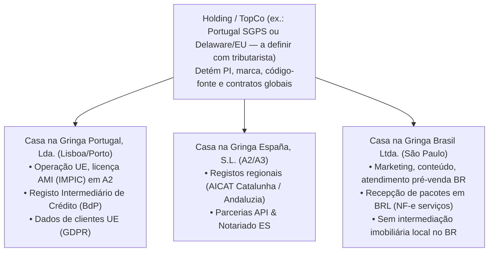

# 02 — Modelo de Negócio · CASA NA GRINGA

| Campo | Valor |
|---|---|
| **Objetivo** | Especificar o modelo de negócio completo, segmentos, canais, fluxo de caixa por produto, unit economics (CAC, LTV, take rate, margem por linha), estrutura de comissão transparente, estrutura societária PT+BR+ES e parcerias regulatórias |
| **Público** | Fundador(es), investidores pré-seed/seed, conselho jurídico/fiscal, futuros líderes comerciais e operacionais |
| **Status** | Rascunho v0.1 |
| **Data** | 16/11/2026 (referência nov/2026; M1 = jan/2027) |
| **Contrato comum** | [00-premissas-e-decisoes.md](00-premissas-e-decisoes.md) (prevalece em caso de divergência) |
| **Documentos relacionados** | [01-visao-estrategica.md](01-visao-estrategica.md) · [03-business-model-canvas.md](03-business-model-canvas.md) · [14-plano-monetizacao.md](14-plano-monetizacao.md) · [15-plano-financeiro-24-meses.md](15-plano-financeiro-24-meses.md) · [19-estrategia-compliance.md](19-estrategia-compliance.md) |

> [!IMPORTANT]
> **Aviso:** Números financeiros, margens e prazos marcados **[E]** são **estimativas a validar** em operação piloto. Qualquer definição societária, fiscal ou regulatória (AMI, crédito, tributos PT/ES/BR) exige **validação com advogado e contador local antes de execução**.

---

## 1. Arquitetura do Modelo de Negócio ("Trust-as-a-Platform")

A Casa na Gringa opera como uma **plataforma híbrida B2C + B2B2C de orquestração transacional e pós-compra**. Ao contrário de portais de classificados (receita por anúncio/lead) ou de imobiliárias tradicionais (receita apenas por comissão opaca no vendedor), a Casa na Gringa monetiza a **redução mensurável de risco** e a **coordenação ponta a ponta**.

### 1.1 Lógica de valor: por que o cliente paga
| Problema tradicional | Resposta do Modelo Casa na Gringa | Mecanismo econômico |
|---|---|---|
| Corretor representa o vendedor, não o comprador | **Representação alinhada ao comprador** + *Statement of Compensation* antes da proposta | *Fee offset* + teto de remuneração transparente |
| 6–8 fornecedores desconectados (NIF, banco, advogado, câmbio, notário, reforma) | **Orquestração única** com checklist auditável e SLA por etapa | Assinaturas + taxa de DD + *rev share* / *referral* regulado |
| Risco de golpe documental / desvio de sinal (IBAN falso) | **Due Diligence pré-CPCV** + cofre com hash-chain + instruções verificadas anti-BEC | Pacote DD pago + confiança que eleva conversão de fechamento |
| Abandono pós-escritura | **Gestão patrimonial e de locação** no mesmo cofre documental | Receita recorrente mensal (AUM imobiliário) |

---

## 2. Segmentos e Posicionamento Comercial

Em alinhamento com [01-visao-estrategica.md](01-visao-estrategica.md):

1. **B2C Primário — Comprador Lusófono com Capital (Ticket ≥ € 250 mil; média € 400 mil [E]):**
   - **S1:** Brasileiros no Brasil buscando diversificação, plano B familiar ou educação (ticket € 450 mil–€ 2 mi).
   - **S2:** Brasileiros residentes em Portugal fazendo 1ª compra ou upgrade com financiamento (ticket € 250–450 mil).
   - **S3 / S4:** Investidores lusófonos mirando Espanha (Madrid, Barcelona, Valência, Málaga) e portugueses comprando em Espanha.
   - **Explorer (Freemium):** Compradores < € 250 mil usam ferramentas gratuitas (simuladores, guias) e são encaminhados para parceiros auditados gerando receita de *referral* sem consumir horas de concierge humano sênior.
2. **B2B Parceiros (Lado Oferta e Serviços):**
   - Imobiliárias licenciadas locais (co-corretagem 50/50 até obtenção de licença AMI própria).
   - Incorporadoras / promotores imobiliários (lançamentos curados).
   - Bancos e intermediários de crédito registados (BdP / Banco de España).
   - Fintechs de câmbio reguladas (transferências internacionais de entrada e escritura).
   - Escritórios de advocacia e contabilidade independentes (contrato direto com o cliente para atos reservados).

---

## 3. Estrutura de Comissão Transparente ("Zero Surpresa")

A transparência na remuneração é um dos maiores diferenciais competitivos de marca.

### 3.1 Regras de Ouro da Comissão
1. **Declaração Prévia (*Statement of Compensation*):** Antes de qualquer proposta ou reserva de imóvel, o cliente assina eletronicamente um resumo claro mostrando quem paga, quanto custa e se há partilha com imobiliária parceira.
2. **Regra do *Fee Offset* (Nunca Pagar Duas Vezes):**
   - **Cenário A — Compra via Co-corretagem (padrão mercado PT/ES):** O vendedor paga a comissão padrão de mediação (PT: tipicamente 4%–5% + IVA 23%; ES: 3%–5% + IVA 21% **[F — mercado livre, confirmar]**). A Casa na Gringa (via parceiro licenciado em A1; licença própria em A2+) recebe sua quota de co-corretagem (ex.: 50% da comissão total = **2,0% a 2,5% do imóvel**, ex-IVA). Se o cliente pagou taxa de Assessoria Premium ou Assinatura Plus/Private, **até 100% do valor pago em assessoria é abatido** da parte que caberia ao comprador ou convertido em crédito de Due Diligence/Pós-compra conforme contrato.
   - **Cenário B — Imóvel de Particular (*FSBO*) ou sem Partilha de Comissão:** Quando o vendedor não remunera o lado comprador, aplica-se uma **Buyer's Fee transparente** acordada previamente (teto publicado: **2,0% a 2,5% + IVA**, ou mínimo operacional de € 6.000 **[E]**).
3. **Proibição de Comissões Ocultas:** Qualquer remuneração recebida de bancos, câmbio ou seguradoras é informada em faixa/critério ao cliente antes da indicação, preservando conformidade com regras de proteção do consumidor e conflitos de interesse.

---

## 4. Fluxo de Caixa por Produto e Ciclo de Recebimento

Um dos maiores riscos de uma PropTech transacional é o **descasamento de caixa**: despesas de marketing e consultoria ocorrem no M0, enquanto a comissão da escritura só entra em **M5 a M8** (150–240 dias depois).

| Linha de Produto | Momento de Entrada de Caixa | Prazo Médio até Caixa | Previsibilidade | Papel no Fluxo de Caixa |
|---|---|---|---|---|
| **Consulta Estratégica / Diagnóstico** | No agendamento (D+0) | Imediato | Média | Financia parte do CAC inicial |
| **Assinaturas (Essencial / Plus / Private)** | Mensal ou trimestral antecipado (D+0 a M+6) | Imediato / Recorrente | Alta | Amortecedor de caixa durante o funil |
| **Pacote Due Diligence Documental** | Antes da análise (pré-CPCV, ~M3) | 7–15 dias | Média-Alta | Cobre custo jurídico/técnico antes do risco de desistência |
| **Comissão de Compra/Venda** | Na escritura pública (~M5–M8) **[E]** | 150–240 dias do lead | Variável (sazonal) | Motor principal de margem e lucro |
| **Intermediação de Crédito / Câmbio** | Liquidação do crédito ou remessa (~M4–M7) | 15–45 dias pós-evento | Média | Adicional de alta margem sem custo operacional alto |
| **Administração / Gestão de Aluguel** | Mensal pós-escritura (M8+) | Recorrente contínuo | Muito Alta | LTV de longo prazo e estabilidade após Ano 3 |

---

## 5. Unit Economics (Premissas e Cenário Base A1–A3)

Todos os valores abaixo são **[E — estimativas a validar]** consistentes com [01-visao-estrategica.md](01-visao-estrategica.md) e [15-plano-financeiro-24-meses.md](15-plano-financeiro-24-meses.md).

### 5.1 Economia Unitária por Fechamento (Comprador Médio — Ticket € 400.000)

| Componente Unitário (por cliente que fecha compra) | Ano 1 (2027) — Co-corretagem | Ano 2 (2028) — Mix + Licença Própria | Ano 3 (2029) — Escala |
|---|---|---|---|
| **Ticket médio do imóvel** | € 400.000 | € 400.000 | € 400.000 |
| Comissão média bruta recebida pela CNG (ex-IVA) | € 8.800 (2,2% efetivo pós-split) | € 12.000 (3,0% mix próprio/parceiro) | € 13.600 (3,4% mix) |
| Receita média DD + Assessoria + Assinatura pré-compra | € 3.200 | € 3.800 | € 4.200 |
| Receita média Financiamento + Câmbio + Indicações | € 1.800 | € 2.800 | € 3.200 |
| Receita média Pós-compra (12m iniciais ponderados)* | € 1.700 | € 2.700 | € 4.500 |
| **Receita Total atribuída por fechamento (LTV transacional + 12m)** | **€ 15.500** | **€ 21.300** | **€ 25.500** |
| **Take rate consolidado (Receita / GMV)** | **3,9%** | **5,3%** | **6,4%** |
| (-) Custos diretos variáveis (split advogado DD, consultor variável, KYC/DocAI, Stripe) | (€ 7.440) | (€ 9.160) | (€ 10.200) |
| **Margem de Contribuição Unitária (€)** | **€ 8.060** | **€ 12.140** | **€ 15.300** |
| **Margem de Contribuição (%)** | **52%** | **57%** | **60%** |
| **CAC Blended por fechamento** (inclui leads que não fecham) | **€ 4.500** | **€ 5.000** (Mix BR pago) | **€ 4.500** (Orgânico + Indicação) |
| **LTV / CAC (visão 12m; sem contar renovação 3–5 anos)** | **1,8×** | **2,4×** (≈ 2,3× com churn) | **3,4×** |
| **Payback do CAC** | Na escritura (~6–7 meses) | ~5 meses (antecipado por assinatura/DD) | ~4 meses |

*\*Nota: Em A1–A2, o LTV pleno em 36 meses (com renovação de administração e gestão de aluguel de 30–40% dos compradores) eleva o LTV líquido para € 28.000–€ 35.000 **[E]**.*

### 5.2 Margem Bruta por Linha de Receita [E]
| Linha | Margem Bruta Estimada | Gargalo / Custo Variável Principal |
|---|---|---|
| Indicação / *Referral* & Câmbio | 85%–92% | Custo mínimo de auditoria e acompanhamento |
| Assinaturas digitais + Conteúdo/IA | 78%–85% | Tokens Gemini/Vertex AI + suporte |
| Intermediação de Crédito (via parceiro) | 70%–80% | Coleta e conferência de dossiê |
| Due Diligence Documental | 45%–55% | Honorário do advogado parceiro revisor (HITL) |
| Comissão de Compra/Venda | 55%–68% | Split com imobiliária parceira (A1) ou comissão do consultor |
| Administração / Gestão de Aluguel | 35%–48% | Equipe operacional, vistorias, manutenção |
| Assessoria Premium / Visitas Presenciais | 28%–40% | Horas de consultor sênior + deslocamento |

---

## 6. Tempo de Ciclo de Venda e Funil Operacional

| Segmento | Tempo do 1º Contato à Escritura | Conversão Lead Qualificado (SQL) → Fechamento | Principal Motivo de Perda |
|---|---|---|---|
| **S2 (Brasileiro residente em PT)** | **3,5 a 5 meses** | 12%–18% **[E]** | Reprovação de crédito bancário / falta de entrada |
| **S1 (Brasileiro no Brasil — Cash/Parcial)** | **5 a 9 meses** | 6%–10% **[E]** | Incerteza cambial / adiamento familiar / burocracia documental |
| **S3 (Investidor em Espanha)** | **4 a 7 meses** | 8%–12% **[E]** | Regulação local de aluguel / ITP regional / abertura bancária |

---

## 7. Estrutura Societária Sugerida (Brasil + Portugal + Espanha)

> [!CAUTION]
> **Obrigatório validar com advogados tributaristas e societários no Brasil, Portugal e Espanha antes da constituição.** Os regimes abaixo são um desenho inicial de arquitetura corporativa.

### Racional por Jurisdição
- **Portugal (`Lda.` — Fase 1 / Ano 1):** Base operacional da UE; idioma comum; permite solicitar licença **AMI (IMPIC)** — requer capital e seguro de responsabilidade civil mínimo de € 150.000 **[F — confirmar requisitos vigentes]** — e registo no **Banco de Portugal** como intermediário de crédito vinculado (Lei n.º 35/2018 **[F]**) a partir de A2.
- **Brasil (`Ltda.` — Fase 1/2):** Necessária para faturar em BRL (assinaturas, consultorias de planejamento e diagnóstico), contratar marketing/comercial local em regime CLT/PJ conforme lei e gerenciar eventos presenciais em São Paulo/Rio/Belo Horizonte, respeitando regras de preços de transferência e remessa internacional (IOF/IRRF — confirmar).
- **Espanha (`S.L.` — Fase 2/3):** Nos primeiros 12 meses, operar via **acordos de co-corretagem e assessoria com agências e advogados licenciados locais** (especialmente na Catalunha/AICAT e Andaluzia, onde há registo obrigatório **[F]**). Abrir `S.L.` apenas quando o volume espanhol justificar custos fixos contábeis e regulatórios (~15+ fechamentos/ano em ES).

---

## 8. Rede de Parcerias Regulatórias e Operacionais (A1–A2)

Como a plataforma nasce enxuta e **não custodia fundos nem pratica atos reservados à advocacia**, o modelo de negócio depende de contratos padronizados com 5 categorias de parceiros auditados:

| Parceiro | Papel no Negócio | Regulação Exigida | Modelo Econômico | SLA Mínimo |
|---|---|---|---|---|
| **1. Imobiliária Licenciada Local** | Co-corretagem, visitas, acesso a carteira/MLS local e assinatura de mediação | PT: Licença AMI (IMPIC) + Seguro RC; ES: AICAT (CAT) / Registo Andaluzia / IAE + RC | Split 50/50 ou 60/40 da comissão bruta | Resposta em < 4h úteis; relatório de visita em 24h |
| **2. Escritório de Advocacia Independente** | Emissão de NIF/NIE, procurações, elaboração/revisão de CPCV/Arras, parecer de DD, representação em escritura | Ordem dos Advogados (PT) / Colegio de Abogados (ES) + Seguro RC | Contrato direto advogado–cliente (sem partilha ilegal de honorários; plataforma cobra taxa tecnológica/coordenação separada — **validar regras éticas OA/CGAE!**) | Parecer DD em ≤ 5 dias úteis |
| **3. Intermediário de Crédito / Banco** | Simulação e aprovação de crédito habitação para residentes e não residentes | PT: Registo BdP; ES: LCCI / Banco de España | *Referral* / partilha de comissão bancária onde permitido por lei | Pré-aprovação indicativa em ≤ 7 dias úteis |
| **4. Provedor de Câmbio / Conta Escrow** | Remessa internacional Brasil→Europa (IOF, contrato câmbio, compliance BCB), abertura de conta ou depósito notarial/escrow | Autorização Banco Central (BR) / Banco de Portugal / Banco de España (PSD2) | *Rev share* sobre *spread* cambial (ex.: 10–25 bps) **[E]** | Liquidação D+1 / D+2 com comprovante Swift/SEPA |
| **5. Gestora Patrimonial & Reformas** | Gestão de aluguel de média/longa duração, vistoria, manutenção, seguros multirriscos | Contabilidade/mediação conforme escopo | Taxa de gestão mensal (8%–12% do aluguel) com *rev share* 2%–3% para a CNG **[E]** | Relatório mensal até dia 5 |

> [!WARNING]
> **Ponto Crítico de Compliance sobre Advogados:** Tanto a Ordem dos Advogados (Portugal) quanto os Colégios de Advogados (Espanha) e a OAB (Brasil) **proíbem a partilha de honorários advocatícios com não-advogados (fee splitting) e a captação mercantil de clientela**. Portanto, o modelo jurídico correto é: o cliente escolhe e contrata o advogado diretamente (em lista curada com tabelas transparentes), enquanto a Casa na Gringa cobra do cliente pela **plataforma tecnológica, gestão documental e coordenação operacional** — nunca por "comissão sobre honorários advocatícios".

---

*Fim do documento.*
