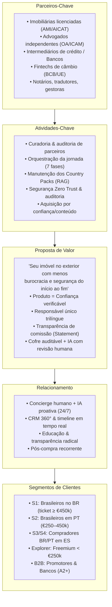
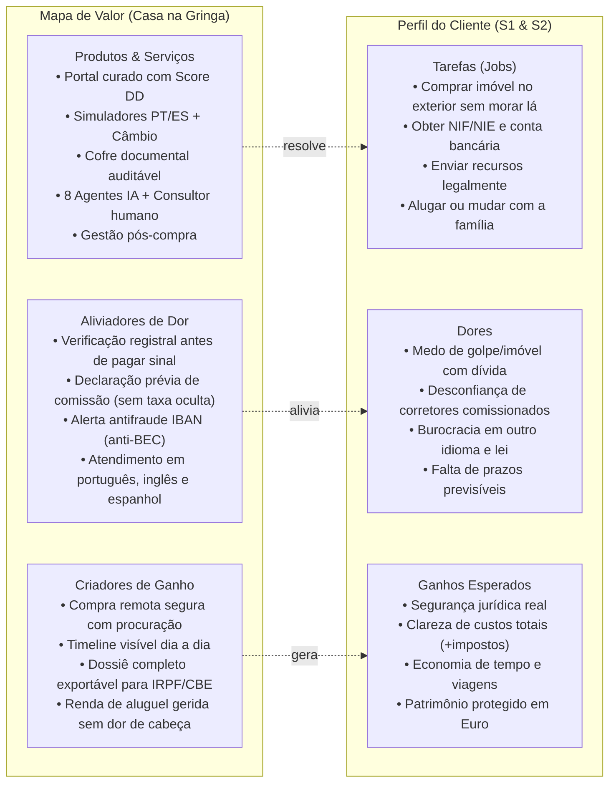

# 03 — Business Model Canvas · CASA NA GRINGA

| Campo | Valor |
|---|---|
| **Objetivo** | Apresentar o Business Model Canvas (9 blocos), o Value Proposition Canvas e o Lean Canvas da Casa na Gringa |
| **Público** | Fundador(es), investidores pré-seed/seed, equipe fundadora, parceiros estratégicos |
| **Status** | Rascunho v0.1 |
| **Data** | 16/11/2026 (referência nov/2026) |
| **Contrato comum** | [00-premissas-e-decisoes.md](00-premissas-e-decisoes.md) |
| **Documentos relacionados** | [01-visao-estrategica.md](01-visao-estrategica.md) · [02-modelo-negocio.md](02-modelo-negocio.md) · [14-plano-monetizacao.md](14-plano-monetizacao.md) |

---

## 1. Visão Geral do Canvas (Diagrama)

---

## 2. Os 9 Blocos do Business Model Canvas

### 2.1 Segmentos de Clientes (Customer Segments)
| Segmento | Perfil e Dor Central | Prioridade |
|---|---|---|
| **S1 — Brasileiros residentes no Brasil (HNWI/Affluent)** | Patrimônio ≥ US$ 1 mi, buscam proteção em Euro, moradia futura ou estudo dos filhos. Dor: medo de golpe à distância, bitributação, câmbio e burocracia. | **P1 (Alta margem)** |
| **S2 — Brasileiros residentes em Portugal** | 2–8 anos no país, renda estável, saem do aluguel. Dor: crédito bancário para estrangeiros, contratos, taxas escondidas. | **P1 (Volume e ciclo curto)** |
| **S3 / S4 — Lusófonos investindo na Espanha** | Ticket € 300–800 mil (Madrid, Barcelona, Valência, Málaga). Dor: NIE, ITP regional, notaria, gestão à distância. | **P2 (Expansão M4+)** |
| **Explorer (Público < € 250 mil)** | Usam simuladores e guias gratuitos; geram escala de SEO e receita via *referral* sem consumir concierge dedicado. | **Topo de funil** |
| **Parceiros B2B (A2+)** | Incorporadoras, imobiliárias prime e bancos que desejam leads pré-qualificados (KYC/capacidade financeira verificados). | **P3 (A partir do Ano 2)** |

### 2.2 Proposta de Valor (Value Propositions)
- **Principal:** Segurança jurídica, financeira, documental e operacional — **"o produto é a confiança"**.
- **Diferenciais tangíveis:**
  1. **Jornada unificada nas 7 fases** (Descoberta → Planejamento → Documentação → Busca → Due Diligence → Compra → Pós-venda) num único painel em PT, EN e ES.
  2. **Transparência radical:** Declaração prévia de remuneração (*Statement of Compensation*) e regra de *fee offset*.
  3. **Cofre Documental Auditável:** Controle de versões, compartilhamento granular com consentimento LGPD/GDPR, trilha imutável (*hash-chain*) e proteção anti-fraude de pagamento (anti-BEC).
  4. **Agentes de IA (Gemini) + Humano no Circuito:** 8 especialistas com RAG legal curado (PT/ES), citações de fonte e escalonamento obrigatório a advogados/consultores humanos em decisões críticas.

### 2.3 Canais (Channels)
- **Aquisição Digital & Orgânica:** SEO programático trilíngue (cidades, impostos, guias NIF/NIE), YouTube/Instagram educativo focado em desmistificar fraudes, LinkedIn para S1/executivos.
- **Ferramentas de Produto (PLG):** Simuladores de Custo Total de Compra (PT/ES), Simulador de Financiamento para Não-Residentes, Comparador de Cidades.
- **Parcerias & Indicações:** Escritórios de contabilidade/planejamento sucessório no Brasil, assessorias de imigração/vistos, gerentes de banco *private*, comunidades de brasileiros em Portugal/Espanha.
- **Entrega:** Plataforma web (`casanagringa.com`), Concierge WhatsApp/E-mail verificado, videochamadas gravadas/auditáveis, acompanhamento presencial em visitas via consultores e parceiros locais.

### 2.4 Relacionamento com Clientes (Customer Relationships)
- **High-Touch + Tech-Enabled:** Concierge proativo (IA faz monitoramento de prazos e alertas diários; Consultor humano conduz negociação, visitas e decisões emocionais).
- **Confiança Programática:** Acesso transparente ao *Score de Due Diligence* do imóvel, relatório de riscos e histórico completo de quem acessou cada documento.
- **Pós-venda Vitalício:** A relação continua após a entrega das chaves (reformas, utilidades, administração patrimonial, gestão de locação e futura revenda).

### 2.5 Fontes de Receita (Revenue Streams)
*(Detalhamento completo e precificação em [14-plano-monetizacao.md](14-plano-monetizacao.md))*
1. **Comissão de compra e venda** (co-corretagem / mediação transparente).
2. **Assessoria Premium** (pacotes com agenda e visitas assistidas).
3. **Due Diligence Documental** (checagem pré-CPCV/Arras).
4. **Planos de Assinatura** (Explorer grátis / Essencial / Plus / Private).
5. **Intermediação de Financiamento** (via parceiros registados).
6. **Indicação de Parceiros & Serviços Financeiros/Câmbio** (*referral* / *rev share* transparente).
7. **Administração de Imóveis & Gestão de Aluguel** (recorrência mensal pós-compra).
8. **Concierge Internacional & Marketplace / Leads B2B** (fases 2 e 3).

### 2.6 Recursos-Chave (Key Resources)
- **Rede Auditada de Parceiros** (imobiliárias AMI/AICAT, advogados, intermediários de crédito, câmbio).
- **Country Packs Versionados** (base legal, alíquotas fiscais, fluxos processuais de PT e ES curados por juristas).
- **Plataforma Tecnológica Segura** (Next.js + Firebase/GCP + Postgres + Cofre Criptografado + Multiagente Gemini + CRM nativo).
- **Ativo de Marca & Reputação** (casos documentados, NPS verificado, política pública anti-fraude).
- **Licenças & Registos (a obter em A2+):** Licença AMI (IMPIC), registo de Intermediário de Crédito (Banco de Portugal), seguros de Responsabilidade Civil.

### 2.7 Atividades-Chave (Key Activities)
- Orquestração ativa das transações (gestão de prazos, pendências e SLAs entre cliente, banco, advogado e vendedor).
- Curadoria contínua dos *Country Packs* e validação jurídica das bases do RAG.
- Auditoria e *onboarding* rigoroso de imóveis e parceiros (KYC/KYB, checagem registral).
- Operação de Segurança da Informação e Compliance (LGPD, GDPR, AML/KYC, testes anti-BEC).
- Produção de conteúdo YMYL de alta autoridade (revisado por especialistas) e conversão consultiva no CRM.

### 2.8 Parceiros-Chave (Key Partnerships)
- Imobiliárias licenciadas em Lisboa, Porto, Cascais, Algarve, Madrid, Barcelona, Valência, Málaga.
- Escritórios de advocacia especializados em direito imobiliário, migratório e fiscal ibérico/brasileiro.
- Bancos portugueses e espanhóis com mesas para não-residentes + intermediários de crédito.
- Fintechs e corretoras de câmbio reguladas no Brasil e UE (remessa legal e transparente).
- Provedores tecnológicos: Google Cloud / Firebase, Stripe, provedor de assinatura eletrônica qualificada (eIDAS/ICP-Brasil) e provedor KYC/AML.

### 2.9 Estrutura de Custos (Cost Structure)
- **Fixos / Equipe (maior fatia, ~65–70% dos custos em A1–A2 [E]):** Fundadores, engenharia/produto, consultores imobiliários sêniores, operações/compliance.
- **Variáveis Transacionais:** Repasses/honorários de verificação técnica e jurídica, custos de verificação KYC/AML, taxas de gateway (Stripe), comissões variáveis de consultores.
- **Tecnologia & IA:** Infra Google Cloud/Firebase, tokens Gemini/Document AI, ferramentas de assinatura eletrônica e monitoramento SIEM.
- **Compliance & Seguros:** Auditorias, consultoria jurídica/DPO, seguro de Responsabilidade Civil Profissional e Cyber.
- **Aquisição (CAC):** Produção de conteúdo, mídia paga segmentada (BR/PT), eventos presenciais e parcerias.

---

## 3. Value Proposition Canvas (Perfil do Cliente vs. Mapa de Valor)

---

## 4. Lean Canvas (Foco de Execução Inicial — Meses 1 a 6)

| Bloco | Definição Enxuta para Validação (M1–M6) |
|---|---|
| **Problema Top 3** | 1. Medo de fraude, ônus oculto e contratos desconhecidos. 2. Fragmentação caótica entre 5+ intermediários. 3. Opacidade de custos totais (IMT/ITP, taxas, câmbio, comissões). |
| **Alternativas Existentes** | Portais (Idealista/Imovirtual) + corretor local informal + indicações em grupos de WhatsApp + escritórios desconectados. |
| **Solução MVP** | Plataforma web trilíngue com Simuladores PT/ES + Onboarding/Perfil + Cofre Documental com trilha de auditoria + Painel Timeline 7 fases + Agentes Gemini com limites + Concierge humano via CRM. |
| **Métrica Única (OMTM M1–M6)** | **Diagnósticos/Assessorias pagas convertidas em processos ativos de compra** (Meta M6: ≥ 15 processos ativos e ≥ 5 fechamentos assistidos). |
| **Vantagem Injusta (Moat futuro)** | Confiança auditável + rede de parceiros sob SLA + *Country Packs* curados + dados de prazos e riscos reais por transação. |
| **Segmento Inicial (Early Adopters)** | Brasileiros já residentes em Portugal (ciclo curto) + Brasileiros de alta renda em SP/RJ planejando compra em Lisboa, Porto ou Madrid nos próximos 6 meses. |
| **Canais M1–M6** | SEO de alta intenção ("IMT estrangeiro", "NIE comprar casa Espanha"), Simuladores virais, YouTube educativo, indicações de contadores/advogados parceiros. |
| **Receita Inicial** | Consultoria Estratégica (€ 350–500), Pacote Due Diligence (€ 1.500–2.500), Co-corretagem (50% da comissão de parceiro), *Referral* câmbio/crédito. |
| **Custo Mínimo (Bootstrapped/Pré-seed)** | Equipe enxuta fundadora + parceiros sob demanda (sucesso/fee) + Stack serverless Firebase/Cloud Run de baixo custo inicial (< € 500/mês no início). |

---

*Fim do documento.*
