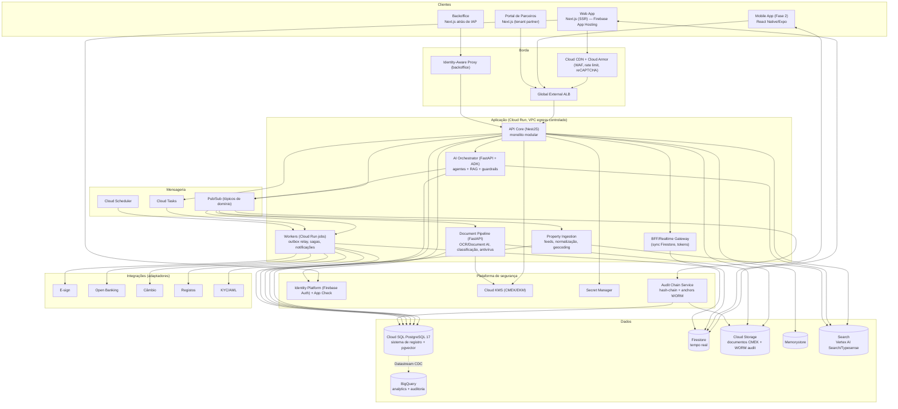
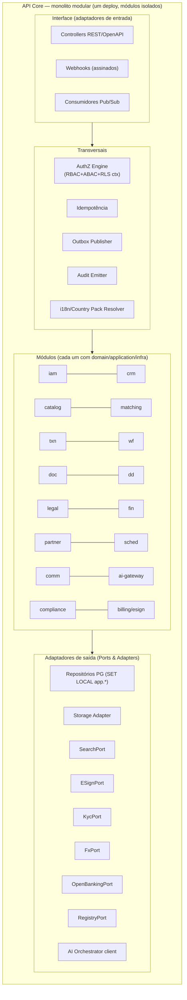
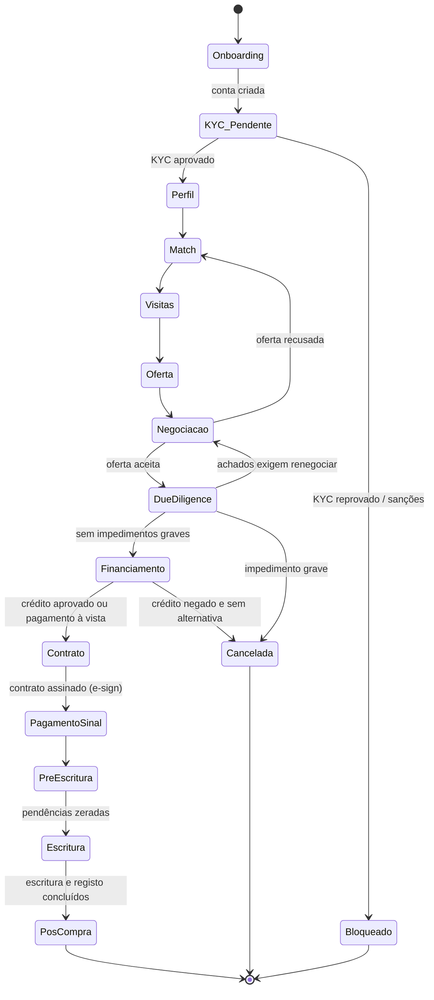
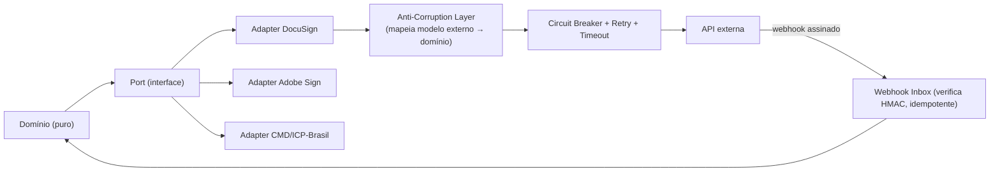
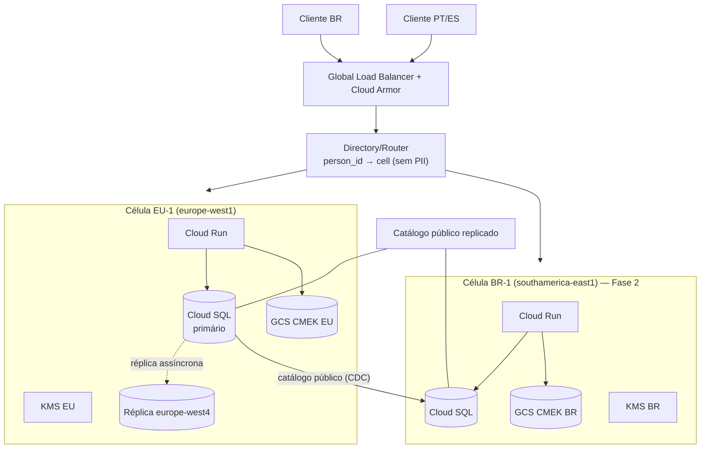
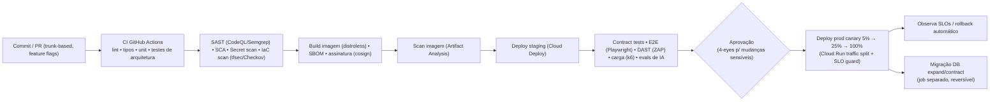
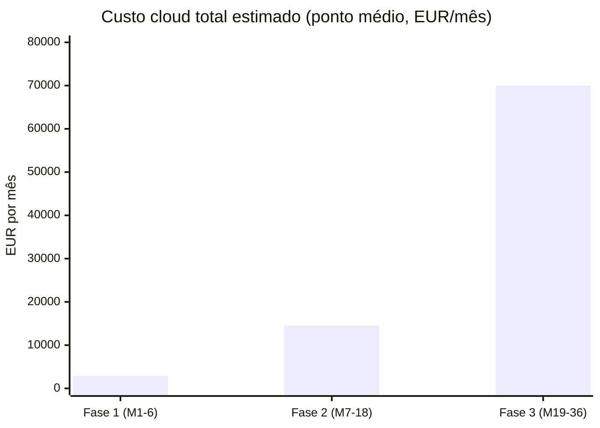
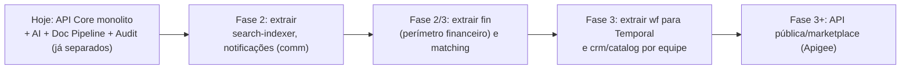

# 04 — Arquitetura de Software e Cloud

| Campo | Valor |
|---|---|
| **Documento** | Arquitetura de referência da plataforma CASA NA GRINGA |
| **Objetivo** | Definir a arquitetura-alvo (contexto, containers, componentes), a stack final com justificativas, a estratégia de evolução (monolito modular → serviços), integrações, multi-região, observabilidade, SLOs, custos e CI/CD |
| **Público** | CTO, tech leads, engenheiros, SRE, segurança, investidores técnicos (due diligence) |
| **Status** | Rascunho v0.1 |
| **Data** | 16/11/2026 |
| **Autor** | CTO/Arquiteto (co-autor do documento mestre) |
| **Contrato comum** | [00-premissas-e-decisoes.md](00-premissas-e-decisoes.md) (prevalece em caso de divergência) |
| **Relacionados** | [05-seguranca.md](05-seguranca.md) · [07-arquitetura-de-dados.md](07-arquitetura-de-dados.md) · [08-banco-de-dados.md](08-banco-de-dados.md) · [09-diagramas.md](09-diagramas.md) · [10-modelagem-dominio.md](10-modelagem-dominio.md) |

> **Aviso (regulatório/legal/tributário):** qualquer referência normativa neste documento é indicativa. **Verificar com advogado/contador local antes de uso.** Valores de custo são **estimativas a validar**.

---

## 1. Sumário executivo

A CASA NA GRINGA vende **confiança** (segurança jurídica, financeira, documental e operacional). A arquitetura deve, portanto, priorizar — nesta ordem — **segurança, privacidade, transparência, rastreabilidade, escalabilidade, automação e experiência**, antes de velocidade de entrega ou custo.

**Decisões-chave (ADRs resumidos na seção 4.9):**

1. **Arquitetura híbrida Google Cloud/Firebase + PostgreSQL**: Firebase/GCP onde é forte (Auth, tempo real, push, hosting, storage); **Cloud SQL for PostgreSQL 17 (→ AlloyDB)** como **sistema de registro transacional**; **audit log append-only com hash-chain + WORM** em Cloud Storage com Bucket Lock; BigQuery para analytics.
2. **Monolito modular** em NestJS/TypeScript sobre Cloud Run, com fronteiras de bounded contexts rígidas (DDD), preparado para extração em serviços. Serviços de IA em Python/FastAPI desde o início (ciclo de vida e dependências distintos).
3. **Orquestração da compra como saga durável** (máquina de estados em Postgres + outbox + Cloud Tasks na Fase 1; **Temporal Cloud** na Fase 2), com tarefas humanas (*human tasks*) como cidadãs de primeira classe.
4. **IA com RAG sobre base legal curada por jurisdição** (Country Pack), Gemini via Vertex AI em região UE, guardrails (Model Armor), *human-in-the-loop* em decisões críticas. O sistema **nunca** afirma "conhecer toda a legislação".
5. **Dados de clientes UE em UE**; **células regionais** (cell-based) para residência de dados — célula UE (primária) e célula BR (southamerica-east1) na Fase 2 para clientes brasileiros.
6. **A plataforma não custodia fundos** na Fase 1: pagamentos de sinal/escritura fluem via parceiros regulados (advogado/notário/escrow). A arquitetura de pagamentos é de **orquestração e verificação** (anti-BEC), não de custódia.

---

## 2. Drivers arquiteturais e requisitos não funcionais

| ID | Atributo de qualidade | Requisito (meta) | Tática principal |
|---|---|---|---|
| NFR-01 | Segurança | MFA obrigatório 100% dos usuários; zero credencial estática em código; criptografia em repouso (CMEK) e em trânsito (TLS 1.3) | Identity Platform + IAP + KMS + Secret Manager |
| NFR-02 | Privacidade | Minimização, consentimento granular, DSR (acesso/portabilidade/exclusão) ≤ 30 dias (meta interna: 10 dias úteis) | Módulo `compliance`, retenção por tipo |
| NFR-03 | Rastreabilidade | 100% das ações sensíveis em log imutável verificável (hash-chain + WORM) | `audit` com outbox transacional |
| NFR-04 | Disponibilidade | 99,9% (web/API); 99,95% (Auth); 99,99% do banco (Cloud SQL Enterprise Plus HA) | Multi-zona, Cloud Run min-instances, health checks |
| NFR-05 | Desempenho | API p95 < 300 ms (leitura), < 800 ms (escrita); busca p95 < 400 ms; 1º token IA p95 < 3 s | Cache, índices, streaming |
| NFR-06 | Escalabilidade | 10× em 12 meses sem reescrita; 100× com extração de serviços | Stateless, Pub/Sub, particionamento |
| NFR-07 | Resiliência | RPO ≤ 5 min / RTO ≤ 1 h (Tier 0); RPO ≈ 0 / RTO ≤ 4 h (documentos) | PITR, réplica cross-region, bucket dual-region |
| NFR-08 | Internacionalização | PT-BR, PT-PT, EN, ES; formatos de data/moeda/endereço por locale; conteúdo legal por jurisdição | next-intl, ICU, `content_translation`, Country Pack |
| NFR-09 | Auditabilidade regulatória | Evidência para AML/CFT, GDPR/LGPD, ISO 27001/SOC 2 | Controles como código, evidências automáticas |
| NFR-10 | Operabilidade | Time enxuto (3–8 eng.) opera em produção | Serviços gerenciados, IaC, runbooks, SLO-based alerting |
| NFR-11 | Custo | Custo cloud ≤ 4% da receita (meta Fase 2); FinOps desde o início | Orçamentos, labels, escala a zero em não-prod |
| NFR-12 | Evolutividade | Trocar fornecedor (assinatura, KYC, busca) sem reescrever domínio | Ports & Adapters (arquitetura hexagonal) |

---

## 3. Visão de contexto (C4 — Nível 1)

```mermaid
flowchart TB
    subgraph Pessoas
        CL["Cliente (Brasil/Portugal/PALOP)<br/>comprador de imóvel no exterior"]
        FAM["Familiar / procurador do cliente"]
        ADV["Consultor (advisor)"]
        LEG["Advogado parceiro (legal_reviewer)"]
        TAX["Contador/fiscalista (tax_reviewer)"]
        BRK["Imobiliária licenciada (broker_partner)"]
        BNK["Banco / intermediário de crédito (bank_partner)"]
        NOT["Notário / conservatória (notary_partner)"]
        OPS["Operações, Compliance, Suporte, Financeiro"]
        AUD["Auditor externo (somente leitura)"]
    end

    CNG(("CASA NA GRINGA<br/>Plataforma de confiança<br/>web + mobile + APIs"))

    subgraph Externos["Sistemas externos"]
        ESIGN["Assinatura eletrônica<br/>DocuSign / Adobe Sign / CMD / ICP-Brasil / eIDAS QES"]
        OB["Bancos / Open Banking<br/>(PSD2 AISP, Open Finance Brasil)"]
        FX["Câmbio / pagamentos internacionais<br/>(parceiro regulado, ex.: Wise Platform/Nium/bancos)"]
        REG["Registos prediais e fiscais<br/>PT: Predial Online, Portal das Finanças<br/>ES: Registradores/Nota Simple, Catastro"]
        KYC["KYC/AML provider<br/>(identidade, sanções, PEP)"]
        DOCAI["Google Document AI / Vertex AI"]
        MAIL["E-mail / SMS / WhatsApp Business / Push"]
        IDP["Google Cloud: Identity Platform, KMS, Chronicle, SCC"]
        MLS["Portais e feeds de imóveis<br/>(feeds de parceiros, APIs de imobiliárias)"]
        CAL["Google/Microsoft Calendar"]
        PAYG["PSP de assinaturas/serviços<br/>(Stripe — somente planos e serviços da plataforma)"]
    end

    CL --> CNG
    FAM --> CNG
    ADV --> CNG
    LEG --> CNG
    TAX --> CNG
    BRK --> CNG
    BNK --> CNG
    NOT --> CNG
    OPS --> CNG
    AUD --> CNG

    CNG <--> ESIGN
    CNG <--> OB
    CNG <--> FX
    CNG <--> REG
    CNG <--> KYC
    CNG <--> DOCAI
    CNG --> MAIL
    CNG <--> IDP
    MLS --> CNG
    CNG <--> CAL
    CNG <--> PAYG
```



**Fronteira de confiança:** tudo dentro de "CASA NA GRINGA" é operado sob os controles de [05-seguranca.md](05-seguranca.md). Todo sistema externo é tratado como **não confiável** (validação de entrada, assinatura de webhooks, *allowlist* de egresso, *circuit breaker*).

---

## 4. Stack final, justificativa e alternativas descartadas

### 4.1 Tabela de decisão

| Camada | Escolha final | Justificativa | Alternativas descartadas (e por quê) |
|---|---|---|---|
| **Frontend web** | Next.js (App Router) + TypeScript + Tailwind + shadcn/ui; next-intl; Firebase App Hosting (Cloud Run + CDN) | SSR/SEO para páginas de imóvel e conteúdo por país; ecossistema; time-to-market; i18n maduro | *Angular*: menor ecossistema de UI pronta; *Remix/SvelteKit*: menor disponibilidade de talentos; *WordPress headless*: governança fraca de segurança |
| **Mobile (Fase 2)** | React Native + Expo, design system compartilhado (tokens) | Reuso de TypeScript/regras de validação; OTA updates | *Flutter*: bom, mas fragmenta o stack TS; *nativo*: custo |
| **Backend core** | NestJS (TypeScript) em Cloud Run; monolito modular | DI, módulos e guards alinham com DDD e RBAC/ABAC; mesmo idioma do front; fácil extrair módulos | *Spring Boot*: robusto, porém exige equipe Java e mais ops; *Go*: excelente, mas menos produtividade para domínio rico; *Django*: forte, mas dividiria linguagem com front |
| **IA/ML** | Python + FastAPI em Cloud Run; Vertex AI (Gemini); ADK; Vertex AI RAG Engine / pgvector; Document AI | Ecossistema ML; Gemini nativo no GCP com residência UE e CMEK; guardrails | *Rodar LLM próprio (Llama)*: custo/ops sem ganho nesta fase; *OpenAI/Anthropic direto*: pior residência/IAM/DPA unificados (avaliar como fallback via Vertex Model Garden) |
| **Banco de registro** | **Cloud SQL for PostgreSQL 17** (Enterprise Plus, HA) → **AlloyDB** quando necessário | ACID, RLS, particionamento, JSONB, pgvector, extensões, SQL analítico; maturidade; portabilidade | *Firestore como principal*: ver 4.2; *Spanner*: custo/complexidade sem necessidade; *MySQL*: sem RLS nativo e menos recursos; *MongoDB*: sem ACID multi-entidade robusto/RLS |
| **Tempo real/UI state** | Firestore (chat, presença, notificações, espelho de status) | Listeners em tempo real, offline, escala sem ops | RTDB: modelo de dados mais limitado; WebSocket próprio: ops desnecessário |
| **Arquivos/documentos** | Cloud Storage (CMEK, versionamento, retention, Bucket Lock) + criptografia por cliente (envelope) | Durabilidade 11 noves, WORM, IAM, URLs assinadas | S3 (multi-cloud): fragmentação de IAM/DPA; Drive: sem controles |
| **Cache** | Memorystore (Redis/Valkey) | Rate limit, sessão de rascunho, cache de catálogo | Cache em memória local: inconsistência entre instâncias |
| **Mensageria** | Pub/Sub (eventos de domínio, CloudEvents), Cloud Tasks (comandos com retry/delay), Cloud Scheduler | Gerenciado, *at-least-once*, DLQ, ordering keys | Kafka/Confluent: ops/custo; RabbitMQ: ops |
| **Workflow** | Fase 1: *state machine* em Postgres + outbox + Cloud Tasks; Fase 2: **Temporal Cloud** (região UE) | Compra dura meses, com timers e tarefas humanas; precisamos de versionamento e visibilidade | *Cloud Workflows*: ótimo para orquestrações curtas, fraco em versionamento de fluxos de meses e UI de tarefas; *Camunda/Zeebe*: pesado; *Airflow*: é para dados |
| **Busca (Fase 1)** | **Vertex AI Search** (commerce/media-like custom) **ou** Typesense Cloud (EU) — decisão por PoC (ver 4.3) | Time-to-market, busca facetada + semântica sem operar cluster | OpenSearch já na Fase 1: ops e custo fixos altos para < 100 mil imóveis |
| **Busca (Fase 3)** | OpenSearch (gerenciado, ex.: Elastic Cloud/Aiven) + Vertex AI Vector Search | Geoespacial/facetas avançadas, > 100 mil imóveis | — |
| **Vetorial (início)** | pgvector (HNSW) em Cloud SQL | Mesmo banco, RLS aplicável, sem novo sistema | Pinecone etc.: novo subprocessador/dados fora da UE |
| **Identidade** | Firebase Auth / Google Identity Platform (multi-tenant, MFA TOTP; passkeys via WebAuthn próprio + custom token) | Integra com Firebase/App Check; SLA; MFA nativo | Auth0/Okta/Keycloak: custo ou ops; Cognito: fora do GCP |
| **API Gateway/WAF** | Cloud Load Balancing + Cloud Armor + API Gateway/Apigee (Fase 3 p/ API pública) | WAF/DDoS/rate-limit/reCAPTCHA Enterprise | Cloudflare na frente: avaliar (duplica controles) |
| **Observabilidade** | OpenTelemetry → Cloud Trace/Logging/Monitoring; Sentry; BigQuery log sink | Padrão aberto, sem lock-in no código | Datadog: custo; Grafana stack: ops |
| **IaC/CI/CD** | Terraform + GitHub Actions + Workload Identity Federation; Artifact Registry; Cloud Deploy (promoção) | Sem chaves de serviço; auditável | Pulumi (equivalente), Cloud Build (opcional) |
| **Migrações/ORM** | SQL-first (Atlas/dbmate) + Kysely/Drizzle | RLS, particionamento e funções exigem SQL explícito; ORMs "mágicos" escondem RLS | Prisma: suporte limitado a RLS/partições/tipos avançados |
| **API** | REST + OpenAPI 3.1 (contrato-first), eventos CloudEvents | Parceiros/integrações, geração de SDKs, API pública futura | GraphQL: complexidade de autorização por campo e caching; gRPC interno só nos serviços Python quando necessário |

### 4.2 Por que **Firebase sozinho não basta**

Firestore/Firebase é excelente para tempo real e velocidade, mas **não** deve ser o sistema de registro de uma plataforma de transações imobiliárias internacionais regulada:

| Requisito crítico | Firestore (isolado) | Postgres (sistema de registro) |
|---|---|---|
| **Transações ACID multi-entidade** (transação ↔ partes ↔ comissão ↔ pagamento ↔ auditoria) | Transações limitadas (500 docs, contenção por documento), sem *joins*, sem constraints relacionais | ACID completo, FKs, `CHECK`, `EXCLUDE`, *deferred constraints* |
| **Integridade relacional** (ex.: comissão deve somar 100% entre partes; um imóvel não pode ter duas transações ativas) | Só via código/regras (frágil) | Constraints declarativas e índices parciais únicos |
| **Autorização RBAC+ABAC fina** (advogado só vê transações atribuídas, campos sensíveis mascarados) | Security Rules são por documento e limitadas; consultas dependem do índice; difícil ABAC com contexto | **RLS** + funções de política + *column-level security* (views/masking) |
| **Auditoria/forense** (consultas ad hoc, reconstrução de estado) | Sem SQL; exportar para BQ é assíncrono | SQL, `pg_audit`, particionamento por tempo, PITR |
| **Relatórios financeiros/comissões** | Agregações caras/limitadas | SQL analítico + replicação para BigQuery |
| **Migração de esquema/constraints** | Schemaless: dívida silenciosa | Migrações versionadas, testáveis |
| **Custo previsível sob leitura intensiva** | Cobrança por leitura de documento (fan-out de listas pode explodir) | Custo por instância |
| **Portabilidade / risco de fornecedor** | Lock-in proprietário | Postgres é portável (AlloyDB, Aurora, on-prem) |
| **Conformidade**: exclusão/retenção/legal hold | TTL simples; difícil legal hold por entidade | Políticas por tabela + particionamento + `legal_hold` |

**Divisão adotada** (resume o contrato comum):

| Dado | Onde vive | Por quê |
|---|---|---|
| Identidade/credenciais/MFA | Identity Platform | Gerenciado, seguro; Postgres guarda só `firebase_uid` e metadados de autorização |
| Transações, comissões, contratos, CRM, RBAC/ABAC, consentimentos, workflow, parceiros | **Postgres** | Integridade e autorização |
| Chat, presença, notificações in-app, espelho de status para UI | **Firestore** (espelho derivado e descartável) | Tempo real e *fan-out* barato |
| Documentos | **Cloud Storage** (blob) + metadados no Postgres | Imutabilidade, CMEK, criptografia por cliente |
| Auditoria | **Postgres (hash-chain) → WORM (GCS Bucket Lock) → BigQuery** | Prova de integridade e análise |
| Analytics | **BigQuery** | Escala analítica, mascaramento por coluna |

> **Regra de ouro:** o Firestore é sempre uma **projeção reconstruível** do Postgres (via eventos), exceto o conteúdo de chat bruto, que é replicado/arquivado em `comm.message_archive` (Postgres/GCS) para retenção legal.

### 4.3 Busca: Vertex AI Search vs OpenSearch (e Typesense)

| Critério | Vertex AI Search | Typesense Cloud (UE) | OpenSearch (gerenciado) |
|---|---|---|---|
| Time-to-market | **Alto** (managed, conectores, ranking semântico) | **Alto** (simples) | Médio/baixo |
| Ops | Nenhum | Baixo | Médio/alto (shards, upgrades, mapeamentos) |
| Busca semântica/híbrida | Nativa (embeddings Google, *ranking*) | Vetorial + BM25 (híbrido) | kNN + BM25 (maduro) |
| Facetas, geofiltro, ordenação customizada | Boa, com limites de controle de ranking | Boa, geosearch simples | **Excelente** (geo_shape, agregações, scripts) |
| Controle fino (boost por regras de negócio) | Médio | Médio | **Alto** |
| Residência de dados UE | Sim (data store em `eu`) — verificar | Sim (clusters UE) | Sim |
| Custo em baixa escala | Por consulta/armazenamento (previsível, baixo) | Baixo (fixo mensal) | Fixo mensal relevante |
| Custo em alta escala (> 100 mil imóveis, alta consulta) | Cresce com consultas | Médio | **Melhor custo unitário** |
| Lock-in | Alto (Google) | Médio (API própria) | Baixo (padrão aberto) |
| Segurança por documento (ACL por imóvel/parceiro) | Filtros por metadado | Filtros | Document-level security (conforme distribuição) |

**Decisão:** Fase 1 — **PoC de 2 semanas** comparando Vertex AI Search e Typesense com 5 mil imóveis reais de PT/ES; **default recomendado: Vertex AI Search** se a qualidade semântica superar e o custo ficar < € 500/mês; caso contrário Typesense. Em ambos, o acesso é via **porta `SearchPort`** (hexagonal). **OpenSearch** entra quando: (a) > 100 mil imóveis ativos **ou** (b) necessidade de agregações geoespaciais/mapa de calor/ranking customizado que a solução gerenciada não cubra **ou** (c) custo por consulta > custo fixo do cluster. A migração é viável porque o índice é **derivado** (reconstruído a partir do Postgres via eventos `PropertyListed/Updated`).

> Importante: o índice de busca contém **apenas dados públicos do imóvel** (nunca dados pessoais do cliente). O **match personalizado** (perfil do cliente × imóvel) roda em `matching` com pgvector e regras, não no índice.

### 4.4 Por que Cloud SQL → AlloyDB

- Fase 1–2: Cloud SQL Enterprise Plus (SLA de 99,99% incluindo manutenção planejada, PITR estendido, *data cache*, pgvector).
- Gatilhos para AlloyDB: leitura analítica concorrente pesada, necessidade de *columnar engine*, > 2 TB quente, réplicas de leitura em volume. Compatível com Postgres: migração por *Database Migration Service* com *downtime* mínimo.

### 4.5 Mapeamento de serviços Google Cloud (visão consolidada)

| Necessidade | Serviço GCP |
|---|---|
| Compute | Cloud Run (serviços e *jobs*), Cloud Functions 2ª gen (eventos simples) |
| Rede | VPC, Private Service Connect, Cloud NAT, Cloud Load Balancing, Cloud Armor, Cloud DNS, Cloud CDN |
| Dados | Cloud SQL (PostgreSQL), Firestore (modo Native), Cloud Storage, BigQuery, Memorystore, Datastream (CDC → BQ) |
| Eventos | Pub/Sub, Cloud Tasks, Cloud Scheduler, Eventarc |
| IA | Vertex AI (Gemini, Embeddings, RAG Engine, Vector Search), Document AI, Model Armor, Sensitive Data Protection (DLP) |
| Segurança | Cloud KMS/EKM, Secret Manager, IAP, VPC Service Controls, Security Command Center Premium, Chronicle, reCAPTCHA Enterprise, Binary Authorization, Cloud Audit Logs, Access Transparency/Approval |
| Observabilidade | Cloud Logging/Monitoring/Trace/Profiler, Error Reporting; Sentry |
| CI/CD | Artifact Registry, Cloud Deploy, Workload Identity Federation (GitHub Actions) |

---

## 5. Visão de containers (C4 — Nível 2)



### 5.1 Descrição dos containers

| Container | Responsabilidade | Tecnologia | Escala | Observações de segurança |
|---|---|---|---|---|
| **Web App** | Experiência do cliente (i18n, SSR, acessibilidade) | Next.js 15+, TS | Auto (App Hosting) | CSP estrita, Trusted Types, SRI, cookies `__Host-`, `SameSite=Lax/Strict` |
| **Backoffice** | Operações, consultores, compliance, financeiro | Next.js atrás de IAP | Baixa | IAP + device posture + MFA; sem IP público direto |
| **Portal de Parceiros** | Advogados, bancos, imobiliárias, notários | Next.js, tenant por organização | Média | Papel + ABAC por transação; sem acesso a dados fora do caso |
| **API Core** | Todos os bounded contexts transacionais | NestJS, Cloud Run (min 1–2 instâncias) | 0→N, concorrência 40–80 | Guards RBAC+ABAC, validação (zod), idempotência, rate limit |
| **BFF/Realtime Gateway** | Emite *custom tokens*/claims mínimos, sincroniza projeções para Firestore | NestJS (módulo/serviço) | Média | Claims só de papel/tenant (nunca decisões finais) |
| **AI Orchestrator** | Roteamento multiagente, RAG, tool-calling, guardrails, log de interações | FastAPI + ADK, Vertex AI | Por demanda | Egresso só para Vertex (PSC); Model Armor; mascaramento DLP antes de prompt |
| **Document Pipeline** | Antivírus, OCR, classificação, extração, validação, tradução | FastAPI + Document AI | Fila (Pub/Sub) | Processa com DEK efêmera (ver [05-seguranca.md](05-seguranca.md) §7); sem persistência em disco |
| **Workers** | Outbox relay, sagas, notificações, webhooks, conciliação | Cloud Run *jobs*/serviços | Fila | Identidades de serviço mínimas por worker |
| **Property Ingestion** | Feeds de imobiliárias, deduplicação (MDM de imóvel), geocodificação | Python/TS | Agendado | Fontes autenticadas; quarentena de dados novos |
| **Audit Chain Service** | Encadeia hashes, ancora em WORM, verifica integridade | Serviço isolado (projeto próprio) | Baixa, crítica | Identidade separada; ninguém (nem admin) altera; ver [05-seguranca.md](05-seguranca.md) §12 |

---

## 6. Módulos / Bounded Contexts (C4 — Nível 3: componentes da API Core)

Dezesseis contextos, alinhados a [10-modelagem-dominio.md](10-modelagem-dominio.md) e aos *schemas* de [08-banco-de-dados.md](08-banco-de-dados.md):

| # | Contexto (módulo) | Schema PG | Responsabilidade | Tipo (DDD) |
|---|---|---|---|---|
| 1 | Identity & Access (`iam`) | `iam` | Contas, papéis, permissões, políticas ABAC, sessões, break-glass | Genérico |
| 2 | Customer & CRM (`crm`) | `crm` | Pessoa (MDM), perfil, leads, funil, tarefas, interações | Suporte (core p/ relacionamento) |
| 3 | Property Catalog (`catalog`) | `catalog` | Imóvel (MDM), anúncio, mídia, preço, identificadores prediais | Core |
| 4 | Search & Matching (`matching`) | `catalog`/`ai` | Busca, recomendação, match IA | Core |
| 5 | Transactions (`txn`) | `txn` | Ofertas, contratos, partes, custos, fechamento | **Core** |
| 6 | Workflow (`wf`) | `wf` | Definições, instâncias, saga, tarefas humanas | **Core** |
| 7 | Document Vault (`doc`) | `doc` | Cofre, versões, extração, validação, compartilhamento | **Core** |
| 8 | Due Diligence (`dd`) | `txn` | Casos e achados de diligência do imóvel/vendedor | **Core** |
| 9 | Legal Knowledge / Country Pack (`legal`) | `legal`,`ref` | Base legal versionada, checklists, tributos, RAG corpora | **Core** |
| 10 | Payments & Finance (`fin`) | `fin` | Comissões, faturas, instruções de pagamento verificadas, câmbio | Core (sensível) |
| 11 | Partners & Marketplace (`partner`) | `partner` | Cadastro, licenças, serviços, indicações, avaliações | Suporte |
| 12 | Scheduling & Visits (`sched`) | `sched` | Disponibilidade, visitas, feedback | Suporte |
| 13 | Communication (`comm`) | `comm` | Notificações, canais, templates, threads | Genérico |
| 14 | AI Agents (`ai`) | `ai` | Definições de agentes, conversas, tool-calls, escalonamentos | Core |
| 15 | Compliance & Privacy (`compliance`) | `compliance` | Consentimento, DSR, KYC/AML, retenção, risco, incidentes | **Core** |
| 16 | Audit (`audit`) | `audit` | Hash-chain, âncoras, verificação | **Core** (isolado) |
| + | Billing (`billing`) | `billing` | Planos e assinaturas da plataforma | Suporte |
| + | E-signature (`esign`) | `esign` | Envelopes e assinaturas (anticorruption layer) | Suporte |
| + | Platform (`platform`) | `platform` | Outbox/inbox, idempotência, i18n de conteúdo | Infra |



### 6.1 Regras de modularidade (impostas por lint e testes de arquitetura)

1. **Cada módulo expõe uma API pública** (`index.ts` + interfaces de *application services* e **eventos de domínio**); acessar tabelas de outro módulo é **proibido** (verificado por `dependency-cruiser`/ArchUnitTS e por *grants* de schema no Postgres: o usuário de aplicação de cada módulo só tem privilégios no seu *schema*; leituras cruzadas via **views públicas** ou eventos).
2. **Sem FKs entre schemas de contextos distintos**, exceto para identificadores "âncora" estáveis (`person_id`, `property_id`, `transaction_id`) — documentado em [08-banco-de-dados.md](08-banco-de-dados.md) (FKs entre schemas são permitidas no monolito e removidas na extração; manter `ON DELETE RESTRICT`).
3. **Comunicação entre módulos**: chamadas síncronas apenas via *application service* público (em processo); efeitos colaterais via **eventos** (outbox). Nada de transações distribuídas: saga.
4. **Um *composition root* por deploy**: o mesmo código pode ser empacotado como 1 serviço (hoje) ou N serviços (futuro) trocando o adaptador de comunicação (in-process → HTTP/Pub/Sub).
5. **Contratos de eventos versionados** (`<contexto>.<agregado>.<evento>.v1`), CloudEvents, esquema em Pub/Sub Schema; mudanças *backward compatible* (expand/contract).

---

## 7. Comunicação síncrona e assíncrona

### 7.1 Critério de escolha

| Situação | Estilo | Tecnologia |
|---|---|---|
| Consulta do usuário (UI espera) | Síncrono (REST) | Cloud Run |
| Comando que altera um agregado | Síncrono + evento de domínio | REST + outbox |
| Efeito colateral em outro contexto | Assíncrono (evento) | Pub/Sub |
| Tarefa com retry/atraso/rate-limit (ex.: enviar e-mail, chamar e-sign) | Assíncrono (comando) | Cloud Tasks |
| Processamento pesado (OCR, embeddings, tradução) | Assíncrono (fila) | Pub/Sub → Document Pipeline |
| Atualização em tempo real para UI | Push | Firestore listeners |
| Integração externa → plataforma | Webhook (HMAC + *replay protection*) | Cloud Run + inbox idempotente |
| Rotina agendada (retenção, conciliação FX, verificação da hash-chain) | Cron | Cloud Scheduler → job |

### 7.2 Padrão Outbox/Inbox (consistência entre Postgres e Pub/Sub)

```mermaid
sequenceDiagram
    autonumber
    participant API as API Core (módulo txn)
    participant PG as PostgreSQL
    participant OB as Outbox Relay (worker)
    participant PS as Pub/Sub
    participant C1 as Consumidor A (comm)
    participant C2 as Consumidor B (audit)
    participant INB as inbox_processed (PG)

    API->>PG: BEGIN; UPDATE txn.transaction; INSERT platform.outbox_event; INSERT audit.event (pendente de encadeamento); COMMIT
    OB->>PG: SELECT ... FROM platform.outbox_event WHERE published_at IS NULL FOR UPDATE SKIP LOCKED
    OB->>PS: publish(event, ordering_key = aggregate_id)
    PS-->>OB: ack
    OB->>PG: UPDATE outbox_event SET published_at = now()
    PS->>C1: entrega (at-least-once)
    C1->>INB: INSERT (consumer, event_id) ON CONFLICT DO NOTHING
    alt novo evento
        C1->>C1: processa e confirma (ack)
    else duplicado
        C1->>C1: ignora e confirma (ack)
    end
    PS->>C2: entrega
    C2->>C2: encadeia hash e ancora
```

### 7.3 Catálogo de tópicos Pub/Sub (principais)

| Tópico | Eventos principais | Consumidores |
|---|---|---|
| `identity.events` | `UserRegistered`, `MfaEnrolled`, `RoleGranted`, `SuspiciousLoginDetected` | `crm`, `compliance`, `audit` |
| `crm.events` | `LeadCreated`, `LeadQualified`, `ClientOnboarded` | `matching`, `comm`, `analytics` |
| `catalog.events` | `PropertyListed`, `PropertyPriceChanged`, `PropertyWithdrawn` | `search-indexer`, `matching`, `comm` |
| `doc.events` | `DocumentUploaded`, `DocumentScanned`, `DocumentExtracted`, `DocumentValidated/Rejected`, `DocumentShared`, `DocumentExpired` | `wf`, `dd`, `comm`, `audit` |
| `txn.events` | `OfferSubmitted/Accepted`, `ContractGenerated`, `TransactionStageChanged`, `ClosingScheduled`, `TransactionClosed/Cancelled` | `wf`, `fin`, `comm`, `analytics` |
| `dd.events` | `DueDiligenceStarted`, `FindingRaised`, `DueDiligenceCompleted` | `wf`, `txn`, `ai` |
| `fin.events` | `PaymentInstructionCreated/Verified/Released`, `IbanChangeRequested`, `CommissionAccrued`, `InvoiceIssued` | `compliance`, `wf`, `comm` |
| `esign.events` | `EnvelopeSent`, `SignerSigned`, `EnvelopeCompleted/Declined` | `wf`, `doc`, `txn` |
| `compliance.events` | `ConsentGranted/Withdrawn`, `DsrOpened/Fulfilled`, `KycCompleted`, `RiskAlertRaised` | `iam`, `crm`, `wf` |
| `ai.events` | `AgentEscalatedToHuman`, `AiAnswerFlagged` | `crm`, `wf`, `compliance` |
| `audit.anchors` | `ChainAnchored` | monitoramento |

**DLQ** por assinatura, com alerta; *replay* controlado por *runbook*.

---

## 8. Orquestração do workflow da compra (saga)

### 8.1 Etapas macro (visão do cliente)

1. Onboarding e KYC → 2. Perfil e match → 3. Visitas → 4. Oferta/negociação → 5. Due diligence → 6. Financiamento (opcional) → 7. Contrato de promessa (CPCV em PT / contrato de arras em ES — nomes a confirmar com advogado) → 8. Pagamentos seguros → 9. Escritura/Registo → 10. Pós-compra (utilidades, NIF/NIE, administração, aluguel).

### 8.2 Modelo de saga

- **Orquestrada** (não coreografada) por `wf`: um coordenador central decide os próximos passos, o que facilita auditoria e visibilidade ao cliente.
- Cada **passo** = *comando idempotente* + **compensação** (quando aplicável) + **timeout** + **política de retry**.
- **Tarefas humanas** (`wf.human_task`): revisão jurídica, aprovação de compliance, conferência de IBAN por *four-eyes*. A saga **espera** (estado `WAITING_HUMAN`) com SLA e escalonamento.
- **Versionamento** de definições de workflow por Country Pack e versão (um processo iniciado na v3 termina na v3).
- **Ponto sem retorno** (*pivot*): após `ContratoAssinado` e `SinalPago`, cancelamento deixa de ser compensação automática e passa a **fluxo jurídico** (humano).



### 8.3 Compensações (exemplos)

| Passo | Efeito | Compensação | Observação |
|---|---|---|---|
| Reservar visita | Cria `appointment` + convite de calendário | Cancelar e notificar | Automática |
| Gerar contrato (minuta) | Cria `contract` rascunho | Arquivar rascunho | Automática |
| Enviar envelope e-sign | Cria envelope no provedor | *Void envelope* | Automática se não assinado |
| Reservar valor de sinal (instrução) | `payment_instruction` em `PENDING_VERIFICATION` | Cancelar instrução | Automática antes da liberação |
| Liberação do pagamento | Parceiro regulado executa | **Não compensável** | Exige fluxo jurídico/estorno bancário (humano) |
| Solicitar certidões | Pedido em registo | Cancelar (se possível) | Pode gerar custo; registrar |

### 8.4 Implementação por fase

| Aspecto | Fase 1 (MVP) | Fase 2 (escala) |
|---|---|---|
| Motor | `wf` em Postgres (tabelas `wf.*`), executor em worker, Cloud Tasks para timers/retry | **Temporal Cloud** (namespace UE), workflows como código TypeScript, `wf.*` vira projeção para UI |
| Visibilidade | Query SQL + UI backoffice | UI Temporal + projeções |
| Abstração | `WorkflowPort` (start, signal, query, cancel) | idem — migração por *strangler* (novos processos no Temporal; antigos terminam no legado) |

---

## 9. Integrações externas

| Integração | Finalidade | Padrão técnico | Provedores candidatos (a validar) | Riscos / controles |
|---|---|---|---|---|
| **Assinatura eletrônica** | Contratos, procurações, termos | Porta `ESignPort`; envelope → webhook `EnvelopeCompleted`; armazenar certificado de conclusão (WORM) | DocuSign, Adobe Sign (eIDAS AdES/QES), Chave Móvel Digital (PT), ICP-Brasil (BR) via provedor | Nível de assinatura exigido por tipo de ato (escritura **não** é eletrônica por padrão: ato notarial presencial/online conforme lei local — **verificar**); validar assinante via KYC |
| **Bancos / Open Banking** | Verificar titularidade de conta, extrato de renda/capacidade (com consentimento), confirmar origem de fundos | Agregador PSD2 (AISP) e Open Finance Brasil; OAuth2 + consentimento revogável | Tink, TrueLayer, Salt Edge (UE); Open Finance BR via participante/iniciador | Escopo mínimo; consentimento granular; tokens cifrados; expiração; sem armazenar credenciais bancárias |
| **Intermediação de crédito** | Simulações e propostas via bancos parceiros | APIs de parceiros / portal do banco (`bank_partner`) | Bancos parceiros PT/ES | Enquadramento regulatório (Banco de Portugal — **verificar**); dados enviados com consentimento |
| **Câmbio e pagamentos internacionais** | Cotação e execução de câmbio (BRL↔EUR) | `FxPort`: cotação (`fin.fx_quote` com validade), execução **pelo parceiro regulado** | Wise Platform, Nium, bancos/IFs autorizadas | Plataforma não custodia; rev share; cotação auditável; *travel rule*/AML do parceiro |
| **Registos prediais PT** | Certidão permanente, caderneta predial, ónus | `RegistryPort` (robô/API oficial quando disponível; fallback humano) | Predial Online (IRN), Portal das Finanças | Credenciais de representação; acesso por procuração; log; **verificar** requisitos de acesso |
| **Registos ES** | Nota simple, cargas, referência catastral | Idem | Registradores de España, Sede Electrónica del Catastro | Idem |
| **KYC/AML** | Verificação de identidade (documento + *liveness*), sanções, PEP, mídia adversa | `KycPort`; webhook de resultado | Onfido, Veriff, Sumsub, ComplyAdvantage, Dow Jones | Residência UE; retenção mínima; revisão humana de *hits* |
| **Document AI** | OCR, classificação, extração | Vertex/Document AI processors (região UE) | Google Document AI (custom classifiers/extractors) | DEK efêmera; descarte; validação cruzada humana |
| **Pagamentos de planos** | Assinaturas e serviços da plataforma (não compra de imóvel) | Stripe Billing/Checkout (webhooks) | Stripe, Adyen | PCI SAQ-A (tokenização); sem dados de cartão |
| **Comunicação** | E-mail, SMS, WhatsApp, push | `NotifyPort` | SendGrid/Mailgun (UE), Twilio/MessageBird, WhatsApp Business API, FCM | Consentimento por canal; *opt-out*; templates aprovados |
| **Calendário** | Visitas, reuniões | OAuth2 Google/Microsoft Graph | Google Calendar, Outlook | Escopo mínimo; tokens cifrados |
| **Feeds de imóveis** | Ingestão de anúncios | CSV/XML/API de imobiliárias; dedup + MDM | Imobiliárias parceiras (e feeds padrão da indústria) | Direitos de uso, qualidade, deduplicação, verificação de licença do anunciante |
| **Tradução** | Documentos e conteúdo | Gemini/Translation API + tradutor juramentado (parceiro) para documentos legais | Cloud Translation; tradutores juramentados | Tradução automática **não substitui** tradução juramentada |

**Padrões obrigatórios para qualquer integração:** adaptador isolado (anticorruption layer); *timeouts* + *retry com backoff e jitter* + *circuit breaker*; idempotência (`Idempotency-Key`); *allowlist* de egresso; segredo no Secret Manager com rotação; webhooks com HMAC/assinatura + janela de tempo + `inbox_processed`; contratos testados (Pact/testes de contrato) e **sandbox** em staging; matriz de risco de fornecedor (subprocessador no DPA, residência, SOC 2/ISO).



---

## 10. Multi-região, residência de dados e arquitetura celular

### 10.1 Princípios

1. **Dados pessoais de residentes UE/EEA ficam na UE** (GDPR). Clientes brasileiros: LGPD. A Decisão de adequação UE–Brasil (adotada em jan/2026, com reconhecimento recíproco da ANPD — **verificar status e escopo atuais com advogado**) simplifica fluxos, mas **mantemos a opção de célula BR** por exigência comercial/ percepção de confiança e latência.
2. **Célula (cell) = pilha completa independente** (projeto GCP, Cloud SQL, buckets, KMS, Firestore, filas). Um cliente pertence a **uma célula "casa"** (`data_region`). Imóveis/catálogo são **dados públicos replicáveis** entre células.
3. **Chaves por célula**: o KMS de cada célula é independente; documentos da célula BR não são decifráveis por operadores da UE sem *break-glass* aprovado e auditado.
4. **Metadados globais mínimos** (diretório de roteamento): `person_id → cell`. Armazenado em um *directory service* pequeno e replicado (sem PII; apenas hash/ID opaco).

### 10.2 Topologia

| Célula | Região primária | DR | Conteúdo | Fase |
|---|---|---|---|---|
| **EU-1** | `europe-west1` (Bélgica) — compute, Cloud SQL, Firestore (`eur3`/multi-região UE), GCS dual-region `eur4` ou *multi-region EU* | Réplica Cloud SQL em `europe-west4`; bucket dual/multi-region; Cloud Run *standby* em `europe-west4` | Clientes UE/PT/ES, PALOP (Fase 1), catálogo | **1** |
| **EU-MAD (edge)** | `europe-southwest1` (Madrid) | — | CDN/edge; *read replicas* de catálogo e Cloud Run de leitura p/ latência ES (opcional) | 2 |
| **BR-1** | `southamerica-east1` (São Paulo) | `southamerica-west1` (Santiago) **ou** réplica EU-1 criptografada (decisão com DPO) | Clientes residentes no Brasil, se exigido | **2** |

> Nomes de região/localização multi-região do Firestore e do Cloud Storage devem ser **confirmados** no momento do provisionamento. Na Fase 1, os dados de clientes brasileiros são tratados na célula EU-1 com base legal e salvaguardas documentadas (ver [05-seguranca.md](05-seguranca.md) §17).



### 10.3 Matriz de residência por tipo de dado

| Tipo de dado | Local | Cross-border? | Observação |
|---|---|---|---|
| Identidade/KYC, documentos, transações, comunicações | Célula do cliente | Não (exceto parceiros com necessidade e base legal) | Compartilhamento com parceiro estrangeiro = transferência; registrar |
| Catálogo de imóveis (público) | Replicado | Sim | Sem PII |
| Logs técnicos | Célula (sem PII; pseudonimizados) | Agregado em BQ da célula | Retenção 13 meses |
| Auditoria | Célula + âncoras (hash) globais | Somente hashes | Hash não revela conteúdo |
| IA (prompts/respostas) | Vertex AI região UE (EU) / BR conforme célula | Não | Configurar *no data retention*/*zero data retention* conforme contrato Google (**verificar**) |
| Analytics | BigQuery da célula (dataset mascarado) | Agregados anonimizados globais | Nunca PII em dataset global |

---

## 11. Multi-idioma (i18n/l10n) e localização por jurisdição

| Dimensão | Estratégia |
|---|---|
| **Locales** | `pt-BR`, `pt-PT`, `en`, `es` (e futuros `es-MX`, `it`, `el`, `ar`); roteamento `/[locale]/...`; negociação de idioma + preferência salva no perfil |
| **UI strings** | ICU MessageFormat (next-intl); chaves em TMS (Lokalise/Crowdin); revisão humana de strings jurídicas |
| **Conteúdo editorial e legal** | `platform.content_translation` (entidade, campo, locale, versão, estado de revisão); conteúdo legal **por jurisdição**, não por idioma (um brasileiro lendo sobre Portugal vê o conteúdo de **PT** em `pt-BR`) |
| **Imóveis** | Descrição original + traduções automáticas marcadas "tradução automática" + opção de revisão; atributos normalizados independentes de idioma (taxonomia) |
| **Documentos** | Documento original imutável; traduções como `doc.translation` (simples, certificada/juramentada, apostilada) |
| **IA** | Agentes respondem no idioma do usuário, **citando a fonte no idioma original** + resumo; avaliação de qualidade por idioma (*evals* PT-BR, PT-PT, EN, ES) |
| **Formatos** | `Intl` para datas, números, moeda (EUR/BRL/USD/AOA…), unidades (m²/sq ft), endereços por país (libpostal/Google Address Validation) |
| **Moedas** | Preço original + conversão informativa (`fx_rate`); transação sempre na moeda do contrato |
| **Acessibilidade** | WCAG 2.2 AA, RTL-ready |

---

## 12. Estratégia de ambientes e CI/CD

### 12.1 Ambientes e projetos GCP (segregação total)

| Ambiente | Projeto GCP (por célula) | Dados | Acesso | Observações |
|---|---|---|---|---|
| `dev` | `cng-dev` | Sintéticos | Engenheiros | Escala a zero; sem PII real |
| `staging` | `cng-stg` | Sintéticos/anonimizados | Engenharia + QA | Espelho de prod em topologia; testes E2E e carga; sandbox de integrações |
| `prod` | `cng-prod-eu1` (e `-br1`) | Reais | Acesso mínimo; *break-glass* | Mudanças só via pipeline; sem SSH/console para escrita |
| `sec` | `cng-security` | Logs consolidados, SIEM | Segurança | Sink de logs imutável (bucket locked) |
| `audit` | `cng-audit` | Hash-chain/WORM | Serviço isolado + auditor read-only | Projeto separado; owners ≠ engenharia |
| `data` | `cng-data` | BigQuery/lakehouse | Dados/BI | Datasets por classificação |
| `shared` | `cng-shared` | Artifact Registry, Terraform state | Plataforma | — |

Estrutura de organização: `Organization → Folders (prod / nonprod / security / shared) → Projects`, com **Organization Policies** (sem chaves de SA, restrição de locais `in:eu-locations`, sem IP público em VMs/SQL, CMEK obrigatório).

### 12.2 Pipeline



| Prática | Regra |
|---|---|
| Branching | Trunk-based; PRs pequenos; *feature flags* (Firebase Remote Config/OpenFeature) |
| Autenticação do CI no GCP | **Workload Identity Federation** (sem chaves) |
| Binary Authorization | Só imagens assinadas e de pipelines confiáveis rodam em prod |
| Migrações | *Expand → migrate → contract*; nunca *breaking* em um passo; *lock timeouts*; teste em cópia anonimizada |
| Infra | 100% Terraform; *plan* comentado no PR; *drift detection* diário |
| Mudanças em prod | Janela, *change record* automático, 4-eyes para IAM/KMS/rede/regras de auditoria |
| Testes de IA | *Golden sets* por agente e idioma; regressão de citações; *red-team* de *prompt injection* a cada release de prompt |
| Rollback | Cloud Run revision pinning (minutos); migrações compatíveis com versão N-1 |

---

## 13. Observabilidade

### 13.1 Pilares

| Pilar | Implementação |
|---|---|
| **Traces** | OpenTelemetry (auto + manual); `trace_id` propagado em eventos Pub/Sub (`traceparent`) e persistido em `audit.event` |
| **Logs** | JSON estruturado, sem PII (redaction + DLP em *log sink*), níveis; Cloud Logging → sink BigQuery (13 meses) e bucket locked (audit/security) |
| **Métricas** | RED (rate/errors/duration) por endpoint; USE para infra; métricas de negócio (funil, tempo por etapa, SLA de tarefas humanas); métricas de IA (latência, custo/tokens, taxa de escalonamento, *groundedness*) |
| **Erros** | Sentry (front e back) com *scrubbing* de PII |
| **Real User Monitoring** | Web Vitals (Sentry/Firebase Performance) |
| **Synthetic** | Cloud Monitoring uptime checks + fluxos Playwright (login+MFA, upload, busca) por região |
| **Perfil** | Cloud Profiler |
| **Alertas** | Baseados em **SLO / burn rate** (janela rápida 1h@14,4× e lenta 6h@6×), roteados por severidade (PagerDuty/Opsgenie) |

### 13.2 SLIs/SLOs

| Serviço/jornada | SLI | SLO | Janela | Error budget |
|---|---|---|---|---|
| API (leitura) | % requisições < 300 ms e sem 5xx | 99,5% | 28 dias | 0,5% |
| API (escrita) | % sucesso sem 5xx | 99,9% | 28 dias | 43 min |
| Login + MFA | % sucesso (exceto credenciais erradas) | 99,95% | 28 dias | 21 min |
| Busca | p95 < 400 ms | 99% das janelas de 5 min | 28 dias | 1% |
| Upload de documento | % `DocumentUploaded → DocumentScanned` < 60 s | 99% | 28 dias | 1% |
| Extração/validação documental | p95 `Uploaded → Validated` < 5 min | 95% | 28 dias | 5% |
| Agente IA | 1º token p95 < 3 s; resposta completa p95 < 20 s | 95% | 28 dias | 5% |
| Notificações críticas (MFA, alerta de IBAN) | Entrega < 30 s | 99% | 28 dias | 1% |
| Integridade da auditoria | Verificação diária da hash-chain sem divergência | 100% | contínuo | **0 (incidente se falhar)** |
| Eventos | Mensagens em DLQ não tratadas > 1 h | 0 | contínuo | 0 |

**Política de budget:** consumo > 50% do budget em 7 dias congela *features* e prioriza confiabilidade.

### 13.3 Dashboards mínimos

Saúde (golden signals) · Funil de compra · SLA de tarefas humanas · Segurança (logins, MFA fail, risk score) · Custo (por serviço/célula/tenant) · IA (qualidade/custo) · Integrações (latência/erros por provedor) · Integridade da auditoria.

---

## 14. Escalabilidade e desempenho

| Camada | Estratégia | Gatilho de evolução |
|---|---|---|
| Frontend | CDN, ISR para páginas de imóvel, imagens otimizadas (resizing/AVIF) | — |
| API | Stateless; Cloud Run autoscaling; `min-instances` ≥ 2 em prod; *concurrency* tunada | CPU > 60% sustentado |
| Banco | Conexões via pooler gerenciado/PgBouncer; índices; partições por tempo (audit, logs, mensagens); réplicas de leitura para relatórios | 70% CPU, p95 de query > 100 ms; > 500 GB → particionar mais/AlloyDB |
| Leitura intensiva | Redis, projeções materializadas, índice de busca | Hit ratio < 80% |
| Busca | Índice derivado; reindex *blue/green* | > 100 mil imóveis → OpenSearch |
| Eventos | Pub/Sub escala automática; consumidores idempotentes | Lag > 1 min |
| IA | Cache semântico de respostas legais (por versão do corpus), *batching* de embeddings, Gemini Flash para triagem, cotas por usuário | Custo/usuário > meta |
| Documentos | Upload direto ao GCS (URL assinada), processamento assíncrono em fila | Fila > 10 min |
| Multi-tenant parceiros | Isolamento lógico (`org_id` + RLS); *rate limits* por tenant | Parceiro > 20% carga |

**Capacidade-alvo (planejamento):** Fase 1: 500 clientes ativos, 5 mil imóveis, 50 transações/mês; Fase 2: 5 mil clientes, 30 mil imóveis, 400 transações/mês; Fase 3: 50 mil clientes, 200 mil imóveis, 3 mil transações/mês. Testes de carga validam 3× o pico previsto.

---

## 15. Custos de cloud estimados por fase (estimativa a validar)

> Premissas: preços públicos de lista (sem descontos/CUD), moeda EUR, câmbio 1 USD ≈ 0,92 EUR, região UE. Excluem salários, licenças de terceiros (KYC, e-sign, CRM de parceiros) e impostos. **Todos os valores são ordens de grandeza para orçamento; validar com a calculadora do Google Cloud e proposta comercial.**

### 15.1 Resumo por fase (€/mês)

| Componente | Fase 1 — MVP (M1–M6) | Fase 2 — Crescimento (M7–M18) | Fase 3 — Escala (M19–M36) |
|---|---|---|---|
| Cloud Run (API, workers, AI, doc) | 150–350 | 800–2.000 | 4.000–9.000 |
| Cloud SQL PG (HA, Enterprise Plus; PITR; réplica DR) | 450–900 | 1.500–3.500 | 6.000–14.000 (AlloyDB) |
| Firestore + Firebase (Auth/Hosting/FCM) | 30–150 | 200–800 | 1.500–4.000 |
| Cloud Storage (docs, WORM, backups) | 20–80 | 150–600 | 1.000–3.500 |
| BigQuery + Datastream | 20–100 | 300–1.200 | 2.000–6.000 |
| Busca (Vertex AI Search/Typesense → OpenSearch) | 150–450 | 500–1.500 | 3.000–8.000 |
| IA: Gemini + embeddings + RAG + Document AI | 200–800 | 1.500–6.000 | 8.000–30.000 |
| Memorystore/Redis | 40–80 | 100–300 | 500–1.500 |
| Rede (LB, Armor, NAT, PSC, egress) | 150–300 | 400–1.000 | 1.500–4.000 |
| Segurança (KMS, SCC Premium, Chronicle/SIEM, DLP, reCAPTCHA) | 100–500 | 800–2.500 | 3.000–9.000 |
| Observabilidade (Logging/Monitoring/Sentry) | 80–200 | 300–900 | 1.500–4.000 |
| CI/CD, Artifact Registry, ambientes não-prod | 100–250 | 300–700 | 1.000–2.500 |
| Temporal Cloud (a partir da Fase 2) | — | 300–1.000 | 1.500–5.000 |
| **Total estimado (€/mês)** | **≈ 1.500–4.200** | **≈ 7.000–22.000** | **≈ 35.000–105.000** |
| Custo/cliente ativo/mês (ref.) | ≈ 3–8 | ≈ 1,5–4,5 | ≈ 0,7–2,1 |

### 15.2 Cenários (Fase 2, 12º mês)

| Cenário | Premissa | Custo mensal | Comentário |
|---|---|---|---|
| Conservador (custo alto) | IA muito usada (30 conversas/cliente/mês), SIEM completo | ≈ 22.000 | Cache semântico e Flash reduzem 30–40% |
| **Base** | 12 conversas/cliente/mês | ≈ 12.000 | Referência de orçamento |
| Otimista (custo baixo) | CUDs, Typesense, sem SIEM pago (SCC + logs) | ≈ 7.000 | Risco de lacuna de detecção |

### 15.3 FinOps

Labels obrigatórios (`env`, `cell`, `module`, `cost_center`); orçamento e alertas a 50/80/100%; relatório semanal por módulo; **cotas de IA por usuário/plano** (`billing.plan`); *committed use discounts* (Cloud SQL/Run) após 6 meses de baseline; revisão trimestral de custo × valor.



---

## 16. Estratégia: monolito modular → serviços

### 16.1 Por que começar como monolito modular

Time enxuto, domínio ainda em descoberta, necessidade de transações ACID entre `txn`, `fin`, `doc`, `wf` e auditoria. Microsserviços prematuros trariam complexidade distribuída (sagas em tudo, observabilidade, latência) antes de haver ganho.

### 16.2 Critérios objetivos para extrair um módulo

| Critério | Limiar |
|---|---|
| Carga/escala independente | Módulo consome > 40% de CPU/mem ou tem padrão de pico distinto (ex.: `ai`, `doc`, `search`) |
| Ciclo de release | Módulo precisa de deploy diário enquanto o restante é semanal (ou o inverso) |
| Isolamento de segurança | Módulo exige perímetro próprio (ex.: `audit`, `fin`) |
| Equipe | Equipe dedicada ≥ 5 pessoas na área |
| Tecnologia | Linguagem/runtime diferente necessário (IA, Python) |
| Disponibilidade | SLO distinto e mais rígido |

### 16.3 Ordem prevista de extração



**Como (Strangler Fig):** (1) módulo já isolado por schema/ports → (2) publicar API interna e consumir via adaptador HTTP → (3) mover schema para instância própria (CDC/DMS) → (4) remover FKs cruzadas e passar a eventos. Testes de contrato garantem compatibilidade.

---

## 17. Marketplace e API pública (futuro)

| Capacidade | Descrição | Arquitetura |
|---|---|---|
| **API pública para parceiros** | Imobiliárias publicam imóveis, advogados recebem casos, bancos recebem pedidos | Apigee/API Gateway; OAuth2 (client credentials + PKCE), *scopes* por papel; OpenAPI 3.1; *rate limit* e quotas por plano; webhooks assinados |
| **Marketplace de serviços** | Tradutores, contadores, mudança, decoração, seguros | `partner.partner_service` + `partner.engagement`; avaliação verificada; escrow via parceiro regulado; comissão (take-rate) |
| **White-label / B2B** | Construtoras e bancos usando o motor de due diligence e checklists | Multi-tenant por `iam.org`; *theming*; isolamento RLS; contratos de dados |
| **Data products** | Índices de preços, tempo médio por país (agregados e anonimizados) | BigQuery Analytics Hub; sem PII |
| **SDKs** | TypeScript/Python gerados do OpenAPI | CI gera e publica |
| **Governança** | Programa de parceiros: *onboarding* KYB, due diligence do parceiro, SLAs, auditoria | `partner.partner_license`, revisões periódicas |

Requisitos prévios: versionamento de API (`/v1`, política de depreciação 12 meses), portal de desenvolvedor, sandbox com dados sintéticos, *abuse detection*, termo de uso de API, subprocessadores documentados.

---

## 18. Decisões arquiteturais (ADRs resumidos)

| ADR | Decisão | Status | Consequências |
|---|---|---|---|
| ADR-001 | Arquitetura híbrida Firebase/GCP + Postgres | Aceita | Dois modelos de dados; projeções Firestore derivadas |
| ADR-002 | Monolito modular NestJS + serviços Python de IA/Doc | Aceita | Fronteiras por lint e *grants* |
| ADR-003 | Outbox transacional + Pub/Sub; sem 2PC | Aceita | Consumidores idempotentes obrigatórios |
| ADR-004 | Saga orquestrada em Postgres (Fase 1) → Temporal (Fase 2) | Aceita | `WorkflowPort` |
| ADR-005 | Audit hash-chain + WORM + âncoras | Aceita | Serviço isolado; verificação diária |
| ADR-006 | RLS no Postgres como defesa em profundidade (além do guard da aplicação) | Aceita | Contexto `SET LOCAL app.*` por requisição |
| ADR-007 | Busca via `SearchPort`; PoC Vertex AI Search × Typesense; OpenSearch na Fase 3 | Aceita (PoC pendente) | Índice só com dados públicos |
| ADR-008 | pgvector no início; Vertex AI Vector Search depois | Aceita | Embeddings versionados por modelo |
| ADR-009 | Células regionais (EU-1, BR-1) | Aceita (BR na Fase 2) | Diretório de roteamento |
| ADR-010 | Criptografia por cliente (envelope) para o cofre; processamento IA com DEK efêmera sob consentimento | Aceita | Ver [05-seguranca.md](05-seguranca.md) §7 |
| ADR-011 | Passkeys via WebAuthn próprio + custom token (Firebase não tem passkey nativo); TOTP nativo | Aceita | Step-up obrigatório para ações críticas |
| ADR-012 | Plataforma não custodia fundos (Fase 1) | Aceita | `fin` orquestra e verifica; execução por parceiro regulado |
| ADR-013 | API REST/OpenAPI contrato-first | Aceita | SDKs gerados |
| ADR-014 | SQL-first migrations + Kysely/Drizzle | Aceita | RLS/partições explícitas |

---

## 19. Riscos arquiteturais e mitigações

| Risco | Prob. | Impacto | Mitigação |
|---|---|---|---|
| Complexidade do modelo híbrido (inconsistência Firestore × PG) | M | M | Firestore apenas projeção; reconstrução por evento; testes de reconciliação |
| Vazamento de PII para prompts/logs | M | A | DLP antes do prompt, *redaction* de logs, testes de regressão |
| Alucinação jurídica | A | A | RAG curado, citações obrigatórias, HITL, *evals*, disclaimers |
| Lock-in Google | M | M | Ports & Adapters; Postgres/OTel/Terraform/containers portáveis |
| Custo de IA fora de controle | M | M | Cotas, cache, Flash, orçamento por plano |
| Time pequeno operando segurança enterprise | A | A | Serviços gerenciados, controles como código, SOC terceirizado (MDR) na Fase 2 |
| Dependência de registos/portais sem API | A | M | Fallback humano/parceiro; `RegistryPort` com modo manual |
| Mudança regulatória (AML, mediação) | M | A | Country Pack versionado; parceria com licenciados; monitoramento legal |
| Falha do serviço de auditoria bloqueando negócio | B | A | Fila durável; *fail-closed* só para ações críticas (pagamento/compartilhamento sensível) |

---

## 20. Roadmap técnico (resumo)

| Marco | Entregas técnicas |
|---|---|
| **M1–M2** | Org GCP + Terraform base; CI/CD; Identity Platform + MFA; núcleo `iam`, `crm`, `audit`; Next.js shell i18n |
| **M3–M4** | `catalog` + ingestão; busca (PoC→escolha); cofre `doc` (upload, antivírus, CMEK); `compliance` (consentimento) |
| **M5–M6** | `txn` + `wf` (saga PT); agentes IA v1 (Imobiliário, Jurídico RAG PT) com HITL; e-sign; backoffice; pentest externo #1 |
| **M7–M12** | Country Pack ES; due diligence automatizada; `fin` (instruções verificadas anti-BEC); mobile; SOC 2 Type I readiness |
| **M13–M18** | Célula BR; Temporal; réplica/DR testado; ISO 27001 certificação; portal de parceiros |
| **M19+** | Marketplace/API pública; OpenSearch; AlloyDB; novos países (EUA/Dubai/Itália/Grécia) |

---

## Apêndice A — Glossário

| Termo | Significado |
|---|---|
| **Country Pack** | Pacote versionado por país: base legal, fluxos, checklists, tributos, parceiros, custos, textos |
| **CMEK** | Customer-Managed Encryption Keys (chaves no Cloud KMS controladas pela empresa) |
| **WORM** | Write Once, Read Many (imutável durante retenção) |
| **RLS** | Row Level Security (Postgres) |
| **HITL** | Human-in-the-loop |
| **BEC** | Business Email Compromise (golpe de alteração de IBAN) |
| **Outbox** | Padrão para publicar eventos de forma atômica com a transação do banco |
| **Saga** | Sequência de transações locais com compensação |
| **Cell** | Instância isolada e completa da plataforma por região/jurisdição |
