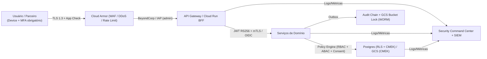

# 05 — Arquitetura de Segurança, Zero Trust, Auditoria e Privacidade · CASA NA GRINGA

| Campo | Valor |
|---|---|
| **Objetivo** | Especificar a arquitetura de segurança enterprise: Zero Trust, MFA obrigatório, RBAC+ABAC, criptografia (TLS 1.3, AES-256/CMEK, envelope encryption e análise E2E do cofre), rede/VPC-SC, SIEM, detecção de fraudes/anti-BEC, trilha imutável (*hash-chain* + WORM), histórico documental, DR/backup, Threat Model STRIDE, resposta a incidentes, Privacy by Design e certificações |
| **Público** | CTO, CISO/Segurança, DPO, engenharia, SRE, auditores externos |
| **Status** | Rascunho v0.1 |
| **Data** | 16/11/2026 |
| **Contrato comum** | [00-premissas-e-decisoes.md](00-premissas-e-decisoes.md) |
| **Documentos relacionados** | [04-arquitetura.md](04-arquitetura.md) · [06-arquitetura-ia.md](06-arquitetura-ia.md) · [08-banco-de-dados.md](08-banco-de-dados.md) · [19-estrategia-compliance.md](19-estrategia-compliance.md) |

---

## 1. Modelo de Confiança Zero (Zero Trust Architecture)

A Casa na Gringa assume que **nenhuma rede, dispositivo ou serviço é confiável por padrão**. Cada chamada entre usuário ↔ borda, serviço ↔ serviço e aplicação ↔ dado é autenticada, autorizada, criptografada e auditada.

### Pilares Zero Trust Implementados
1. **Identidade Forte Contínua:** Firebase Identity Platform com **MFA obrigatório** (TOTP via app autenticador ou Passkeys/WebAuthn FIDO2; SMS aceito apenas como recuperação secundária de alto atrito devido a risco de *SIM swapping*). Sessões administrativas e de revisão jurídica exigem **reautenticação recente** (< 15 min) para ações sensíveis (baixar passaporte, aprovar DD, liberar instrução de pagamento).
2. **Microssegmentação & Perímetro de Dados:** VPC Service Controls (VPC-SC) no GCP impedindo exfiltração de Storage/Cloud SQL/BigQuery para projetos externos. Serviços internos usam Private Service Connect sem IP público.
3. **Menor Privilégio + Acesso Just-in-Time:** Contas de engenharia não têm acesso permanente ao banco de produção. Acesso emergencial segue protocolo *break-glass* com aprovação dupla, sessão gravada e expiração em 60 min.
4. **App Check & Proteção de Borda:** Cloud Armor (OWASP Top 10, bloqueio geográfico anômalo configurável, *rate limiting* por IP e por `uid`) + Firebase App Check (reCAPTCHA Enterprise) bloqueando tráfego automatizado contra APIs e IA.

---

## 2. Controle de Acesso: RBAC + ABAC + Row-Level Security (RLS)

### 2.1 Matriz RBAC (Papéis de Referência)
| Papel | Escopo Principal | Pode Ver Docs do Cliente? | Pode Aprovar DD? | Pode Ver Audit Log? |
|---|---|---|---|---|
| `client` | Próprio perfil, processos, imóveis, cofre próprio | Sim (próprios) | Não | Histórico do próprio cofre |
| `client_family_member` | Processo compartilhado pelo titular | Somente docs permitidos (ABAC) | Não | Somente ações próprias |
| `advisor` | Carteira atribuída (CRM + Timeline) | Somente metadados + docs com consentimento ativo | Não (propõe) | Próprias ações |
| `legal_reviewer` | Processos atribuídos para DD/CPCV | Sim, apenas do processo atribuído e enquanto ativo | **Sim (parecer jurídico)** | Próprios processos |
| `tax_reviewer` | Processos atribuídos para análise fiscal | Apenas docs fiscais com consentimento | Parecer fiscal | Próprios processos |
| `broker_partner` | Imóveis próprios e visitas atribuídas | **Não** (apenas KYC mínimo para contrato se autorizado) | Não | Próprios imóveis |
| `bank_partner` | Dossiês de crédito enviados pelo cliente | Apenas pacote financeiro explícito com validade | Aprova crédito no banco | Próprios envios |
| `notary_partner` | Dossiê pré-escritura atribuído | Apenas pacote cartorial autorizado | Não | Próprios atos |
| `compliance_officer` | Fila AML/KYC, alertas antifraude, DSR | Sim (com justificativa auditada) | **Sim (AML/EDD)** | **Sim (leitura completa)** |
| `ops_manager` | Operação global, SLAs, parceiros | Metadados; docs só c/ ticket | Não | Leitura operacional |
| `support_agent` | Tickets N1/N2 | **Não** (mascarado / PII oculto) | Não | Logs de suporte |
| `finance_admin` | Faturas, comissões, repasses | **Não** (sem acesso a cofre KYC) | Não | Logs financeiros |
| `platform_admin` | Infraestrutura / IAM (sem acesso a conteúdo do cofre por padrão) | **Não** | Não | Config de sistema |
| `auditor` | Auditoria externa/interna | Somente amostragem anonimizada ou autorização formal | Não | **Sim (somente leitura)** |

### 2.2 Regras ABAC (Atributos Contextuais avaliados em tempo de execução)
Mesmo que um usuário possua papel permitido no RBAC, o *Policy Engine* exige que **todos os atributos ABAC** sejam verdadeiros:
1. **Vínculo de Atribuição (`assignment`):** `advisor` ou `legal_reviewer` só acessam o processo `deal_id` ao qual estão formalmente alocados.
2. **Consentimento Granular Ativo (`consent_grants`):** Nenhum parceiro externo lê documento sem registro válido de consentimento do cliente com `purpose` e `expires_at > now()`.
3. **Estado do Processo (`deal_status`):** Após encerramento + janela de pós-venda ou revogação, acessos de parceiros expiram automaticamente.
4. **Nível de Confiança da Sessão (`auth_strength`):** Requer `mfa_verified = true` e `amr` compatível; para downloads sensíveis, exige `auth_age <= 900s`.
5. **Jurisdição / Residência (`data_region`):** Contas de serviço ou operadores fora da região autorizada não descriptografam dados restritos sem justificativa de transferência legal.

---

## 3. Criptografia, Gestão de Chaves e Trade-off E2E do Cofre

| Camada | Padrão Técnico | Gestão de Chaves |
|---|---|---|
| **Em Trânsito** | **TLS 1.3** obrigatório (HSTS preload, ciphers AEAD modernos), mTLS interno em service mesh | Certificados gerenciados com rotação automática |
| **Em Repouso (Banco & Storage)** | **AES-256-GCM** com **CMEK** (Customer-Managed Encryption Keys) | Cloud KMS (rotação automática a cada 90 dias); chaves separadas por ambiente e região (UE vs BR) |
| **Envelope Encryption (Cofre Documental)** | Cada arquivo recebe uma **DEK (Data Encryption Key)** única AES-256; a DEK é cifrada por uma **KEK por cliente** no Cloud KMS | Permite **crypto-shredding** (ao apagar a KEK do cliente após prazo legal de retenção, o arquivo torna-se irrecuperável) |
| **Campos Ultra-Sensíveis no Banco** | Número de passaporte, NIF/NIE, IBAN de destino cifrados em nível de coluna (*application-level encryption*) | Acesso exclusivo por serviço autorizado; mascaramento em logs e CRM |
| **Secrets** | **Google Cloud Secret Manager** (chaves de API, Stripe, Document AI, assinaturas HMAC) | Zero segredos em Git, `.env` de produção ou imagens Docker |

### 3.1 Análise de Trade-off: Criptografia E2E (Client-Side) vs. Processamento por IA / Advogados
- **Problema:** Se o cliente criptografar um PDF no navegador com chave conhecida apenas por ele (*zero-knowledge E2E puro*), o servidor não consegue: (i) executar OCR/Document AI para validar vencimento e autenticidade, (ii) aplicar marca d'água dinâmica ao compartilhar com o banco, (iii) permitir revisão pelo advogado parceiro em caso de incapacidade ou auditoria AML legal.
- **Arquitetura Escolhida (Híbrida por Camada de Sensibilidade):**
  1. **Cofre Operacional (Padrão):** *Envelope Encryption* com CMEK gerenciada em enclave seguro + KMS + controle estrito RBAC/ABAC + acesso de leitura ao Document AI em memória efêmera (zero persistência fora do bucket UE).
  2. **Camada "Cofre Privado Familiar" (Plano Private — opcional para testamentos/inventários):** Suporta encriptação *client-side* (WebCrypto AES-GCM derivada de passphrase/chave do titular) para arquivos que o cliente quer apenas guardar e jamais processar por IA ou terceiros.

---

## 4. Segurança Antifraude, Anti-BEC e Proteção de Pagamentos

O maior vetor de perda financeira em compra de imóveis internacionais é o **BEC (Business Email Compromise)**: alteração fraudulenta de IBAN em contrato ou e-mail para desviar o sinal (CPCV/Arras).

### Controles Técnicos e Operacionais Obrigatórios
1. **Cofre de Instruções Bancárias Verificadas (`verified_payment_instructions`):**
   - Toda conta destinatária (escrow de advogado, notário, vendedor) é cadastrada via validação dupla (`legal_reviewer` + `compliance_officer`), com conferência de titularidade bancária (IBAN check + comprovante oficial) e **assinatura criptográfica HMAC/KMS** do registro.
   - A interface do cliente exibe um **selo verde verificável** e um código curto de conferência; qualquer alteração de IBAN invalida o registro anterior, dispara alerta crítico e exige **nova verificação dupla + confirmação por vídeo/voz (*out-of-band*)** com o cliente.
2. **Proteção de E-mail:** SPF `-all`, DKIM 2048-bit, DMARC `p=reject`, BIMI; banners de alerta em todo e-mail lembrando: *"A Casa na Gringa NUNCA envia ou altera dados bancários por e-mail ou WhatsApp"*.
3. **Detecção de Acessos Suspeitos & Anomalias:**
   - Regras em tempo real no SIEM (Cloud Chronicle / BigQuery streaming):
     - Login de país inédito em intervalo impossível (*impossible travel*);
     - Download em massa (> 5 arquivos em 2 min por parceiro/consultor);
     - Tentativa de acesso a documento fora do horário operacional sem justificativa;
     - Múltiplas falhas de MFA ou troca de dispositivo seguida de pedido de exportação/alteração bancária.
   - Resposta automática: revogação de *refresh tokens*, bloqueio temporário da conta e alerta para o `compliance_officer` e para o titular.

---

## 5. Auditoria Imutável (Hash-Chain + WORM) e Histórico Documental

> Princípio do Contrato Comum: *"Toda ação deve possuir rastreabilidade. Todo documento deve possuir histórico de acesso, edição, download e compartilhamento."*

### 5.1 Algoritmo da Cadeia de Hash (*Hash-Chain*) + WORM
1. Toda mutação crítica ou leitura sensível grava um registro na tabela `audit_logs` dentro da mesma transação (via *Outbox*) ou fila garantida:
   - Campos: `seq_id`, `event_id (UUIDv7)`, `occurred_at`, `actor_id`, `actor_role`, `action`, `resource_type`, `resource_id`, `ip_hash`, `device_fp`, `diff_summary_json`, `prev_hash`, `entry_hash`.
2. Cálculo determinístico:
   $$\text{entry\_hash} = \text{SHA256}(\text{seq\_id} \parallel \text{occurred\_at} \parallel \text{actor\_id} \parallel \text{action} \parallel \text{resource\_id} \parallel \text{canonical\_payload\_json} \parallel \text{prev\_hash})$$
3. O usuário de aplicação possui apenas permissão `INSERT` (nunca `UPDATE` ou `DELETE` — reforçado por *trigger* no PostgreSQL e políticas IAM).
4. A cada hora (ou a cada 1.000 eventos), um *job* exporta o lote + raiz Merkle / último `entry_hash` para um bucket **Cloud Storage com Retention Policy travada (Bucket Lock — WORM)** por 10 anos, tornando impossível alterar eventos passados mesmo para um administrador com acesso ao banco.
5. Um verificador público interno (`/seguranca`) recalcula a cadeia e comprova matematicamente integridade (`CHAIN_VALID`).

### 5.2 Histórico Completo por Documento (`document_events`)
Todo documento possui uma aba auditável pelo próprio cliente e pelo `auditor`:
- `UPLOAD` (versão, hash SHA-256 do arquivo binário, vírus scan status)
- `VIEW` (quem visualizou, quando, papel, duração/URL assinada gerada)
- `DOWNLOAD` (quem baixou, justificativa obrigatória para equipe/parceiros, marca d'água aplicada)
- `EDIT_METADATA` / `NEW_VERSION` (antes → depois)
- `SHARE_GRANTED` / `SHARE_REVOKED` / `SHARE_EXPIRED` (destinatário, escopo, link ao registro de consentimento)
- `AI_PROCESSED` (modelo usado, campos extraídos, score de confiança)
- `HUMAN_REVIEWED` (aprovado/rejeitado por `legal_reviewer` / `compliance_officer`, justificativa)

---

## 6. Threat Model (STRIDE) dos Fluxos Críticos

| Fluxo | Ameaça STRIDE | Risco | Contramedida Arquitetural |
|---|---|---|---|
| **Login & Sessão** | **S**poofing / Roubo de credencial | Acesso à conta e ao cofre | MFA obrigatório (TOTP/Passkey), cookies `HttpOnly/Secure/SameSite`, detecção de *impossible travel*, token lifetime curto (1h) |
| **Cofre Documental** | **T**ampering / Substituição de contrato | Alterar cláusula ou documento já aprovado | Hash SHA-256 do binário verificado em cada leitura, versionamento imutável (*append-only*), assinatura eletrônica qualificada |
| **Auditoria** | **R**epudiation / Negação de autoria | Parceiro ou usuário nega ter aprovado ou baixado | *Hash-chain* + WORM, registro de IP/dispositivo/sessão MFA no evento |
| **APIs & Multi-tenant** | **I**nformation Disclosure (IDOR) | Cliente A acessa doc do Cliente B mudando ID | PostgreSQL **Row-Level Security (RLS)** + validação de `owner_id` no Policy Engine + Firestore Rules restritas |
| **Agentes de IA / RAG** | **E**levation / Prompt Injection | Usuário ou texto oculto em PDF tenta extrair prompt/dados de outros | Sanitização de entrada, Model Armor, separação rígida de contexto por `tenant_id`, ferramentas com escopo do usuário autenticado |
| **Site Público & IA** | **D**enial of Service / Abuso de tokens | Ataque para esgotar cota Gemini ou derrubar busca | Cloud Armor WAF + App Check + *rate limit* por usuário/plano + *circuit breaker* de tokens |

---

## 7. Backup, Continuidade (BCDR), Segurança de Software e Incidentes

### 7.1 Backup 3-2-1 e RPO / RTO
| Tier de Dados | RPO | RTO | Estratégia |
|---|---|---|---|
| **Tier 0 — PostgreSQL (Transações, Auditoria, Auth)** | **≤ 5 min** | **≤ 1 h** | Cloud SQL HA multi-zona + PITR (Point-in-Time Recovery 35 dias) + snapshot diário replicado cross-region (ex.: `europe-west1` → `europe-west4`) |
| **Tier 1 — Cofre Documental (GCS)** | **≈ 0** | **≤ 4 h** | Bucket Dual-Region na UE + Object Versioning + Bucket Lock para logs/contratos fechados |
| **Tier 2 — Firestore / Busca / Cache** | **≤ 1 h** | **≤ 4 h** | Exportação diária programada para GCS + reconstrução idempotente dos índices a partir do Postgres |
- **Testes de Restauração:** Simulação trimestral obrigatória de *restore* completo em projeto sandbox isolado, cronometrando RTO real.

### 7.2 Ciclo de Desenvolvimento Seguro (SDLC & DevSecOps)
- **Segregação Total de Ambientes:** Projetos GCP separados (`cng-dev`, `cng-staging`, `cng-prod`), sem compartilhamento de credenciais ou dados reais em dev/staging (apenas dados sintéticos).
- **Pipeline CI/CD:** SAST (Semgrep/ESLint security), SCA/Dependabot (bloqueio de CVEs críticos), scan de segredos (*gitleaks* no pre-commit e CI), container scanning (Artifact Analysis), SBOM gerado a cada release.
- **Pentest & Bug Bounty:** Pentest caixa-cinza externo antes do lançamento comercial (M5) e semestralmente após crescimento; política de divulgação coordenada de vulnerabilidades (`security.txt`).

### 7.3 Runbook de Resposta a Incidentes (Prazos Legais)
| Fase | Janela Alvo | Ações Obrigatórias |
|---|---|---|
| **1. Detecção & Triagem** | **≤ 15 min** | Alerta SIEM → abertura de sala de crise → classificação Sev1/Sev2 |
| **2. Contenção** | **≤ 1 h** | Revogar tokens, isolar serviço/conta comprometida, bloquear chave KMS se aplicável |
| **3. Análise Forense** | **1–24 h** | Preservar snapshot, validar cadeia `audit_logs`, identificar escopo exato de titulares e dados afetados |
| **4. Notificação Regulatória** | **≤ 72 h (GDPR)** · **Prazo razoável / 3 dias úteis ANPD (LGPD — confirmar regra vigente)** | DPO envia notificação formal à autoridade supervisora (CNPD/AEPD/ANPD) e comunicação clara aos titulares afetados quando houver risco relevante |
| **5. Erradicação & Pós-Incidente** | **≤ 7 dias** | Patch, rotação de chaves, *post-mortem* sem culpados e atualização de controles |

---

## 8. Privacy by Design & Tabela de Retenção

- **Minimização Progressiva:** Simulador anônimo pede 0 PII. Cadastro inicial pede nome, e-mail e país. Passaporte e IR só são exigidos na Fase 3 (Documentação/KYC).
- **Portabilidade & Exclusão:** Botões no painel `/portal` permitem baixar todo histórico + docs + consentimentos em `.zip`/`.json` ou solicitar eliminação (aplicando anonimização em registros transacionais que não podem ser apagados por obrigação fiscal/AML).

| Categoria de Dado | Prazo de Retenção Padrão **[Verificar c/ advogado local]** | Ação ao Expirar |
|---|---|---|
| Leads não convertidos (sem contrato/KYC) | 24 meses de inatividade (ou imediato se opt-out) | Exclusão definitiva |
| Conversas com agentes de IA | 24 meses (ou conforme plano ativo; cliente pode apagar antes se não vinculado a parecer) | Anonimização de PII / exclusão |
| Documentos de imóveis não comprados | 90 dias após encerramento do processo | Exclusão do storage |
| Dossiês KYC/AML e contratos de transação | **7 a 10 anos** após fim da relação (Lei 83/2017 PT / Ley 10/2010 ES — **confirmar**) | Bloqueio de acesso operacional (arquivo morto WORM) → crypto-shredding ao fim do prazo |
| Logs de auditoria de segurança | 10 anos (WORM) | Expurgo automático de bucket |

---

## 9. Roadmap de Certificações e Maturidade de Segurança

- **M1–M6 (Pré-lançamento):** Controles base **OWASP ASVS Nível 2**, MFA, RBAC/ABAC, CMEK, hash-chain, primeiro **Pentest externo**, DPIA concluída.
- **M7–M15:** Prontidão e auditoria **SOC 2 Type I** (critérios Security + Confidentiality + Privacy).
- **M16–M24:** Certificação **ISO/IEC 27001** e **ISO/IEC 27701** (extensão de privacidade) + **SOC 2 Type II** (12 meses de evidência contínua), tornando o selo institucional um argumento de venda frente a bancos e clientes Private.

---

*Fim do documento.*
