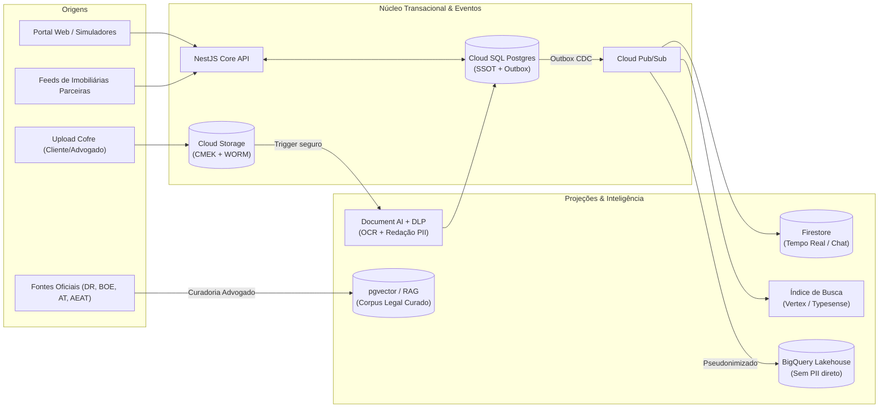

# 07 — Arquitetura de Dados · CASA NA GRINGA

| Campo | Valor |
|---|---|
| **Objetivo** | Definir os domínios de dados, fluxos ponta a ponta, classificação de sensibilidade, *data lineage*, Data Lakehouse (BigQuery), pipelines de ingestão e RAG, gestão de dados mestres (MDM), qualidade e governança |
| **Público** | CTO, engenheiros de dados, engenheiros de IA, DPO, produto |
| **Status** | Rascunho v0.1 |
| **Data** | 16/11/2026 |
| **Contrato comum** | [00-premissas-e-decisoes.md](00-premissas-e-decisoes.md) |
| **Documentos relacionados** | [04-arquitetura.md](04-arquitetura.md) · [05-seguranca.md](05-seguranca.md) · [08-banco-de-dados.md](08-banco-de-dados.md) · [10-modelagem-dominio.md](10-modelagem-dominio.md) |

---

## 1. Princípios da Arquitetura de Dados

1. **Fonte Única de Verdade (SSOT):** O **Cloud SQL PostgreSQL** é o sistema de registro (*System of Record*) para entidades transacionais, CRM, imóveis curados, workflow, documentos e finanças. **Firestore** é projeção/estado em tempo real (chat, notificações, timeline viva); **BigQuery** é camada analítica; **índice de busca** é projeção otimizada para filtro e geoespacial.
2. **Separação Estrita de PII e Analytics:** Nenhum dado pessoal identificável direto (nome, passaporte, NIF, e-mail) trafega em claro para o Data Warehouse de produto/growth — aplica-se *pseudonimização* (`client_hash_id`) na camada de ingestão.
3. **Eventos como Espinha Dorsal:** Toda mudança relevante emite um evento de domínio via padrão **Transactional Outbox → Pub/Sub**, alimentando simultaneamente busca, Firestore, notificações do Concierge, auditoria e BigQuery.
4. **Residência de Dados por Jurisdição:** Dados de transações e documentos europeus (PT/ES) residem exclusivamente em regiões da UE (`europe-southwest1` Madrid / `europe-west1` Bélgica).

---

## 2. Domínios de Dados (Data Mesh / Bounded Contexts)

| Domínio | Entidades Principais | Armazenamento Primário | Sensibilidade Máxima |
|---|---|---|---|
| **Identidade & Acesso (`iam`)** | Usuários, papéis RBAC, atributos ABAC, sessões MFA, consentimentos LGPD/GDPR | Identity Platform + Postgres | **Restrito** |
| **Cliente & CRM (`crm`)** | Leads, perfil comprador, interações, pipeline, tarefas, agendamentos, score | Postgres (+ Firestore UI) | **Confidencial / Restrito** |
| **Imóveis & Mercado (`catalog`)** | Imóveis curados, mídias, métricas de cidades/bairros, Country Packs, tabelas fiscais | Postgres + Índice Busca + GCS | **Público / Interno** |
| **Transação & Workflow (`deal`)** | Processos de compra, 7 fases, checklists dinâmicos, propostas, reservas, prazos | Postgres + Firestore (projeção) | **Confidencial** |
| **Cofre Documental (`vault`)** | Documentos, versões, hashes SHA-256, compartilhamentos, extrações Document AI | GCS (CMEK) + Postgres | **Restrito** |
| **Due Diligence & Risco (`dd`)** | Relatórios DD, pareceres jurídicos/fiscais, ônus, KYC/AML/PEP, instruções verificadas | Postgres + GCS WORM | **Restrito** |
| **Financeiro & Pós-Compra (`fin`)** | Assinaturas, faturas, comissões, *fee offset*, contratos de aluguel, vistorias | Postgres | **Confidencial / Restrito** |
| **IA & Conhecimento (`ai`)** | Corpus legal versionado (RAG), embeddings (`pgvector`), sessões/mensagens, escalonamentos HITL, evals | Postgres + Firestore + Vertex | **Confidencial (PII redigido)** |
| **Auditoria & Segurança (`audit`)** | Trilha imutável (*hash-chain*), histórico documental, alertas SIEM | Postgres (append-only) + GCS WORM | **Restrito (Imutável)** |

---

## 3. Classificação da Informação e Controles Obrigatórios

| Nível | Definição | Exemplos | Controles Exigidos |
|---|---|---|---|
| **1. Público** | Aberto ao mundo | Anúncios públicos, simuladores, guias de cidades, termos | CDN, proteção contra scraping abusivo |
| **2. Interno** | Operação da empresa sem PII de cliente | Playbooks internos, SLAs de parceiros, métricas agregadas | Autenticação corporativa + RBAC |
| **3. Confidencial** | Dados comerciais/negociais e PII básico | Pipeline CRM, e-mails, valores de proposta, faturas, contratos comerciais | TLS 1.3, CMEK, RBAC+ABAC, logs de acesso |
| **4. Restrito (Ultra-Sensível)** | Documentos de identidade, dados fiscais/bancários, AML, segredos | Passaportes, NIF/NIE, IRPF, comprovante origem de fundos, IBAN verificado, logs forenses | Tudo acima + Envelope Encryption, RLS, reautenticação MFA, mascaramento em logs/analytics, proibição de exportação em massa |

---

## 4. Fluxo de Dados e Data Lineage (Da Captura ao Analytics & IA)

### 4.1 Camadas Analíticas no BigQuery (Medallion Architecture)
1. **Bronze (`raw_events`):** Eventos brutos do Pub/Sub (particionados por dia, imutáveis, retenção 24 meses).
2. **Silver (`clean_domain`):** Tabelas limpas, desduplicadas e **pseudonimizadas via Cloud DLP / hash HMAC com salt secreto** (`client_pseudo_id`).
3. **Gold (`mart_*`):** Modelos de negócio via dbt:
   - `mart_funnel_conversion`: conversão Visitante → Simulador → Lead → Diagnóstico → CPCV → Escritura (com atribuição de canal e CAC).
   - `mart_country_sla`: tempo médio real em cada uma das 7 fases por país e por parceiro.
   - `mart_ai_quality`: taxa de alucinação, taxa de citação, latência, escalonamentos HITL e custo por sessão.
   - `mart_unit_economics`: LTV, take rate, margem de contribuição e *fee offset* por safra mensal (*cohort*).

---

## 5. Master Data Management (MDM) e Qualidade de Dados

### 5.1 Deduplicação e Entidade Única de Imóvel ("Golden Record")
No mercado ibérico, o **mesmo imóvel** aparece anunciado por 3–5 imobiliárias diferentes (em PT não há exclusividade padrão como nos EUA). Sem MDM, a plataforma mostraria duplicatas e perderia credibilidade.
- **Chave Composta Canônica:** `country + normalized_postal_code + street_norm + area_m2 (±3%) + floor + cadastral_or_predial_ref` (quando disponível após curadoria) + *perceptual hash (pHash)* das fotos principais.
- **Regra de Sobrevivência:** Dados oficiais verificados (Caderneta Predial / Nota Simple / Certidão) **sempre sobrescrevem** dados de feed de anúncio comercial; a origem de cada campo é rastreada (`field_provenance`).

### 5.2 MDM de Cliente e Processo
- Chave única do comprador vinculada ao `user_id` + documento oficial verificado no KYC (hash do passaporte/NIF/NIE para impedir contas duplicadas fraudulentas).
- Regras automatizadas de qualidade (*Data Contracts* na entrada da API com `zod`):
  - Validação algorítmica de dígitos verificadores de **CPF** (BR), **NIF** (PT) e **NIE/DNI** (ES) antes de persistir.
  - Validação de formato **IBAN** (ISO 13616 / mod-97) antes de cadastrar contas.

---

## 6. Arquitetura do Corpus RAG (Dados Jurídicos e Fiscais)

1. **Ingestão:** Fontes oficiais (`Diário da República`, `Portal das Finanças`, `IRN`, `BOE`, `Agencia Tributaria`, `Registradores`) ingeridas em documentos versionados com metadados obrigatórios: `jurisdiction (PT|ES)`, `sub_region (ex.: ES-MD, ES-CT)`, `topic`, `effective_from`, `effective_to`, `official_url`, `reviewed_by_lawyer_id`, `reviewed_at`.
2. **Chunking Estruturado:** Quebra por artigo/secção normativa (nunca quebra cega por caracteres que separe a regra da sua exceção!).
3. **Regra de Vigência:** Toda consulta RAG filtra obrigatoriamente `effective_from <= target_date AND (effective_to IS NULL OR effective_to >= target_date)`, evitando que o agente cite normas revogadas (como o antigo Golden Visa imobiliário de PT).

---

*Fim do documento.*
