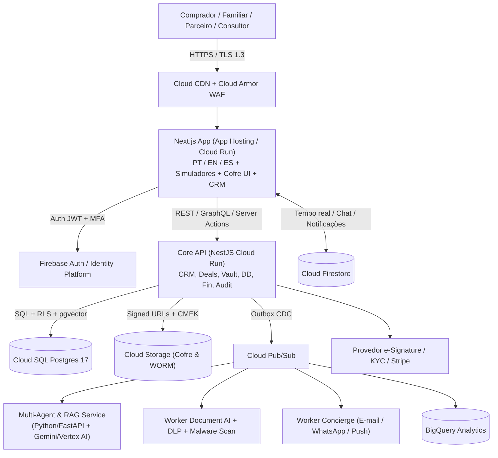
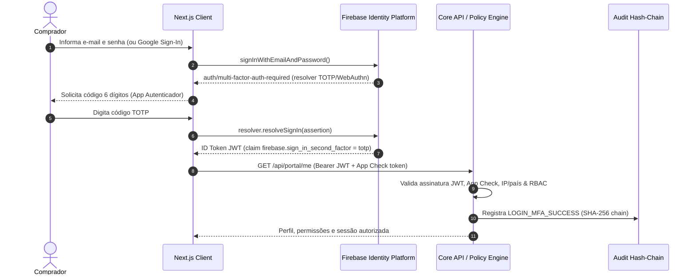
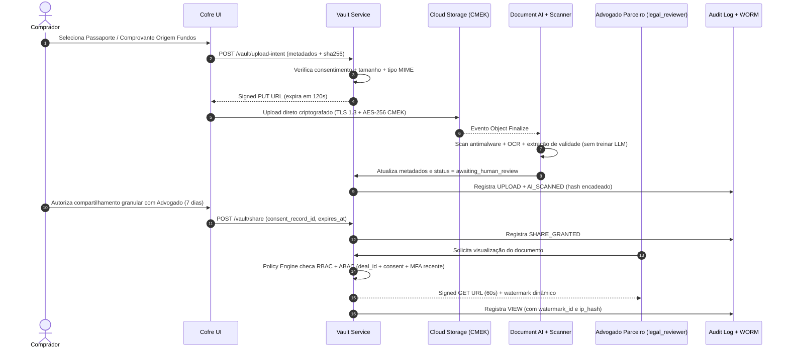
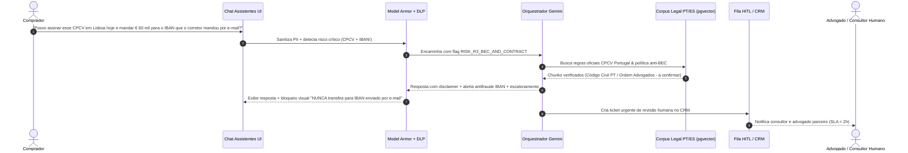
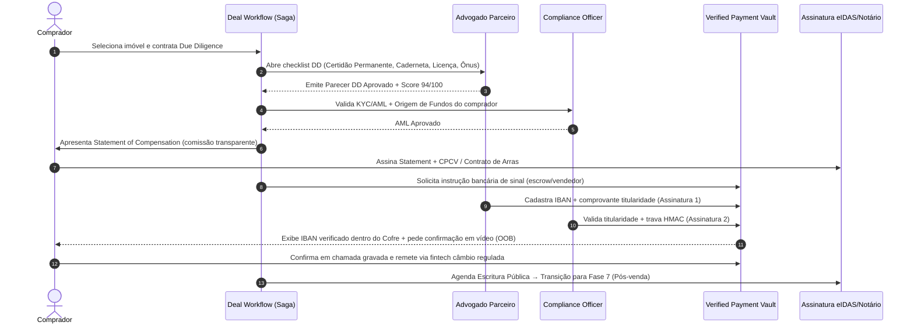
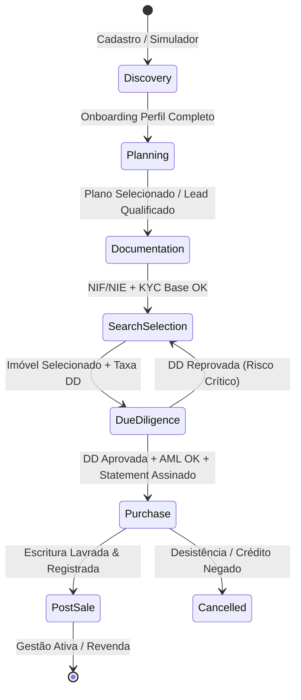
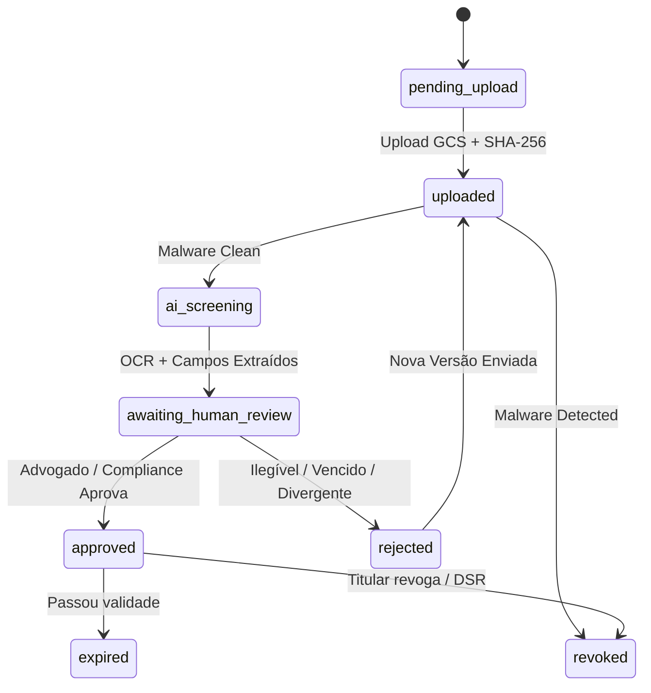
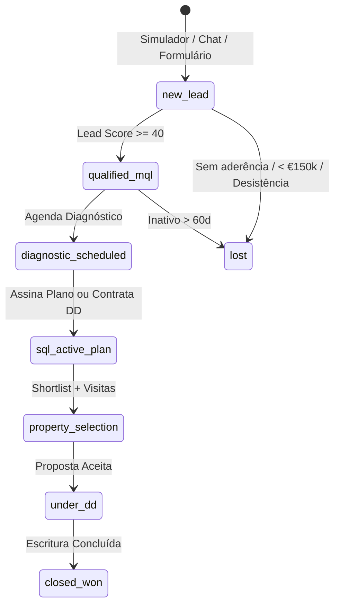
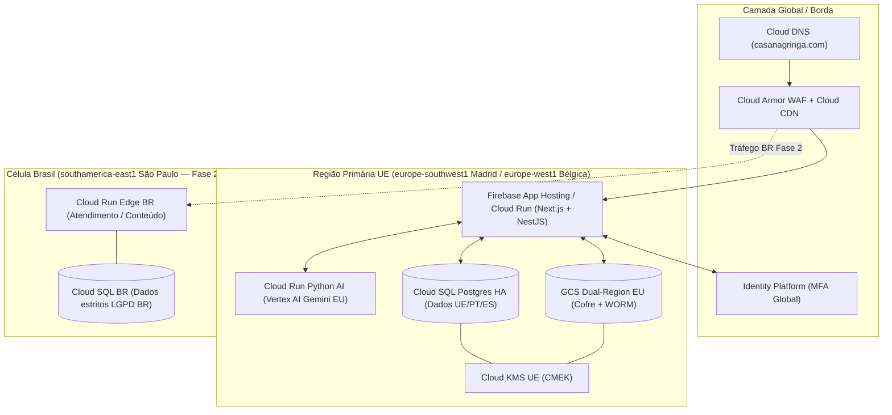

# 09 — Diagramas de Sistema · CASA NA GRINGA

| Campo | Valor |
|---|---|
| **Objetivo** | Consolidar os diagramas visuais (Mermaid) de arquitetura, sequência dos fluxos críticos, máquinas de estado, implantação no Google Cloud/Firebase, fluxo de dados e arquitetura orientada a eventos |
| **Público** | Engenharia, arquitetura, segurança, produto, auditoria técnica |
| **Status** | Rascunho v0.1 |
| **Data** | 16/11/2026 |
| **Contrato comum** | [00-premissas-e-decisoes.md](00-premissas-e-decisoes.md) |
| **Documentos relacionados** | [04-arquitetura.md](04-arquitetura.md) · [05-seguranca.md](05-seguranca.md) · [06-arquitetura-ia.md](06-arquitetura-ia.md) · [08-banco-de-dados.md](08-banco-de-dados.md) · [10-modelagem-dominio.md](10-modelagem-dominio.md) |

---

## 1. Arquitetura de Containers (C4 — Nível 2)

---

## 2. Sequência 1 — Login com MFA Obrigatório e Verificação Zero Trust

---

## 3. Sequência 2 — Upload Seguro no Cofre, Document AI e Compartilhamento com Parceiro

---

## 4. Sequência 3 — Match por IA e Chat Multiagente com Limites e HITL

---

## 5. Sequência 4 — Due Diligence, Compra, Escritura e Pagamento Seguro (Anti-BEC)

---

## 6. Máquinas de Estado (`stateDiagram-v2`)

### 6.1 Estados da Transação (7 Fases)

### 6.2 Estados de um Documento no Cofre

### 6.3 Ciclo de Vida do Lead no CRM

---

## 7. Diagrama de Implantação no Google Cloud & Firebase (Multi-Região Fase 2+)

---

*Fim do documento.*
