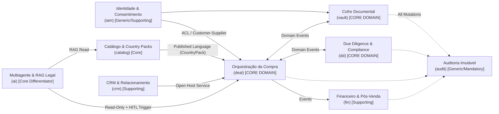
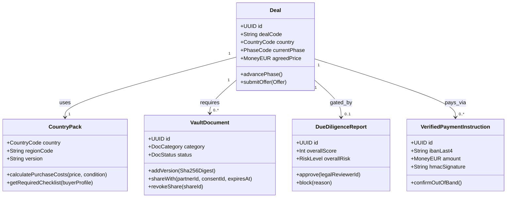

# 10 — Modelagem de Domínio (DDD — Domain-Driven Design) · CASA NA GRINGA

| Campo | Valor |
|---|---|
| **Objetivo** | Definir a Linguagem Ubíqua trilíngue, os *Bounded Contexts*, o *Context Map*, Agregados, Entidades, *Value Objects*, Comandos, Eventos de Domínio, Invariantes críticas e o conceito de *Country Pack* |
| **Público** | CTO, arquitetos, desenvolvedores backend/frontend, product managers, analistas de negócio |
| **Status** | Rascunho v0.1 |
| **Data** | 16/11/2026 |
| **Contrato comum** | [00-premissas-e-decisoes.md](00-premissas-e-decisoes.md) |
| **Documentos relacionados** | [04-arquitetura.md](04-arquitetura.md) · [08-banco-de-dados.md](08-banco-de-dados.md) · [09-diagramas.md](09-diagramas.md) · [11-jornada-usuario.md](11-jornada-usuario.md) |

---

## 1. Linguagem Ubíqua (Ubiquitous Language)

Termos padronizados entre código, banco de dados, documentos jurídicos e interface do usuário:

| Termo de Domínio (Código) | Português (UI) | Inglês (UI) | Espanhol (UI) | Significado Exato |
|---|---|---|---|---|
| `Deal` | Processo de Compra | Purchase Deal | Proceso de Compra | Agregado raiz que orquestra a compra de um imóvel do planejamento ao pós-venda |
| `CountryPack` | Pacote País | Country Pack | Paquete País | Conjunto versionado de leis, impostos, fluxos e checklists de uma jurisdição (PT/ES) |
| `VaultDocument` | Documento do Cofre | Vault Document | Documento de la Bóveda | Arquivo verificado com hash, versões, validade e histórico imutável de acesso |
| `DueDiligenceReport` | Relatório de Due Diligence | Due Diligence Report | Informe de Due Diligence | Auditoria documental, registral, urbanística e fiscal assinada por advogado antes do contrato |
| `StatementOfCompensation` | Declaração de Remuneração | Compensation Statement | Declaración de Honorarios | Termo assinado antes da proposta explicando quem paga a comissão e qual o *fee offset* |
| `VerifiedPaymentInstruction` | Instrução Bancária Verificada | Verified Payment Instruction | Instrucción Bancaria Verificada | Dados IBAN de sinal/escritura validados com dupla assinatura e confirmação anti-BEC |
| `HitlEscalation` | Escalonamento Humano | Human Escalation | Escalamiento Humano | Transferência obrigatória de decisão crítica da IA para especialista humano |

---

## 2. Context Map (Bounded Contexts e Relacionamentos)

---

## 3. Agregados Raiz, Value Objects e Invariantes Críticas

### 3.1 Agregado `Deal` (Domínio Central — Orquestração)
- **Raiz:** `Deal` (`DealId`, `DealCode`, `ClientUserId`, `CountryCode`, `CountryPackVersion`, `CurrentPhase`, `Status`)
- **Entidades filhas:** `DealPhase`, `ChecklistItem`, `Offer`, `DealParticipant`
- **Value Objects:** `MoneyEUR` (nunca `float`!), `TaxEstimateBreakdown`, `TargetTimeline`
- **Invariantes Invioláveis:**
  1. **Não pular Due Diligence antes da Compra:** `Deal` não pode transicionar de `due_diligence` para `purchase` sem `DueDiligenceReport.status IN ('approved', 'approved_with_caveats')` assinado por `legal_reviewer` e `AmlScreening.risk_tier != 'blocked'`.
  2. **Transparência antes de Proposta:** Nenhuma `Offer` pode passar para `submitted` sem `StatementOfCompensation.accepted_by_client === true`.
  3. **País Imutável no Processo:** Um `Deal` pertence a um único `CountryCode` (PT ou ES) e fixa a versão do `CountryPack` no início (alertando se houver atualização normativa).

### 3.2 Agregado `VaultDocument` (Domínio Central — Segurança Documental)
- **Raiz:** `VaultDocument` (`DocumentId`, `OwnerUserId`, `Category`, `Status`, `Classification`, `RetentionUntil`)
- **Entidades filhas:** `DocumentVersion`, `DocumentShare`, `DocumentReview`, `DocumentEvent`
- **Value Objects:** `Sha256Digest`, `StorageLocation`, `ConsentGrantRef`
- **Invariantes Invioláveis:**
  1. **Nenhuma versão é sobrescrita:** Novo upload sempre cria `version_num + 1`.
  2. **Proibido compartilhar sem consentimento:** Criar `DocumentShare` exige `ConsentRecord` válido para aquele parceiro e expiração obrigatória (`expires_at <= now() + 90 days`).
  3. **Todo acesso gera rastro:** Gerar URL de visualização ou download exige gravação síncrona/atômica em `DocumentEvent` e `AuditLog`.

### 3.3 Agregado `CountryPack` (Conceito Estruturante de Escalabilidade)
- Encapsula tudo que varia de um país para outro sem precisar reescrever o código central:
  - **Motor Tributário Declarativo:** faixas de IMT/Imposto do Selo (PT) ou ITP regional/IVA/AJD (ES).
  - **Template de Workflow:** documentos obrigatórios por perfil (ex.: NIF para PT, NIE para ES; Apostila de Haia quando emitido no BR).
  - **Fontes RAG Vinculadas:** conjunto de normas válidas naquela jurisdição.
  - **Regras de SLA e Prazos Típicos:** duração esperada por etapa (ex.: obtenção de NIF remoto ~5–15 dias úteis vs. NIE consular/presencial ~15–45 dias — a confirmar).

### 3.4 Agregado `VerifiedPaymentInstruction` (Anti-Fraude BEC)
- **Invariantes:**
  1. Requer **dupla aprovação de papéis distintos** (`verified_by_1 != verified_by_2`, sendo um `legal_reviewer` e outro `compliance_officer`).
  2. Qualquer tentativa de edição não atualiza o registro — revoga (`superseded`) o anterior, emite `PaymentInstructionChangedAlert` (severidade crítica) e bloqueia exibição ao cliente até nova dupla assinatura + confirmação *out-of-band*.

---

## 4. Comandos e Eventos de Domínio Principais

| Bounded Context | Comandos (Intenção) | Eventos Publicados (Fatos Passados) | Consumidores Principais |
|---|---|---|---|
| **IAM** | `EnrollMfa`, `GrantConsent`, `RequestDataExport` | `MfaEnrolled`, `ConsentGranted`, `ConsentRevoked`, `DsrRequested` | Vault, CRM, Audit, AI |
| **CRM** | `QualifyLead`, `ScheduleAppointment`, `RecordVisitFeedback` | `LeadQualified`, `AppointmentBooked`, `ClientOnboarded` | Deal, Concierge Notif, BigQuery |
| **Deal** | `StartDeal`, `CompleteChecklistItem`, `SubmitOffer`, `AdvancePhase` | `DealStarted`, `ChecklistItemCompleted`, `OfferSubmitted`, `PhaseAdvanced`, `DealClosed` | Fin, Audit, Concierge Notif, Firestore |
| **Vault** | `RequestUploadUrl`, `ConfirmUpload`, `ShareDocument`, `ReviewDocument` | `DocumentUploaded`, `DocumentShared`, `ShareRevoked`, `DocumentApproved`, `DocumentRejected` | DocAI, Deal, Audit, Concierge Notif |
| **DD & AML** | `StartDueDiligence`, `SignOffDueDiligence`, `RegisterPaymentInstruction` | `DueDiligenceApproved`, `DueDiligenceBlocked`, `AmlFlagRaised`, `FraudAlertTriggered` | Deal, Concierge Notif, CRM HITL |
| **AI** | `AskAgent`, `EscalateToHuman` | `AgentResponded`, `CriticalDecisionEscalated`, `CitationMismatchBlocked` | CRM HITL, Audit, BigQuery Evals |

---

## 5. Modelo de Classes Simplificado (Mermaid)

---

*Fim do documento.*
