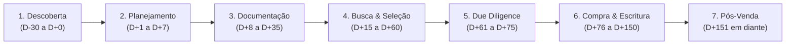

# 11 — Jornada Completa do Usuário (7 Fases) e Fluxos PT & ES · CASA NA GRINGA

| Campo | Valor |
|---|---|
| **Objetivo** | Mapear em riqueza de detalhes as 7 fases da jornada (Descoberta, Planejamento, Documentação, Busca e Seleção, Due Diligence, Compra, Pós-venda), por persona, documentos exigidos, prazos típicos, tributos/custos PT e ES, ações da IA vs. humano, notificações do Concierge, CRM e KPIs por etapa |
| **Público** | Produto, UX, operações, consultores, advogados parceiros, engenharia |
| **Status** | Rascunho v0.1 |
| **Data** | 16/11/2026 |
| **Contrato comum** | [00-premissas-e-decisoes.md](00-premissas-e-decisoes.md) |
| **Documentos relacionados** | [01-visao-estrategica.md](01-visao-estrategica.md) · [12-wireframes.md](12-wireframes.md) · [06-arquitetura-ia.md](06-arquitetura-ia.md) |

> [!IMPORTANT]
> **Aviso:** Prazos, alíquotas de impostos (IMT, Imposto do Selo, IMI, ITP, IVA, AJD, *Plusvalía*) e exigências documentais são **referências de planejamento [a confirmar com advogado/contador local antes de cada operação]**.

---

## 1. Visão Macro da Jornada (7 Fases)

---

## 2. Detalhamento Minucioso por Fase

### Fase 1 — Descoberta
- **Objetivo do cliente:** Entender se comprar no exterior cabe no seu bolso, escolher país/cidade e perder o medo inicial de golpes.
- **Telas / Pontos de contato:** Home (`/`), Busca de Imóveis (`/imoveis`), Comparador de Cidades, Simuladores PT/ES (`/simuladores`), Guias Educativos SEO.
- **Ações do cliente:** Simula custo total de aquisição (+ impostos), compara Lisboa vs. Porto vs. Madrid vs. Valência, conversa com o Agente Imobiliário/Financeiro (limite gratuito).
- **Ações do sistema / IA:** Calcula breakdown de impostos, converte EUR↔BRL, captura lead no CRM com `lead_score` inicial, exibe aviso de estimativa.
- **Medo mitigado:** *"Não sei quanto custa de verdade além do valor do anúncio."*
- **KPI:** Taxa Visitante → Simulador concluído (meta ≥ 18%); Simulador → Cadastro/Lead (meta ≥ 8%).

### Fase 2 — Planejamento
- **Objetivo:** Definir orçamento real, uso (moradia, investimento ou residência), necessidade de crédito e estratégia fiscal básica (PF vs. estrutura societária).
- **Ações do cliente:** Preenche Onboarding do Perfil Comprador (`/portal`), agenda Diagnóstico Estratégico pago ou assina plano Essencial/Plus.
- **Ações humanas + IA:** Consultor realiza chamada de 45 min para validar viabilidade; Agente Financeiro sugere faixa de entrada + prestação; se crédito necessário, pré-triagem encaminha ao intermediário de crédito registado.
- **Medo mitigado:** *"Não sei por onde começar nem quanto de entrada e reserva cambial preciso ter."*
- **Prazo típico:** 3 a 7 dias.
- **KPI:** Lead → Diagnóstico realizado; Taxa de qualificação SQL.

### Fase 3 — Documentação (Preparação Pré-Oferta)
- **Objetivo:** Ter todos os documentos fiscais, bancários e de KYC/AML prontos **antes** de encontrar o imóvel certo (evita perder bons imóveis para compradores locais).
- **Documentos & Procedimentos Detalhados:**
  - **Portugal:** Passaporte válido, comprovativo de morada, últimos 3 recibos/IRPF + extratos (origem de fundos), pedido de **NIF** (Número de Identificação Fiscal — para não residentes UE exige representante fiscal ou procuração a advogado/solicitador, verificar regras vigentes AT), abertura de conta bancária portuguesa, procuração apostilada (**Apostila de Haia** no Brasil quando assinatura remota).
  - **Espanha:** Passaporte, solicitação de **NIE** (*Número de Identidad de Extranjero* via consulado ou polícia na Espanha com procuração), abertura de conta bancária espanhola (rigoroso KYC de origem de fundos — *blanqueo de capitales*), certidão de casamento/poderes apostilada e **tradução juramentada** (*traductor jurado* MAEC).
- **Ações do sistema:** Checklist dinâmico no Cofre (`/cofre`); Document AI lê validade/legibilidade; Concierge envia alertas D-5 antes de vencimentos; trilha imutável registra cada upload e compartilhamento.
- **Prazo típico:** **PT:** 10–25 dias úteis (NIF + conta); **ES:** 20–45 dias úteis (NIE consular/local + validação bancária) **[a confirmar]**.

### Fase 4 — Busca e Seleção
- **Objetivo:** Filtrar imóveis reais, sem anúncios duplicados ou irregulares, com visita presencial ou vídeo-tour técnico ao vivo.
- **Ações:** Motor de Match calcula score % (`0–100`) explicando por que o imóvel adere ao perfil (orçamento, yield, bairro, score DD prévio). Cliente favorita imóveis, solicita visita via portal/CRM.
- **Ações humanas:** Consultor local + imobiliária parceira realizam visita e preenchem **Relatório Técnico de Visita** (barulho, umidade, estado estrutural, vizinhança) dentro do CRM.
- **Medo mitigado:** *"Fotos bonitas que escondem problemas reais no imóvel."*

### Fase 5 — Due Diligence (Portal de Confiança — Obrigatória pré-CPCV/Arras)
- **Objetivo:** Auditar 100% da situação jurídica, registral, fiscal e urbanística **antes** de assinar contrato vinculante ou pagar sinal.
- **Checklist Técnico-Jurídico por País:**
  - **Portugal:** Certidão Permanente do Registo Predial (titularidade, hipotecas, penhoras), Caderneta Predial Urbana (VPT e áreas), Licença de Utilização / isenção legal aplicável (**confirmar reformas recentes do Simplex Urbanístico!**), Certificado Energético, Ficha Técnica de Habitação, declaração de ausência de dívidas de condomínio, confirmação de inexistência de inquilinos/direito de preferência (câmara municipal/DGT em zonas protegidas).
  - **Espanha:** *Nota Simple Informativa* atualizada do *Registro de la Propiedad* (cargas, embargos, titularidade), *Certificado Catastral*, *IBI* (últimos recibos pagos), *Certificado de Comunidad de Propietarios* (sem dívidas + atas sobre obras futuras derramas), *Cédula de Habitabilidad* (quando exigida pela comunidade autónoma, ex.: Catalunha/Valência), *Certificado de Eficiencia Energética*, verificação de licença turística (VUT) caso o objetivo seja aluguel de temporada.
- **Fluxo:** Documentos vão ao Cofre → Agente de Due Diligence faz pré-leitura → **`legal_reviewer` (advogado parceiro) emite e assina Parecer DD com Score (0–100)**. Sem aprovação, o workflow bloqueia avanço à compra.
- **Prazo típico:** 5 a 12 dias úteis **[E]**.

### Fase 6 — Compra, Financiamento, Câmbio e Escritura
- **Passo a passo auditado:**
  1. **Statement of Compensation:** Cliente assina eletronicamente a declaração clara de remuneração e *fee offset*.
  2. **Reserva / CPCV (PT) ou Contrato de Arras Penitenciales (ES):** Elaborado/revisado pelo advogado parceiro; assinatura eletrônica (eIDAS / procuração).
  3. **Pagamento Seguro de Sinal (Anti-BEC):** Dados IBAN cadastrados no Cofre Verificado (`verified_payment_instructions`) com dupla assinatura e confirmação *out-of-band* por vídeo.
  4. **Aprovação Final de Crédito (se aplicável):** Avaliação bancária (*tasación* / avaliação pericial), emissão de Carta de Aprovação / FINE (PT) ou FEIN (ES — período de reflexão obrigatório de min. 10 dias na LCCI **[F — confirmar]**).
  5. **Remessa Cambial Regulada:** Fechamento de câmbio via parceiro regulado (declaração de finalidade no BCB, recolhimento de IOF, envio com antecedência de D-5 úteis para compensar compliance bancário europeu).
  6. **Liquidação de Impostos Pré-Escritura (PT):** Guias de **IMT** e **Imposto do Selo (0,8%)** pagas antes do ato (ou liquidadas no ato conforme protocolo). *(Em ES, o ITP/IVA/AJD é liquidado em até 30 dias úteis após a escritura).*
  7. **Escritura Pública & Registo:** Presencial ou por procuração no Notário / Casa Pronta (PT) / Notaría (ES); entrega das chaves e protocolo no Registo Predial / Registro de la Propiedad.
- **Prazo típico (da proposta aceita à escritura):** 45–90 dias (à vista) ou 75–130 dias (com crédito hipotecário) **[E]**.

### Fase 7 — Pós-Venda (LTV & Confiança Contínua)
- **Objetivo:** Garantir que o cliente não fique desamparado após a escritura.
- **Ações:** Transferência de água, luz, gás e condomínio; contratação de seguro multirriscos; coordenação de reformas/mobília; gestão contínua de propriedade ou colocação de inquilino (contratos de longa/média duração conforme legislação local); arquivo do dossiê completo de aquisição no Cofre para declaração anual de **IRPF / CBE (Banco Central do Brasil)** e impostos anuais locais (**IMI** em PT / **IBI + IRNR Modelo 210** em ES).

---

## 3. Resumo de Impostos e Custos de Compra (Referência Estimativa)

> **[Verificar alíquotas exatas vigentes com contador/advogado antes de cada transação]**

| Item | Portugal (Continente — Imóvel Secundário / Invest.) | Espanha (Varia por Comunidade Autónoma) |
|---|---|---|
| **Imposto de Transmissão (Usado)** | **IMT** tabela progressiva (1% a 8% marginal com parcela a abater, ou taxa única 6%/7,5% em valores altos — verificar tabela do ano) | **ITP**: Madrid **6%** · Andaluzia **7%** · Valência **9%** (11% > €1M) · Catalunha **10%–13%** (incide sobre maior valor entre escritura e *Valor de Referencia Catastral*) |
| **Imóvel Novo (1ª transmissão)** | Mesma tabela de IMT + Imposto do Selo (IVA já embutido pelo promotor) | **IVA 10%** + **AJD** (0,5% a 1,5% conforme região) |
| **Selo / Escritura / Registo** | Imposto do Selo **0,8%** s/ imóvel (+ 0,6% s/ empréstimo >5 anos — confirmar) + Notário/Registo (~€ 750–€ 1.500) | Notaría + Registro de la Propiedad + Gestoría (~€ 1.500–€ 3.000) |
| **Honorários Advocatícios (parceiro)** | ~1% a 1,5% (ou pacote fixo € 2.000–€ 4.500) **[E]** | ~1% a 1,5% (+ IVA 21%) **[E]** |
| **Imposto Anual Recorrente** | **IMI** (~0,3% a 0,45% do VPT) + AIMI se aplicável | **IBI** municipal + **IRNR (Modelo 210)** para não residentes |
| **Custo Total Adicional Estimado** | **~6% a 9%** sobre o preço (conforme faixa de valor) | **~8,5% a 13,5%** sobre o preço (depende da região e se novo/usado) |

---

## 4. Notificações Proativas do Concierge & Ciclo CRM

| Gatilho no Sistema | Canal | Mensagem Resumida do Concierge | Ação no CRM |
|---|---|---|---|
| Cadastro incompleto há 48h | E-mail + In-app | "Falta 1 minuto para calibrar seu Match PT/ES e simular impostos." | Tarefa follow-up N1 |
| Documento do Cofre vence em 15d | WhatsApp + In-app | "Seu comprovante de morada vence em 15 dias; envie nova versão para não travar a análise bancária." | Alerta no card do Deal |
| Parecer DD concluído pelo advogado | Push + E-mail + In-app | "Seu relatório de Due Diligence está pronto (Score 92/100). Agende sua revisão." | Move Kanban → Aprovação |
| Tentativa de envio de IBAN fora do cofre / alteração | In-app + SMS + Ligação | "ALERTA DE SEGURANÇA: Dados bancários nunca mudam por e-mail. Confira o Cofre Verificado." | Ticket Crítico Compliance |
| Pós-escritura D+30 | E-mail | "Seu dossiê consolidado para declaração fiscal (IRPF/CBE) já está disponível no Cofre." | Oportunidade Pós-Venda |

---

*Fim do documento.*
