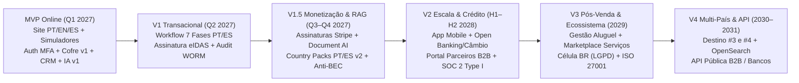

# 13 — Roadmap de Produto (5 Anos: 2027–2031) · CASA NA GRINGA

| Campo | Valor |
|---|---|
| **Objetivo** | Definir a evolução do produto por trimestre no Ano 1 e por semestre nos Anos 2 a 5, com épicos, releases, critérios de entrada/saída, priorização RICE, dependências técnicas e capacidade de equipe |
| **Público** | CPO, CTO, fundador(es), produto, engenharia, operações |
| **Status** | Rascunho v0.1 |
| **Data** | 16/11/2026 (M1 = jan/2027) |
| **Contrato comum** | [00-premissas-e-decisoes.md](00-premissas-e-decisoes.md) |
| **Documentos relacionados** | [01-visao-estrategica.md](01-visao-estrategica.md) · [04-arquitetura.md](04-arquitetura.md) · [22-plano-execucao-6-meses.md](22-plano-execucao-6-meses.md) |

---

## 1. Visão de Evolução do Produto (Timeline Mermaid)

---

## 2. Roadmap Detalhado — Ano 1 (Trimestral, 2027)

### Q1 2027 (M1–M3) — Release `MVP Confiança Online`
- **Objetivo:** Colocar a plataforma no ar no Firebase App Hosting (`casanagringa.com`), validar aquisição orgânica/simuladores e operar os primeiros processos com equipe enxuta (2 devs + fundador/ops).
- **Épicos:**
  - `EP-01` Site público trilíngue (PT/EN/ES) + SEO programático base (Lisboa, Porto, Madrid, Valência).
  - `EP-02` Simuladores financeiros interativos PT (IMT/IS) e ES (ITP/IVA/AJD) + Comparador de cidades + conversão EUR/BRL.
  - `EP-03` Autenticação Zero Trust (Firebase Auth + MFA TOTP) + Onboarding Perfil do Comprador + Consentimentos LGPD/GDPR.
  - `EP-04` Cofre Documental v1 (upload Firebase Storage, checklist PT/ES, versões, histórico auditável com hash-chain).
  - `EP-05` Painel do Cliente (Timeline 7 fases) + CRM Interno (Kanban, Lead Score, Agendamento).
  - `EP-06` Multiagente Gemini v1 (Orquestrador + 8 agentes com disclaimers, RAG base PT/ES e botão de escalonamento humano).
- **Critério de Saída:** Build estável, regras Firestore/Storage auditadas, 500+ simulações, 20+ diagnósticos agendados, 0 incidentes de segurança.

### Q2 2027 (M4–M6) — Release `V1 Transacional & Due Diligence`
- **Objetivo:** Suportar os primeiros fechamentos reais ponta a ponta em PT e ES com segurança jurídica e anti-BEC.
- **Épicos:**
  - `EP-07` Migração/consolidação do SSOT transacional em **Cloud SQL Postgres 17** com RLS + exportação horária **WORM**.
  - `EP-08` Módulo de **Due Diligence Assistida**: fluxo `legal_reviewer`, score DD (0–100), parecer assinado.
  - `EP-09` Integração **Assinatura Eletrônica** (DocuSign/eIDAS) para *Statement of Compensation* e reservas.
  - `EP-10` Cofre de Instruções Bancárias Verificadas (**Anti-BEC**) com dupla assinatura e confirmação OOB.
  - `EP-11` Integração inicial de feeds de imobiliárias parceiras + deduplicação MDM básica.
- **Critério de Saída:** ≥ 5 fechamentos assistidos, Pentest externo #1 aprovado, SLA resposta HITL < 4h.

### Q3–Q4 2027 (M7–M12) — Release `V1.5 Assinaturas, Document AI & Concierge Proativo`
- **Objetivo:** Automatizar leitura de documentos, lançar assinaturas pagas e reduzir carga manual por cliente.
- **Épicos:**
  - `EP-12` Billing completo com **Stripe** (Explorer / Essencial / Plus / Private) + controle automático de crédito para ***Fee Offset***.
  - `EP-13` Pipeline **Document AI + Antimalware + DLP**: extração automática de NIF/NIE/passaporte/validade e alertas proativos do Concierge via WhatsApp Business e e-mail.
  - `EP-14` RAG Jurídico v2 (`pgvector` + busca híbrida BM25 + verificador automático de citações e datas de vigência).
  - `EP-15` Motor de Match explicável v2 + Relatório consolidado exportável para IRPF/CBE no pós-venda.
- **Critério de Saída:** 20 fechamentos acumulados A1, NPS ≥ 60, custo marginal de operação reduzido em 35%.

---

## 3. Roadmap — Anos 2 a 5 (Semestral, 2028–2031)

| Período | Release | Épicos Principais | Gate de Negócio / Segurança |
|---|---|---|---|
| **H1 2028 (M13–18)** | `V2.0 Escala PT/ES` | Portal dedicado de Parceiros B2B (imobiliárias/bancos/advogados); integração com intermediários de crédito (BdP); integração parceiro de câmbio; orquestrador **Temporal** para sagas de compra; **App Mobile v1** (React Native — timeline, alertas anti-BEC, upload rápido de docs). | Licença AMI obtida em PT; Prontidão **SOC 2 Type I**; ≥ 40 fechamentos no semestre. |
| **H2 2028 (M19–24)** | `V2.5 Pós-Venda & Célula BR` | Módulo de **Administração de Imóveis & Gestão de Aluguel** v1 (vistorias, cobrança, relatórios mensais); **Célula Brasil (`southamerica-east1`)** para residência local LGPD; portal de leads qualificados B2B para incorporadoras. | 90 fechamentos no A2; LTV/CAC ≥ 2,4×; 0 incidentes graves. |
| **2029 (Ano 3)** | `V3.0 Plataforma & Marketplace` | **Marketplace de Serviços Curados** (reformas, mobília, seguros, energia); suporte ao segmento **PALOP** (com KYC/EDD reforçado); automação de renovação e revenda patrimonial. | Certificação **ISO 27001** + **SOC 2 Type II**; 240 fechamentos/ano. |
| **2030–2031 (A4–A5)** | `V4.0 Multi-País & API Aberta` | Lançamento de **Country Pack #3 e #4** (Itália / Flórida / Dubai conforme scorecard doc 20); busca **OpenSearch** para > 100k ativos; **AlloyDB** se volume exigir; **API/SDK B2B** para bancos privados oferecerem jornada Casa na Gringa em *co-branding*. | EBITDA positivo (A4); 480 → 800 fechamentos/ano; 3–4 destinos ativos. |

---

## 4. Matriz de Priorização (RICE — Seleção de Features MVP vs. Pós-MVP)

*(Alcance 1–10 × Impacto 0.25–3 × Confiança % ÷ Esforço em semanas-dev)*

| Feature | Reach | Impact | Conf. | Effort | RICE | Decisão |
|---|---|---|---|---|---|---|
| Simuladores PT/ES + Lead Capture | 10 | 3 | 100% | 2 | **15,0** | **Fazer já (MVP Q1)** |
| Cofre Documental + Histórico Auditável | 8 | 3 | 90% | 3 | **7,2** | **Fazer já (MVP Q1)** |
| Timeline 7 Fases + CRM Nativo | 8 | 3 | 90% | 3 | **7,2** | **Fazer já (MVP Q1)** |
| Agentes Gemini RAG + Disclaimers + HITL | 9 | 2 | 85% | 2,5 | **6,1** | **Fazer já (MVP Q1)** |
| Controle Anti-BEC + Dupla Assinatura IBAN | 6 | 3 | 95% | 2,5 | **6,8** | **Q2 (antes de sinais altos)** |
| Integração Automática Document AI | 7 | 2 | 80% | 4 | **2,8** | **Q3 (até lá revisão manual)** |
| App Mobile Nativo | 5 | 1 | 70% | 12 | **0,3** | **Adiar para H1 2028 (web responsivo resolve A1)** |
| Integração Open Banking direta | 4 | 2 | 60% | 10 | **0,5** | **Adiar para 2028 (upload PDF resolve A1)** |

---

## 5. Capacidade de Engenharia por Fase

- **Q1–Q2 2027:** 2 engenheiros *full-stack*/AI (ou 1 sênior + 1 pleno apoiados por ferramentas de produtividade) + 1 fundador produto/ops. Foco absoluto em simplicidade operacional.
- **Q3–Q4 2027:** +1 engenheiro backend/segurança (chegando a 3 eng. + 1 PM/designer parcial).
- **2028 (Pós-Seed):** Time de produto/engenharia sobe para 6–8 pessoas (2 squads: *Core Trust & Vault* e *Growth, Search & AI*).

---

*Fim do documento.*
