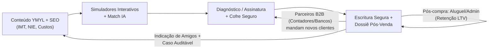

# 16 — Estratégia de Crescimento (Growth Model & Loops) · CASA NA GRINGA

| Campo | Valor |
|---|---|
| **Objetivo** | Definir o modelo de crescimento, *North Star Metric*, loops sustentáveis, funil AARRR, ativação via ferramentas (PLG), retenção pós-compra, comunidade e parcerias |
| **Público** | CEO/Growth, produto, marketing, parcerias, investidores |
| **Status** | Rascunho v0.1 |
| **Data** | 16/11/2026 |
| **Contrato comum** | [00-premissas-e-decisoes.md](00-premissas-e-decisoes.md) |
| **Documentos relacionados** | [17-estrategia-seo.md](17-estrategia-seo.md) · [18-estrategia-aquisicao.md](18-estrategia-aquisicao.md) · [14-plano-monetizacao.md](14-plano-monetizacao.md) |

---

## 1. Modelo de Crescimento: "Trust-Led + Product-Led + Sales-Assisted"

No mercado imobiliário de alto ticket (€ 300 mil–€ 2 mi), ninguém compra um apartamento por impulso clicando em anúncio. O crescimento depende de **confiança acumulada** e **ferramentas úteis no topo do funil** antes da venda consultiva humana.

- **North Star Metric (NSM):** **Processos de Compra Ativos Verificados (com Perfil + KYC/Doc inicial concluídos) por Trimestre** — conecta valor real entregue ao cliente com receita previsível em M3–M7.
- **Métricas de Guarda (Guardrails):** NPS ≥ 60, taxa de incidentes/fraude = 0, LTV/CAC ≥ 3× (a partir de A3).

---

## 2. Os 4 Loops de Crescimento da Casa na Gringa

1. **Loop de Conteúdo & Ferramentas (PLG):** Dúvidas complexas ("quanto custa comprar casa em Madrid sendo brasileiro?") levam ao Simulador gratuito → usuário calcula IMT/ITP + prestação em BRL → salva simulação criando conta → recebe alertas do Concierge sobre mudanças fiscais/imóveis.
2. **Loop de Confiança & Indicação (*Member-Get-Member*):** Comprador bem atendido em país estrangeiro torna-se evangelizador no seu círculo social (empresários, médicos, expatriados). Benefício em **crédito pós-compra ou isenção de administração** (evitar recompensas agressivas que pareçam marketing multinível).
3. **Loop de Parceiros B2B (Contadores, Advogados & Assessores):** Contadores tributaristas e gestores patrimoniais no Brasil são frequentemente perguntados pelos clientes sobre imóveis em PT/ES. Oferecemos a eles o **Diagnóstico Gratuito de Viabilidade** e *co-branding* educativo; eles nos trazem leads S1 altamente qualificados com CAC próximo de zero.
4. **Loop de Dados & Autoridade:** Quanto mais compras e DDs executamos, mais precisos ficam nossos benchmarks de prazo real e taxa de reprovação por cidade — alimentando relatórios anuais de mercado citados pela imprensa no Brasil e em Portugal.

---

## 3. Funil AARRR e Metas (Estimativas a Validar [E])

| Etapa | Ação do Usuário | Alavanca Principal | Meta A1 → A2 [E] |
|---|---|---|---|
| **Acquisition** | Chega via SEO, YouTube, Simuladores ou Indicação | Guias YMYL revisados por advogados + Ads alta intenção | 3.000 → 18.000 visitas/mês |
| **Activation** | Conclui 1 simulação completa ou faz ≥ 3 perguntas à IA | Resultado transparente + comparação EUR/BRL sem paywall | ≥ 12% geram Lead (MQL) |
| **Revenue** | Compra Diagnóstico (€ 390), Assinatura ou DD; fecha imóvel | *Fee Offset* (crédito na compra) + urgência real de mercado | 4%–8% MQL → SQL pago |
| **Retention** | Usa Cofre, Timeline 7 fases e segue no pós-venda | Concierge proativo + dossiê anual IRPF/CBE + gestão aluguel | ≥ 35% retenção pós-compra (A2+) |
| **Referral** | Indica outro comprador ou parceiro | Pesquisa NPS pós-escritura + programa embaixadores | ≥ 25% novos fechamentos por indicação em A3 |

---

## 4. Plano de Experimentos Priorizados (Primeiros 90 Dias — ICE Score)

| Experimento | Hipótese | Métrica | ICE |
|---|---|---|---|
| **EXP-01:** Calculadora "Preço Anunciado vs. Custo Real na Escritura" compartilhável em PDF | Compradores enviam o PDF para cônjuge/sócio/contador, trazendo novo tráfego qualificado | % usuários que exportam PDF + leads gerados | **27/30** |
| **EXP-02:** Checklist "10 sinais de imóvel problemático em PT/ES" como ímã de e-mail | Reduz atrito de entrada para quem ainda não quer falar com vendedor | Taxa opt-in na página de guia (> 8%) | **24/30** |
| **EXP-03:** Comparativo interativo Lisboa vs. Porto vs. Madrid vs. Valência | Retém usuários indecisos entre os dois países por mais tempo na sessão | Conversão para Onboarding Perfil | **22/30** |
| **EXP-04:** Webinars mensais com advogado PT + contador BR-PT ("IRPF, CBE e Escritura") | Gera pico imediato de diagnósticos € 390 para público S1 | Comparecimento (> 40%) e vendas D+7 | **25/30** |

---

*Fim do documento.*
